Bài viết này sẽ hướng dẫn các bạn cài NukeViet trên các hệ điều hành linux, ví dụ như Ubuntu... (sử dụng phần mềm Xampp để tạo localhost). Các hệ điều hành Linux khác bạn có thể xem hướng dẫn ở đây: [Cài XAMPP trên Ubuntu / Fedora / RHCE / CentOS](/nukeviet/setup/localhost_linux)

## Cài đặt Xampp trên Ubuntu

### Tải về

Tải về file cài đặt tại đây: [http://sourceforge.net/projects/xampp/files/XAMPP%20Linux/1.8.2/xampp-linux-1.8.2-0-installer.run/download](http://sourceforge.net/projects/xampp/files/XAMPP%20Linux/1.8.2/xampp-linux-1.8.2-0-installer.run/download)

Tham khảo bản mới nhất tại trang giới thiệu phần mềm: [http://www.apachefriends.org/en/xampp-linux.html](http://www.apachefriends.org/en/xampp-linux.html)

### Cài đặt

Bước 1. Mở Terminal bằng cách nhấn tổ hợp 3 phím : Ctrl + Alt + T

Bước 2. Chuyển đến thư mục chứa file cài đặt. Trong ví dụ này, tên file cài đặt là 'xampp-linux-1.8.2-0-installer.run ' và thư mục chứa file là Desktop

``` text
cd ~/Desktop
```

*Hình 1 . Di chuyển đến thư mục chứa file cài đặt* 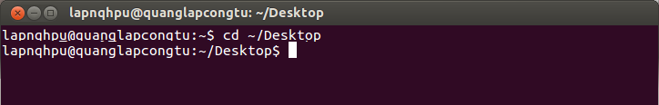

Bước 3. Thay đổi quyền thực thi cho file cài đặt:

``` text
sudo chmod 755 xampp-linux-1.8.2-0-installer.run
```

*Hình 2. Thay đổi quyền thực thi cho file cài đặt* 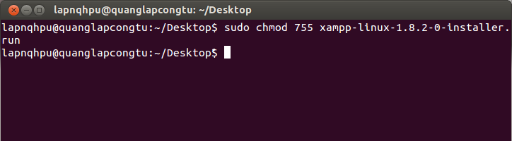

Bước 4. Chạy file installer , xuất hiện 1 giao diện cài đặt (hình 3)

``` text
./xampp-linux-1.8.2-0-installer.run
```

*Hình 3. Giao diện cài đặt XAMPP xuất hiện*

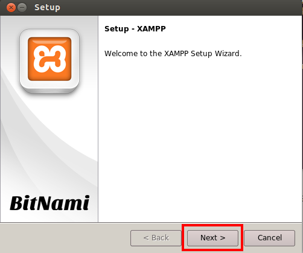

Bước 5. Cài đặt theo hướng dẫn trên giao diện cài đặt (Next, Next, . . .)

Bước 6. Tiếp tục nhấn Finish để kết thúc cài đặt. XAMPP đã được cài đặt vào thư mục /opt/lampp

Bước 7. Xampp sẽ tự khởi động sau đó hoặc bạn có thể khởi động Xampp rồi truy cập đại chỉ [http://localhost](http://localhost) hoặc http://%5Btên người dùng\] nếu màn hình Xampp hiện ra chứng tỏ bạn đã thành công (xem Hình 4).

*Hình 4. Xampp đã được cài đặt thành công* 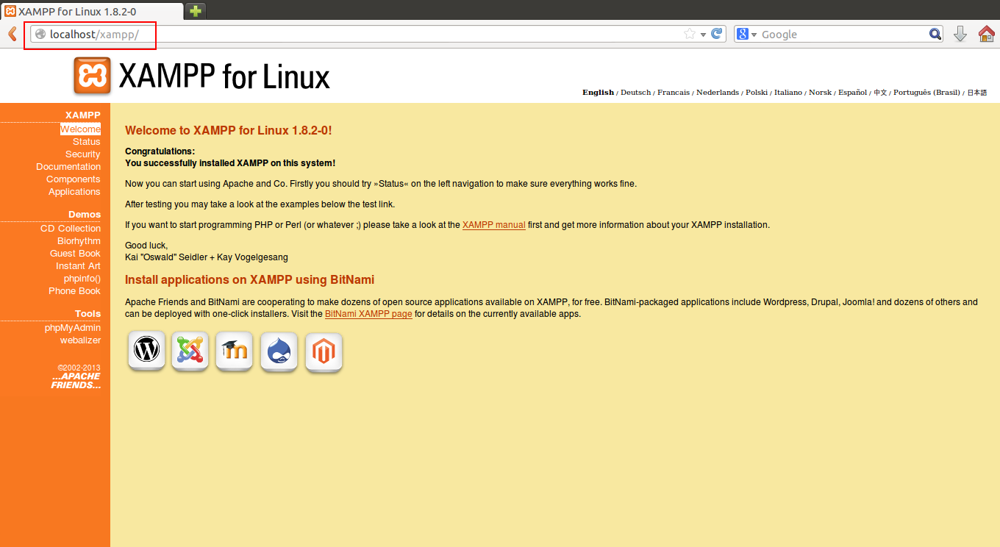

Nếu dùng để test và lập trình bạn có thể chmod thư mục `/opt/lampp/htdocs` thành **775** hoặc **777**

``` text
sudo chmod -R 777 /opt/lampp/htdocs
```

### Sử dụng

\- Chạy xampp server:

``` text
sudo /opt/lampp/lampp start
```

\- Khởi động lại xampp:

``` text
sudo /opt/lampp/lampp restart
```

\- Dừng xampp:

``` text
sudo /opt/lampp/lampp stop
```

\- Chạy xampp service :

``` text
sudo ln -s /opt/lampp/lampp /etc/init.d/lampp
sudo update-rc.d lampp start 80 2 3 4 5 . stop 30 0 1 6 .
```

### Nâng cấp Xampp

Tải bản nâng cấp về, bạn có thể tìm thấy bản nâng cấp tại đây: [http://sourceforge.net/projects/xampp/files/XAMPP%20Linux/](http://sourceforge.net/projects/xampp/files/XAMPP%20Linux/)

Ví dụ này hướng dẫn bạn nâng cấp lên phiên bản 1.8.0: [http://sourceforge.net/projects/xampp/files/XAMPP%20Linux/1.8.0/xampp-linux-upgrade-1.7.7-1.8.0.tar.gz/download](http://sourceforge.net/projects/xampp/files/XAMPP%20Linux/1.8.0/xampp-linux-upgrade-1.7.7-1.8.0.tar.gz/download)

Đặt file **xampp-linux-upgrade-1.7.7-1.8.0.tar.gz** được tải về trong thư mục `home/người-dùng` rồi mở Terminal gõ lệnh sau để giải nén nó ngay tại thư mục này:

``` text
tar xvfz xampp-linux-upgrade-1.7.7-1.8.0.tar.gz
```

Tiếp đó bạn chuyển sang tài khoản root để có quyền nâng cấp Xampp, sử dụng lệnh:

``` text
sudo -i 
```

Bạn chuyển về thư mục chứa bộ nâng cấp đã giải nén bằng lệnh:

``` text
cd /home/người-dùng
```

Tiến hành chạy chương trình cài đặt bằng lệnh:

``` text
xampp-upgrade/start
```

Chương trình sẽ tự động nâng cấp, bạn có thể kiểm tra lại bằng cách truy cập [http://localhost/](http://localhost/) để xem Xampp có hoạt động bình thường chưa.

Xem thêm hướng dẫn nâng cấp Xampp: [http://www.apachefriends.org/en/faq-xampp-linux.html#upgrade](http://www.apachefriends.org/en/faq-xampp-linux.html#upgrade)

## Cài đặt NukeViet trên Ubuntu

Hướng dẫn này dành cho bản NukeViet 2.4.02.r1929, các phiên bản khác có thể có đôi chút khác biệt, lưu ý nên sử dụng phiên bản mới nhất.

### Tải về

Tải NukeViet về và cài đặt bình thường như trên Windows, chú ý cấp quyền truy cập tới thư mục NukeViet (Chmod 775) để có thể tiến hành cài đặt. Việc cài đặt NukeViet tiếp theo thực hiện trên giao diện web qua trình duyệt do đó không khác gì nhiều khi [cài NukeViet trên windows hoặc trên hosting](/nukeviet/setup).

Bạn có thể sử dụng lệnh sau để tải trực tiếp NukeViet 3.4.02 (phiên bản ổn định của NukeViet tính đến tháng 5 năm 2015) về máy Ubuntu.

``` text
wget http://nuke-viet.googlecode.com/files/NukeViet3.4.02.r1929.zip
```

Lưu ý, đây là đường link tải bản NukeViet 3.4.02.r1929, các phiên bản mới hơn sẽ có đường link khác, bạn nên vào trang chủ [http://nukeviet.vn](http://nukeviet.vn) để kiểm tra đường link tải về bản ổn định mới nhất.

Hoặc sử dụng lệnh sau để tải trực tiếp NukeViet 4.0 (phiên bản mới nhất đang phát triển của NukeViet) về máy Ubuntu.

``` text
wget https://github.com/nukeviet/nukeviet/archive/develop.zip
```

Lưu ý: Bản mới nhất là bản đang phát triển, có thể chứa các lỗi chưa được báo trước. Nếu gặp lỗi vui lòng báo lên kho code.nukeviet.vn để đội code của NukeViet sửa chữa.

### Giải nén

``` text
unzip NukeViet3.4.02.r1929.zip -d /opt/lampp/htdocs
```

### Cài đặt

Chmod 777 cho thư mục **sess** của NukeViet để hệ thống cài đặt có thể làm việc.

``` text
sudo chmod -R 777 /opt/lampp/htdocs/nukeviet/sess
```

Truy cập [http://localhost/nukeviet/](http://localhost/nukeviet/) để tiến hành cài đặt. Quá trình cài đặt mới 1 website sử dụng NukeViet sẽ qua 07 bước như sau:

### Bước 1: Lựa chọn ngôn ngữ

Ngôn ngữ mặc định khi cài đặt là tiếng Việt, bạn cũng có thể chọn sử dụng tiếng Anh. Lựa chọn xong ngôn ngữ bạn có thể nhấn vào nút “Bước kế tiếp” để chuyển sang bước tiếp theo (Hình 1).

Hình 1: Chọn ngôn ngữ cài đặt. 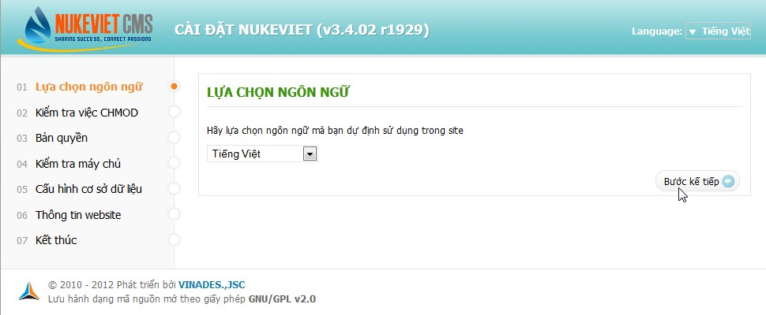

Gợi ý: Bạn có thể chọn cài đặt với ngôn ngữ bất kỳ. Sau khi cài đặt bạn vẫn có thể bổ sung các ngôn ngữ khác tải về từ website nukeviet.vn.

### Bước 2: Kiểm tra việc CHMOD

Tại bước 2, hệ thống sẽ kiểm tra việc cấp phép ghi cho các file và thư mục cần thiết. Bạn cần Chmod 777 cho các file và thư mục sau:

``` text
sess
logs
logs/data_logs
logs/dump_backup
logs/error_logs
logs/error_logs/errors256
logs/error_logs/old
logs/error_logs/tmp
logs/ip_logs
logs/ref_logs
logs/voting_logs
cache
uploads
tmp
files
files/css
data
data/ip_files
data/bpl_1.xml
data/bpl_2.xml
data/config_geo.php
data/config_global.php
data/metatags.xml
data/robots.php
data/search_engine.xml
data/search_engine_ping.xml
tmp/config_*.php
.htaccess
```

Chạy lệnh này để Chmod 777 các file và thư mục trên:

``` text
sudo chmod -R 777 /opt/lampp/htdocs/nukeviet/sess
sudo chmod -R 777 /opt/lampp/htdocs/nukeviet/logs*
sudo chmod -R 777 /opt/lampp/htdocs/nukeviet/cache
sudo chmod -R 777 /opt/lampp/htdocs/nukeviet/uploads*
sudo chmod -R 777 /opt/lampp/htdocs/nukeviet/tmp*
sudo chmod -R 777 /opt/lampp/htdocs/nukeviet/files*
sudo chmod -R 777 /opt/lampp/htdocs/nukeviet/data*
sudo chmod -R 777 /opt/lampp/htdocs/nukeviet/.htaccess
```

- Sau khi Chmod xong, bạn trở lại cửa sổ cài đặt nukeViet, ấn phím F5 để refresh trang web cho NukeViet kiểm tra lại. Chỉ khi kết quả Chmod là **OK** thì bạn mới có thể tiếp tục cài đặt, nếu kết quả kiểm tra là **Không ghi được** chứng tỏ file hoặc thư mục đó chưa được chmod 777.

Hình 2: Kiểm tra điều kiện cài đặt. 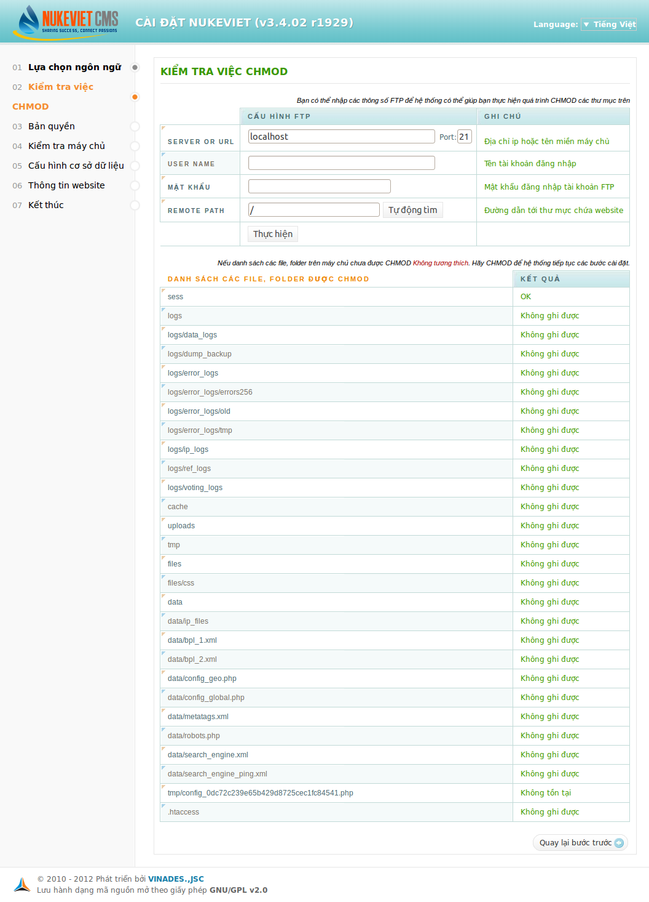

- Nếu tất cả các thông số đều đạt yêu cầu như hình 2b, bạn có thể chuyển qua bước kế tiếp bằng cách nhấp nút “Bước kế tiếp để chuyển qua bước tiếp theo.”.

Hình 2b: Các kết quả kiểm tra đều đạt yêu cầu 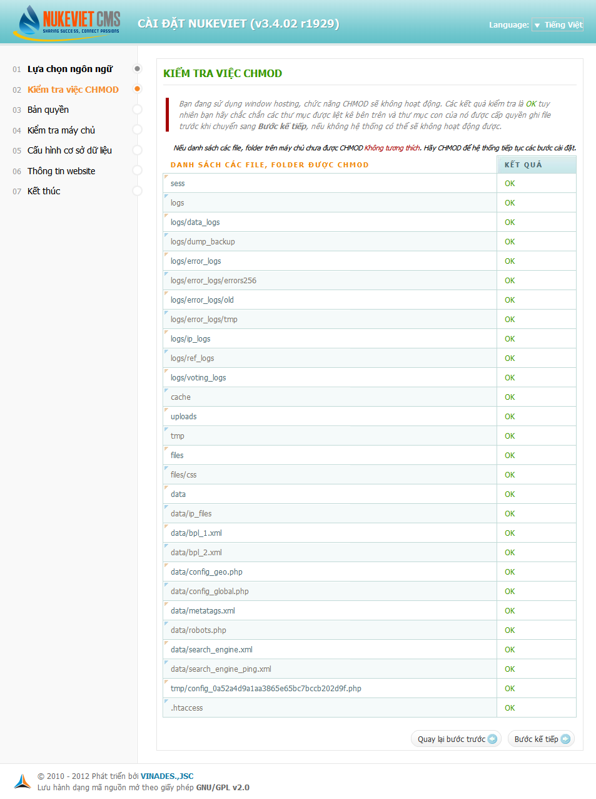

### Bước 3: Bản quyền

Hình 3: Thông báo bản quyền. 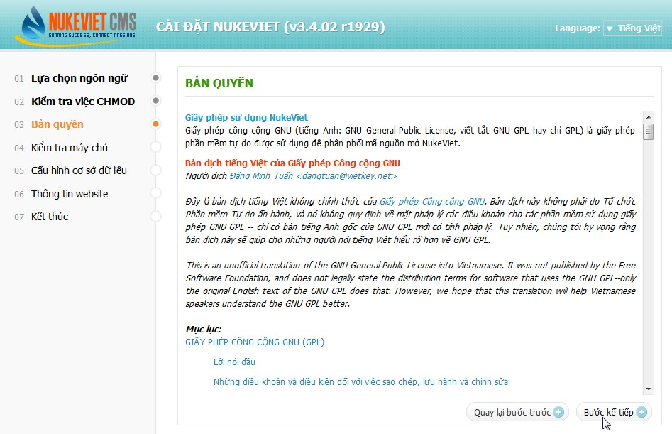

Phần mềm sẽ hiển thị thông tin bản quyền về phần mềm nguồn mở theo giấy phép GNU/GPL và giải thích các điều khoản bạn được phép và không được phép. Bạn nhấp nút “Bước kế tiếp” để chuyển sang bước tiếp theo.

### Bước 4: Kiểm tra máy chủ

Hình 4: Kiểm tra môi trường máy chủ. 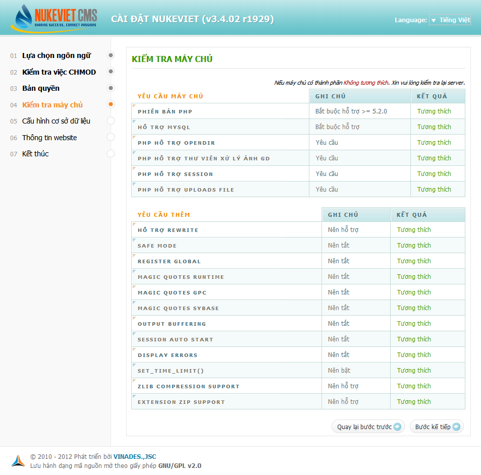

Để hệ thống NukeViet có thể chạy được thì yêu cầu máy chủ bắt buộc phải hỗ trợ Phiên bản PHP từ 5.2.0 và MySQL 5.02 trở lên. Nếu hai điều kiện này không thỏa mãn thì quá trình cài đặt không thể tiếp tục. Ngoài ra hệ thống còn đưa ra những khuyến cáo về những tính năng khác của máy chủ. Nếu những yêu cầu thêm này không thỏa mãn bạn vẫn có thể cài đặt NukeViet nhưng hệ thống sẽ mất đi một số chức năng tiện ích.

### Bước 5: Cấu hình cơ sở dữ liệu

Hình 5: Cấu hình cơ sở dữ liệu. 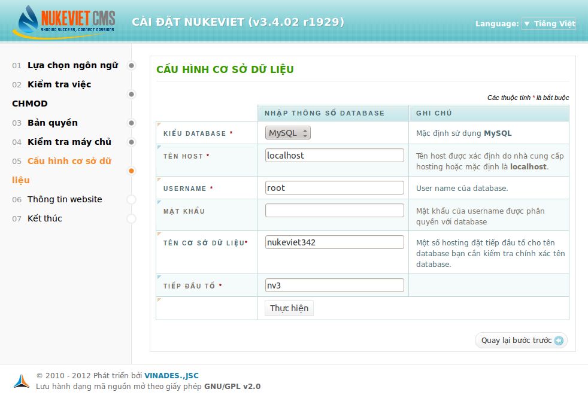

Bạn phải điền đầy đủ các thông tin về thông số database của bạn sau đó nhấn vào nút “Thực hiện”. Thông số Username và Mật khẩu do phần mềm Xampp quản lý (mặc định Username là **root** và mật khẩu không có). Riêng Tên cơ sở dữ liệu bạn có thể điền tên tùy ý, ví dụ **nukeviet**. Bạn không cần tạo trước cở sở dữ liệu này vì hệ thống sẽ tự tạo cho bạn.

Nếu nhập sai bất kỳ thông số nào ở bước 5 này, hệ thống sẽ thông báo lỗi và không hiển thị nút “Bước kế tiếp” để bạn có thể tiếp tục quá trình cài đặt. Khi bạn điền chính xác thông tin và việc kết nối tới cơ sở dữ liệu thành công, hệ thống sẽ chuyển bạn sang bước tiếp theo.

### Bước 6: Thông tin website

Hình 6: Khai báo thông tin website. 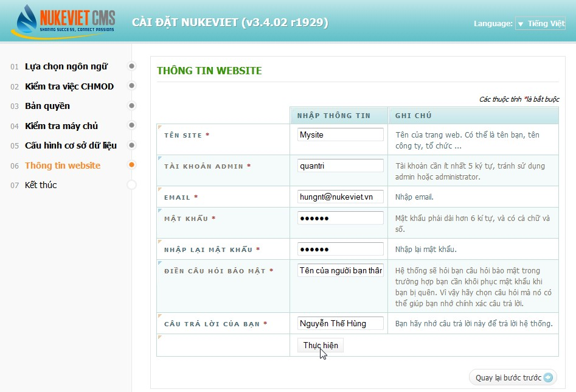

Ở bước này các bạn phải điền đầy đủ thông tin vào những ô được đánh dấu (\*), bên cạnh là cột ghi chú giúp bạn có thể hiểu rõ hơn quá trình nhập thông tin. Sau khi nhập thông tin xong bạn nhấn vào nút “Thực hiện” để hoàn tất.

### Bước 7: Kết thúc

Khi hoàn thành 6 bước trên hệ thống sẽ chuyển bạn qua bước cuối cùng. Nếu hệ thống không thể tự di chuyển tập tin config.php từ thư mục temp ra thư mục gốc, nó sẽ yêu cầu bạn di chuyển thủ công.

Hình 7a: Thông báo yêu cầu di chuyển file config.php ra thư mục gốc. 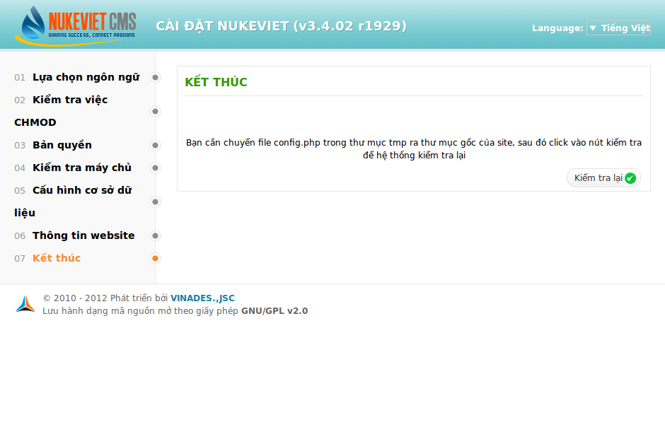

Bạn nhấp nút "Kiểm tra lại" để hệ thống kiểm tra xem bạn đã làm đúng chưa. Nếu đúng, bạn sẽ nhìn thấy thông báo chúc mừng bạn đã cài đặt thành công. Đồng thời, hệ thống cũng nhắc bạn hãy CHMOD ngay thư mục uploads trên webroot (thư mục gốc của website) và các thư mục con nằm trong thư mục uploads ở chế độ 777 (việc này chúng ta đã làm ở bước 2).

Hình 7b: Thông báo cài đặt thành công. 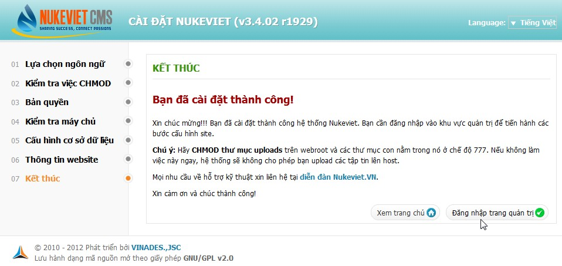

Sau khi xong các bước hệ thống yêu cầu, bạn có 2 lựa chọn: *Xem trang chủ* hoặc *Đăng nhập trang quản trị*. Bạn có thể đăng nhập trang quản trị bằng cách gõ thêm /admin/ sau địa chỉ cài đặt NukeViet.

**Chú ý:**

- Nếu bạn muốn cài đặt lại website hãy xóa file **config.php** ở thư mục gốc của NukeViet. Sau đó tiếp tục các bước như trên để cài lại hệ thống NukeViet 3.x

**Đây là giao diện Nukeviet khi duyệt bằng FireFox Trên Ubuntu 12.04** 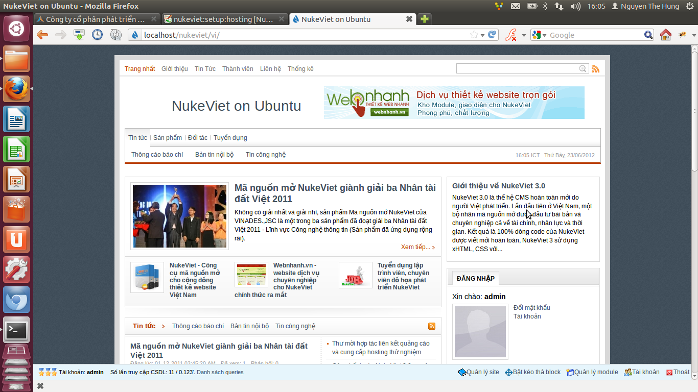

## Một số lỗi thường gặp cho người mới cài đặt NukeViet trên Ubuntu

### Lỗi khi bắt đầu cài NukeViet

- Không copi được mã nguồn NukeViet vào thư mục /opt/lampp/htdocs. Nguyên nhân: Bạn chưa cấp quyền truy cập cho thư mục `/opt/lampp/htdocs`, hãy chmod nó thành 755 hoặc 777.

- Không truy cập được vào thư mục đặt nukeviet: [http://localhost/nukeviet/](http://localhost/nukeviet/). Nguyên nhân: Bạn chưa cấp quyền truy cập cho thư mục `/opt/lampp/htdocs/nukeviet/`, hãy chmod nó thành 755 hoặc 777.

- Truy cập được vào thư mục đặt nukeviet: [http://localhost/nukeviet/](http://localhost/nukeviet/) nhưng nó báo lỗi session như sau:
  ``` text
  User Error
  session.save_path directory not set! Please set your session.save_path in your system file
  (Code: 51f18922f86cbfc1a76baf0bccf317bb)
  If you have any questions about this site,
  please contact the site administrator for more information
  ```

  Nguyên nhân: Bạn chưa cấp quyền ghi/xóa file cho thư mục `/opt/lampp/htdocs/nukeviet/sess`, hãy chmod nó thành 777 sau đó truy cập lại trang cài đặt NukeViet.

- Hệ thống đòi khai báo tài khoản FTP khi cài NukeViet đến bước 2. Nguyên nhân: Bạn chưa cấp quyền ghi (chmod 777) cho các thư mục và tệp tin được liệt kê bên dưới. Chỉ cần chmod 777 cho các thư mục này là bạn không cần khai báo tài khoản FTP.

### Vấn đề với cơ sở dữ liệu

Thay vì để NukeViet tự tạo cơ sở dữ liệu cho NukeViet, Bạn cũng có thể tạo trước cở sở dữ liệu rỗng bằng cách truy cập địa chỉ: [http://localhost/phpmyadmin/](http://localhost/phpmyadmin/), vào mục Database, tạo cơ sở dữ liệu mới tại ô Creat new database (xem hình dưới).

Hình 5b: Tạo cơ sở dữ liệu rỗng. 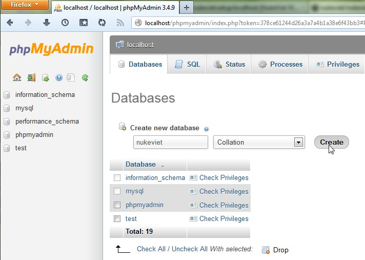

Chú ý:

- Từ phiên bản Xampp 1.8.0, khi truy cập [http://localhost/phpmyadmin/](http://localhost/phpmyadmin/) bạn sẽ được báo `Access forbidden!`, nguyên nhân là do Xampp áp dụng phương thức bảo mật mới. Bạn chỉ có thể truy cập bằng cách sửa lại cấu hình trong file "httpd-xampp.conf". Cách sửa như sau: Từ cửa sổ Terminal, bạn gõ dòng lênh sau để sửa file cấu hình
  ``` text
  sudo gedit /opt/lampp/etc/extra/httpd-xampp.conf
  ```

  Cửa sổ Gedit bật lên, bạn tìm đoạn `<Directory "/opt/lampp/phpmyadmin">`, thêm vào trong đó dòng `Require all granted`. Nó sẽ như sau: \<code\> \<Directory "/opt/lampp/phpmyadmin"\>

``` text
      AllowOverride AuthConfig Limit
      Order allow,deny
      Allow from all
      Require all granted
  </Directory></code> Cuối cùng bạn chỉ cần save file, đóng Gedit, trở lại cửa sổ Terninal chạy lệnh ''    sudo /opt/lampp/lampp restart'' để khởi động lại Xampp. Sau đó bạn có thể truy cập vào phpMyAdmin. Chú ý: nếu không thể save file httpd-xampp.conf sau khi sửa, bạn có thể sẽ phải chmod lại để cấp phép truy cập file này và tắt Xampp trước.
* Trong trường hợp bạn không muốn sửa file httpd-xampp.conf thì bạn có thể tạo cơ sở dữ liệu rỗng một cách thủ công như sau: Tìm đến thư mục **/opt/lampp/var/mysql/**, tạo một thư mục mới có tên **nukevietx**, chmod 777 để cấp quyền ghi cho thư mục này. Trường hợp chưa cấp quyền ghi thư mục này, hệ thống sẽ báo lỗi như sau sau khi bạn nhấp nút **Thực hiện** ở bước 5: <code>CREATE TABLE `nv3_authors` ( `admin_id` mediumint(8) unsigned NOT NULL, `editor` varchar(100) NOT NULL, `lev` tinyint(1) unsigned NOT NULL DEFAULT '0', `files_level` varchar(255) NOT NULL, `position` varchar(255) NOT NULL, `addtime` int(11) NOT NULL DEFAULT '0', `edittime` int(11) NOT NULL DEFAULT '0', `is_suspend` tinyint(1) unsigned NOT NULL DEFAULT '0', `susp_reason` mediumtext NOT NULL, `check_num` varchar(40) NOT NULL, `last_login` int(11) unsigned NOT NULL DEFAULT '0', `last_ip` varchar(45) NOT NULL, `last_agent` varchar(255) NOT NULL, PRIMARY KEY (`admin_id`) ) ENGINE=MyISAM</code> Nếu lỡ quên, bạn sẽ phải chmod lại thư mục này cho đúng, sau đó quay lại cửa sổ trình duyệt đang cài đặt NukeViet, ấn phím F5 để nạp lại trình duyệt, hệ thống sẽ yêu cầu bạn chạy lại các bước từ đầu, qua bước 4 thì hệ thống sẽ đưa thẳng bạn sang 6 (bước 5 đã được khai báo từ lần trước).
* Trường hợp nếu bạn đã chmod 777 cho thư mục **/opt/lampp/var/mysql/** thì NukeViet có thể tự tạo cơ sở dữ liệu mới mà không cần bạn tạo trước (với điều kiện bạn khai báo đúng Username và mật khẩu tại bước 5).
```

## Tài liệu tham khảo

[http://www.apachefriends.org/faq_linux.html](http://www.apachefriends.org/faq_linux.html)

## Các bài viết liên quan

- [Cài XAMPP trên Ubuntu / Fedora / RHCE / CentOS](/nukeviet/setup/localhost_linux)
- [Hướng dẫn cài đặt MAMP trên MAC OS](/nukeviet/setup/localhost_mac)
- [Cài đặt NukeViet 3 trên IIS7](/nukeviet/setup/iis7)
- [Hướng dẫn cài NukeViet trên localhost Windows](/nukeviet/setup/localhost)
