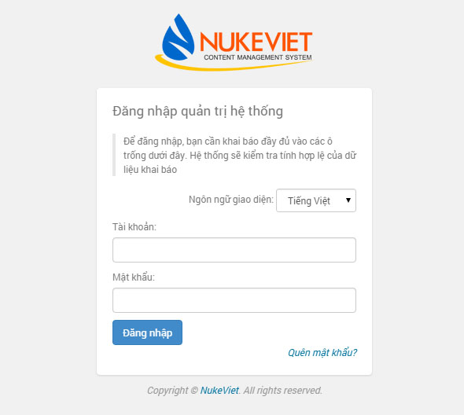
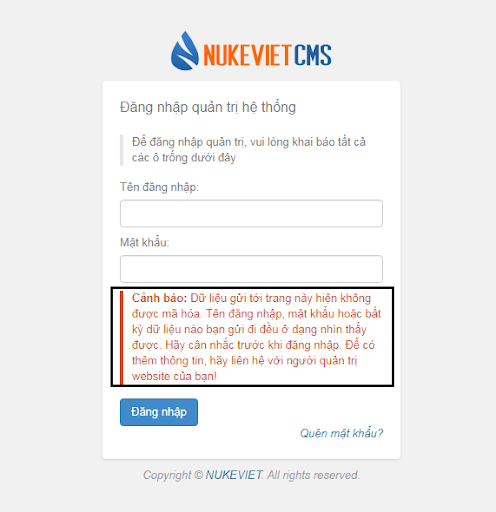
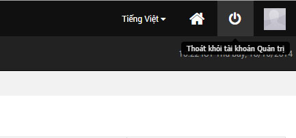
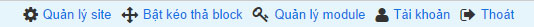

Admin Control Panel (viết tắt là ACP) tiếng việt là Bảng điều khiển của người quản trị (đôi khi gọi tắt là Trang quản trị) là công cụ quản trị website dành cho người quản trị.

## Địa chỉ truy cập

Nếu bạn đường dẫn site của bạn là [http://my-domain.com/](http://my-domain.com/) thì đường dẫn đăng nhập khu vực quản trị là [http://my-domain.com/admin/](http://my-domain.com/admin/)

Nếu bạn đường dẫn site của bạn là [http://my-domain.com/portal/](http://my-domain.com/portal/) thì đường dẫn đăng nhập khu vực quản trị là [http://my-domain.com/portal/admin/](http://my-domain.com/portal/admin/)

## Đăng nhập Admin Control Panel

Khi bạn truy cập vào trang quản trị trong trạng thái chưa đăng nhập thì màn hình đăng nhập hiện ra như sau:

Bạn cần nhập bí danh và mật khẩu lúc cài đặt site để truy cập vào khu vực quản trị. Hoặc có thể dùng tài khoản thành viên đã được người quản trị cấp quyền vào khu vực quản trị để quản lý các module.

Tại phiên bản NukeViet 4.5.01 có thêm 1 dòng cảnh báo tại màn hình Đăng nhập như sau:

Cảnh báo này giúp người dùng cân nhắc trước khi đăng nhập vào site và gợi ý người dùng liên hệ với người quản trị để có thêm thông tin.

## Đăng xuất Admin Control Panel

Nếu bạn đăng xuất khỏi quản trị admin thì bạn tiến hành click vào nút "Thoát khỏi tài khoản Quản trị" trong admin như sau hình sau:

Hoặc thoát khỏi quản trị admin ngay trên trang chủ website thì bạn click vào nút "Thoát" như hình sau:

