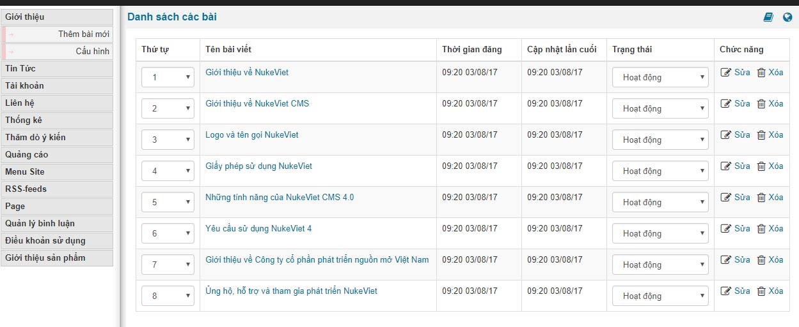
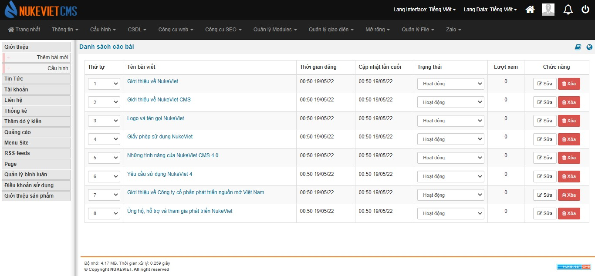
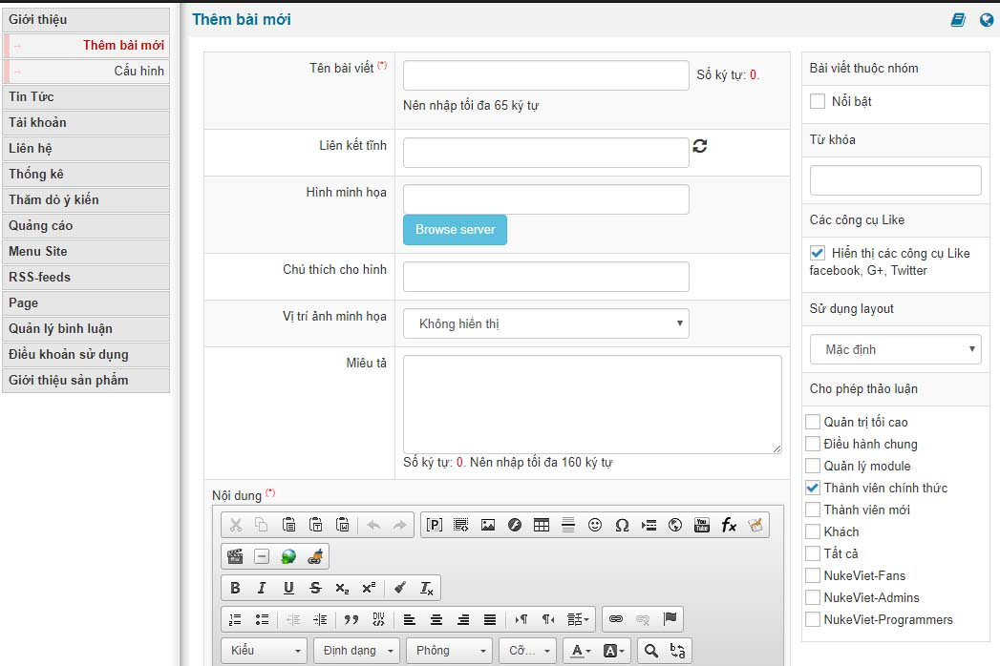
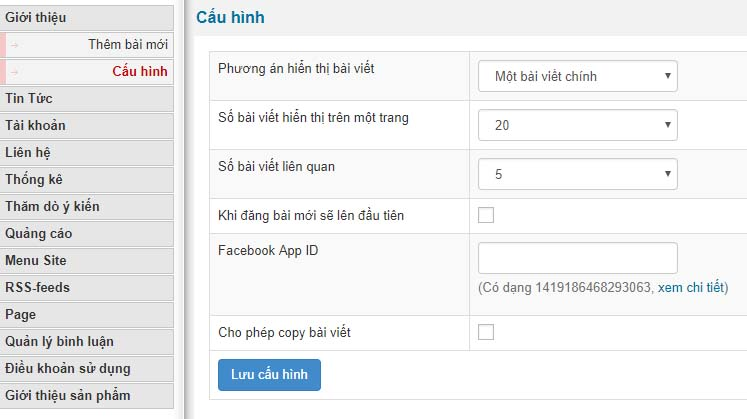
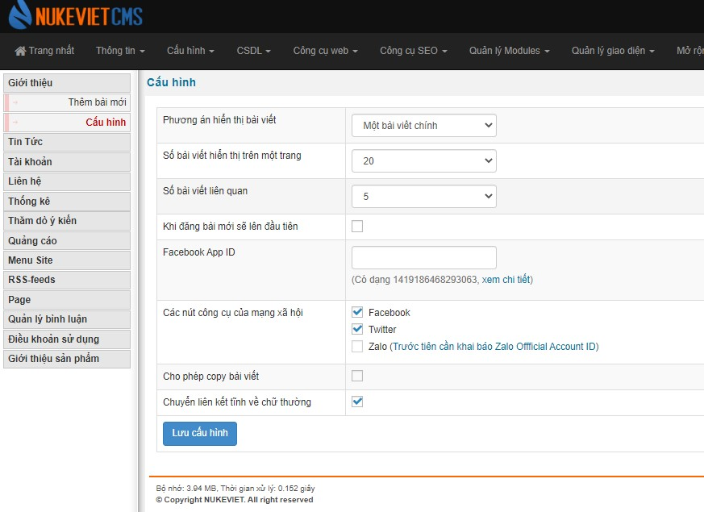
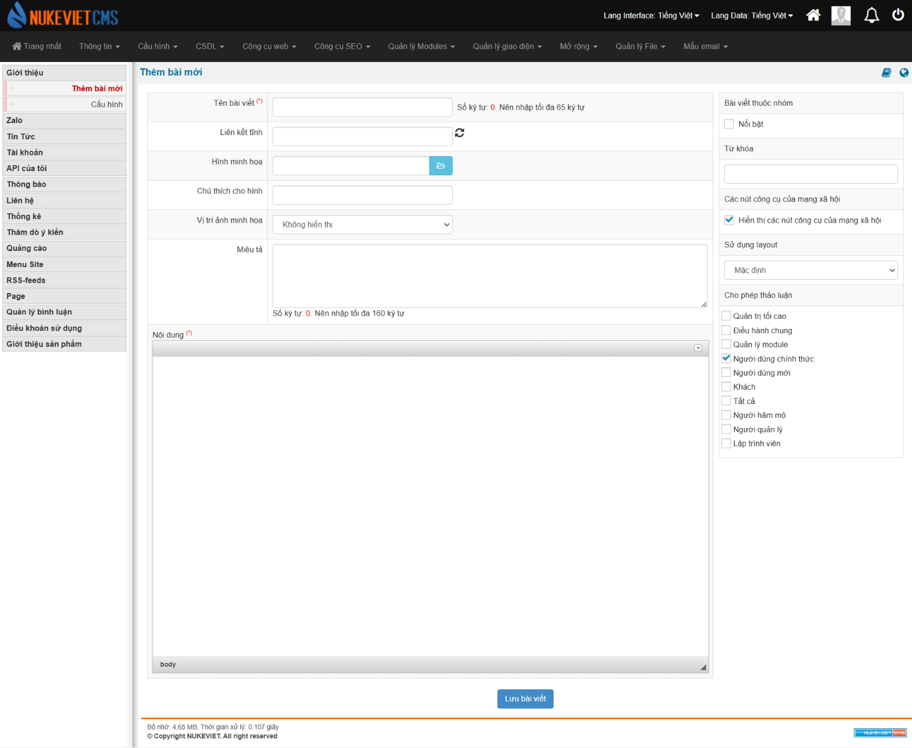

Module about (module giới thiêu) là module dùng để biên soạn nội dung dành cho phần giới thiệu website, đơn vị, tổ chức

- Hiển thị danh sách các bài viết
- Thay đổi trạng thái hiển thị ngoài site
- Nút chức năng sửa và xóa
- Sắp xếp lại thứ tự bài viết

**So với phiên bản NukeViet 4 thì từ phiên bản NukeViet 4.5.01 đến 4.5.06 đã bổ sung thêm cột "lượt xem":**

## Thêm bài mới

Tại đay tiến hành thêm nội dung cho bài viết

Lưu ý: các phần có đánh đấu \* màu đỏ là bắt buộc bạn phải điền và các tùy chọn khác

## Cấu hình

Thiết lập cấu hình hiển thị trình bày module ngoài site và tích hợp API của Facebook

**Phiên bản NukeViet 4.5.0.1:**

Một số tùy chọn đã được thêm vào:

\- Các nút công cụ mạng xã hội

\- Chuyển liên kết tĩnh về chữ thường

### Phiên bản NukeViet 4.5.06

- Tương tự phiên bản 4.6.0

### Phiên bản NukeViet 4.6.0

- Nút *‘Browse server’* chuyển thành icon
- Không còn tùy chỉnh kiểu chữ trong phần nội dung (body)

