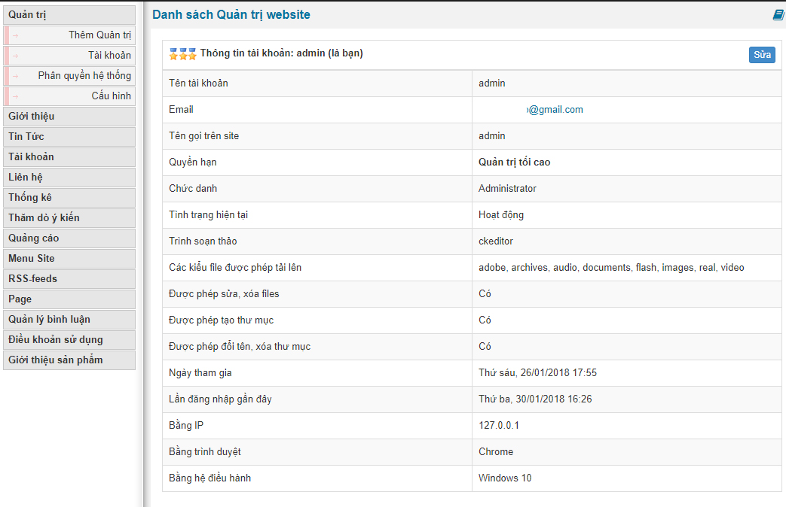
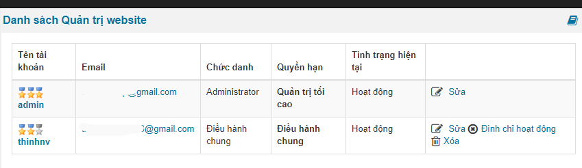
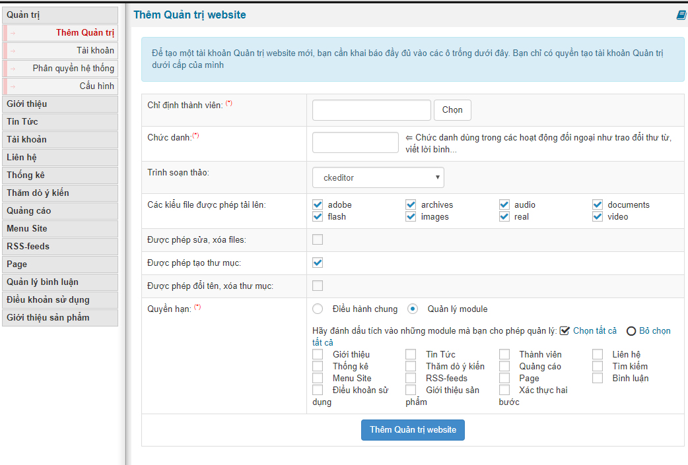
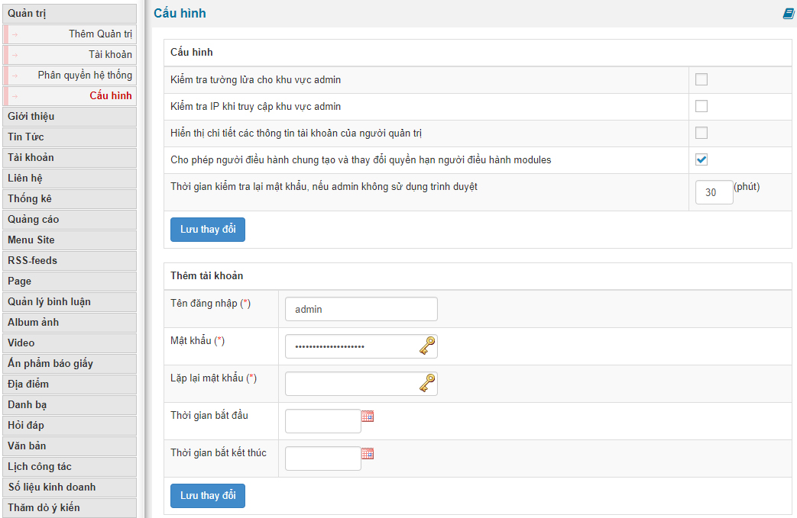
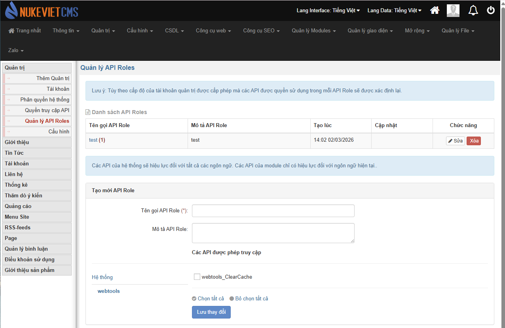
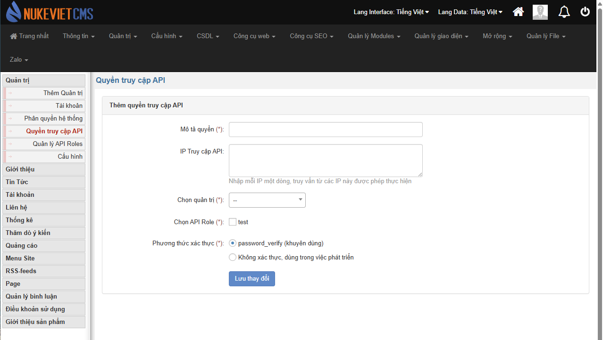
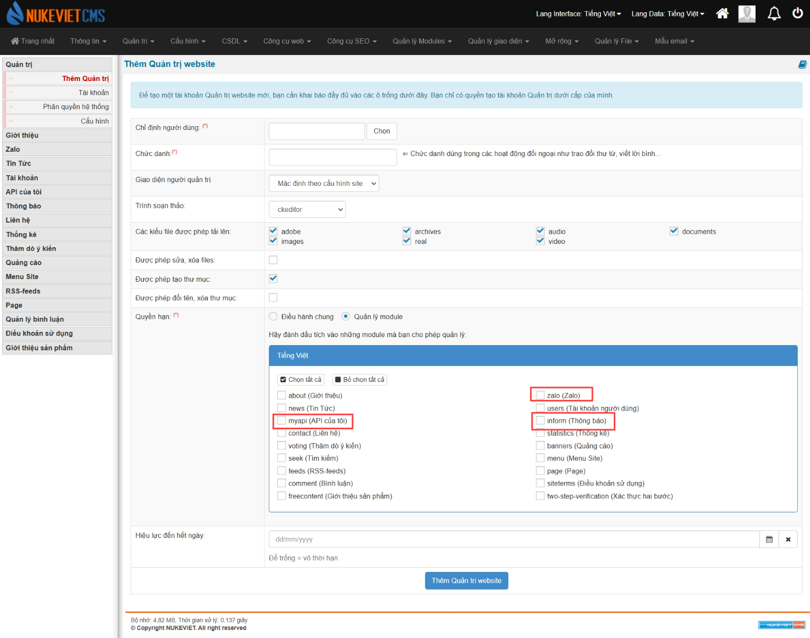

Quản trị website sẽ quản lý tất cả các thành viên trong ban điều hành website gồm:

- Quản trị tối cao
- Điều hành chung
- Quản trị module

Mỗi chức danh sẽ có chức năng và nhiệm vụ riêng. Tuy nhiên đồng nghĩa với từng vị trí chức danh thì các tính năng sẽ bị hạn chế ở mức theo quy định của hệ thống.

## Sửa/thêm/xóa quản trị

Khi bạn truy cập vào phần quản trị site nó sẽ hiển thị thông tin tài khoản bạn đang đăng nhập là tài khoản quản trị của bạn

hoặc nếu có nhiều hơn 2 người quản trị thì nó sẽ là danh sách tài khoản quản trị

Để thêm quản trị thì bạn bấm vào phần quản trị thì bạn chỉ việc bấm vào "Thêm quản trị". Tại đây có các thông số tùy chọn cho bạn lựa chọn để có thể phần quyền

Lưu ý: khi bạn thêm bạn chỉ có thểm thêm quản lý module và điều hành chung vì quản trị tối cao chính là tài khoản admin khi cài đặt site

## Cấu hình

- Kiểm tra tường lửa cho khu vực admin
- Kiểm tra IP khi truy cập khu vực admin
- Hiển thị chi tiết các thông tin tài khoản của người quản trị
- Cho phép người điều hành chung tạo và thay đổi quyền hạn người điều hành modules
- Thời gian kiểm tra lại mật khẩu, nếu admin không sử dụng trình duyệt

Ngoài ra bạn có thể điền thông tin cho phần tường lửa đăng nhập vào trang quan trị như hình trên ở form "Thêm tài khoản" và "Thêm địa chỉ IP"

## Quản lí API Roles

## Quyền truy cập API

 Sau khi tạo api trong quản lí API Roles thì sẽ định nghĩa quyền truy cập API của roles đó

### Phiên bản NukeViet 4.6.0

- Phần ‘thêm quản trị website’ mục quyền hạn đã thêm ‘myapi (API của tôi)’, ‘zalo (Zalo)’, ‘inform (Thông báo)’

