Module quảng cáo là một tiệt ích quản lý chuyên nghiệp các quản cáo trên website. Bao gồm quản quảng cáo, các vị trí quảng cáo, đếm số lượt click lên mỗi quảng cáo, …

## Quảng cáo

Quảng cáo là phần danh sách các quảng cáo mà bạn đã đăng lên website. Tuy nhiên bạn có thêm tính năng xóa, kích hoạt trạng thái, sửa cũng như truy cập vào tên quảng cáo và khối quảng cáo để đến trang đích

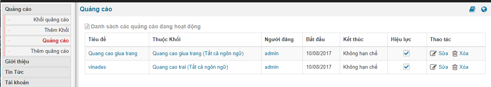

**So với phiên bản NukeViet 4 thì từ phiên Bản NukeViet 4.5.01 đến phiên Bản NukeViet 4.5.06 đã có thêm phần tìm kiếm quảng cáo theo từ khóa và khối:**

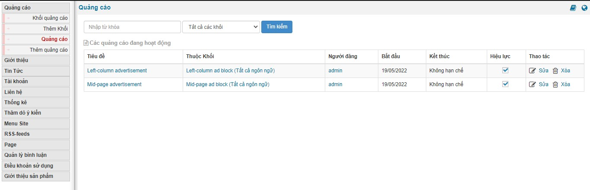

Khi bạn click chuột vào tên quảng cáo nó sẽ ra chi tiết các thông số của quảng cáo cũng như có thể ngưng quảng cáo, sửa, cũng như xem ảnh demo của quảng cáo và các thông tin khác như hình sau

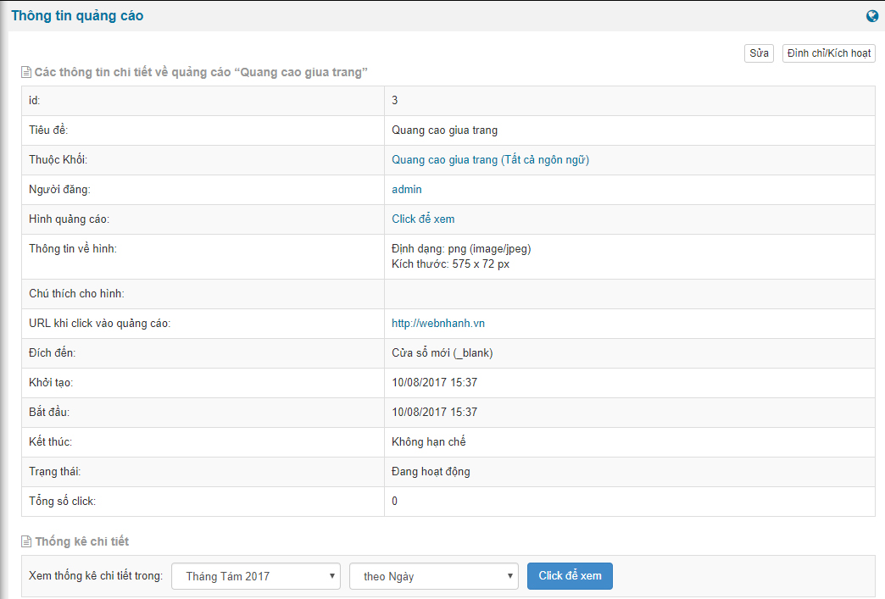

Khi bạn click chuột vào tên khối quảng cáo, bạn sẽ có thông tin cơ bản và các tính năng

- Sửa khối
- Đình chỉ / kích hoạt
- Thêm quảng cáo vào khối
- Xóa khối

Ngoài ra nó còn liệt kê danh sách các quảng cáo có trong khối và cũng như bạn có thể sắp xếp lại thứ tự quảng cáo trong khối đó.

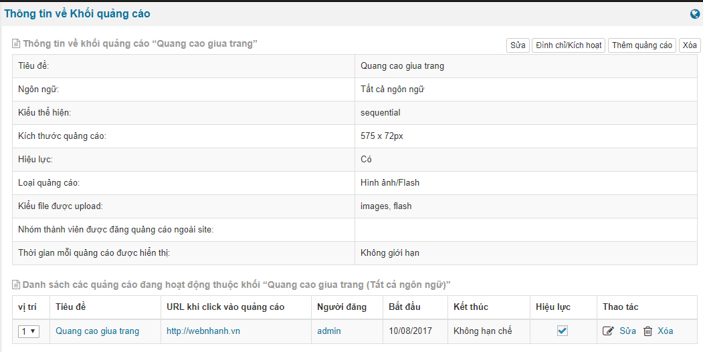

## Khối quảng cáo

Khối quảng cáo nhằm phân loại dạng quảng cáo như: dịnh dạng, vị trí, kích thước, ngôn ngữ sẽ hiển thị, … Bạn có thể xem và sửa lại khối quảng cáo

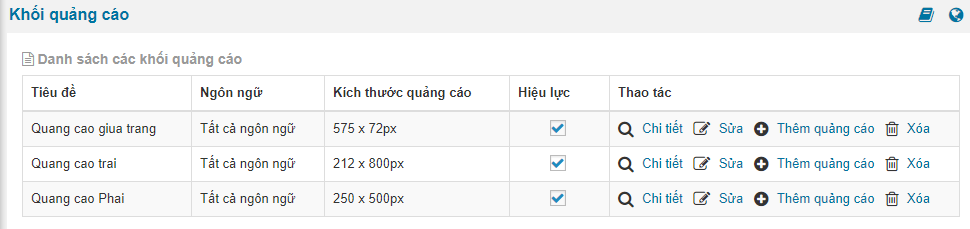

Chú ý: Nội dung của 1 khối hiển thị cả theo ngôn ngữ được cấu hình, nên nếu 1 khối quảng cáo bạn muốn cấu hình mối ngôn ngữ 1 kiểu sẽ cần tạo ra 2 hay nhiều khối theo ngôn ngữ và cấu hình việc hiển thị ở giao diện ngoài site.

## Thêm khối quảng cáo

Ngoài một số khối quảng cáo đã có, bạn có thể tạo thêm nhóm cho các quảng cáo mới

- Tiêu đề
- Kích thước quảng cáo
- Ngôn ngữ
- Kiểu thể hiện
- Loại quảng cáo
- Kiểu file được upload: tùy chọn giữa ảnh và flash
- Nhóm thành viên được đăng quảng cáo ngoài site: tính năng này mới được bổ sung khi nhóm thành viên được quyền đăng quảng cáo
- Thời gian mỗi quảng cáo được hiển thị
- Giới thiệu về Khối

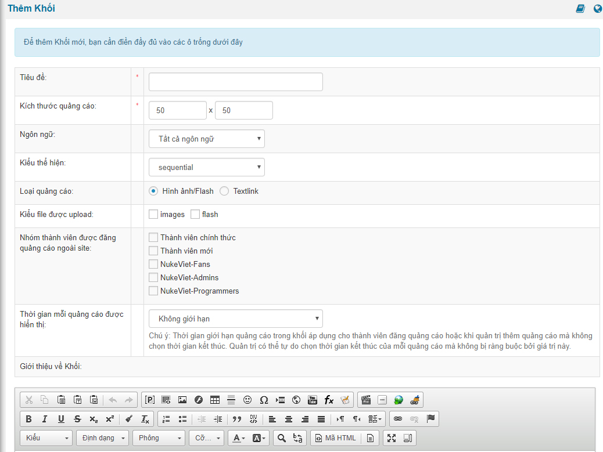

Khi bạn phân quyền nhóm thành viên được đăng quảng cáo thì ngoài site ở tại module quảng cáo bạn sẽ có phần upload hiện lên cho bạn upload theo cấu hình khối quảng cáo mà bạn thiết lập trong trang quản trị module quảng cáo

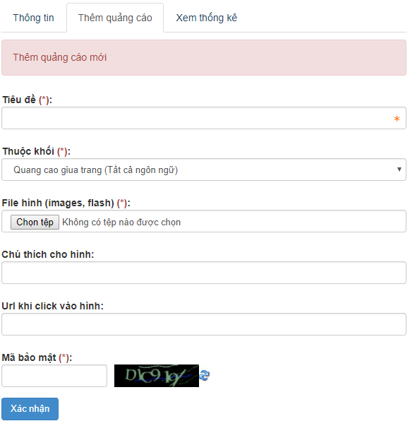

Ngoài ra bạn cũng có thể xem thông số thống kê quảng cáo ở tab bên cạnh của hình trên

## Quảng cáo

Hiển thị danh sách tất cả các quảng cáo

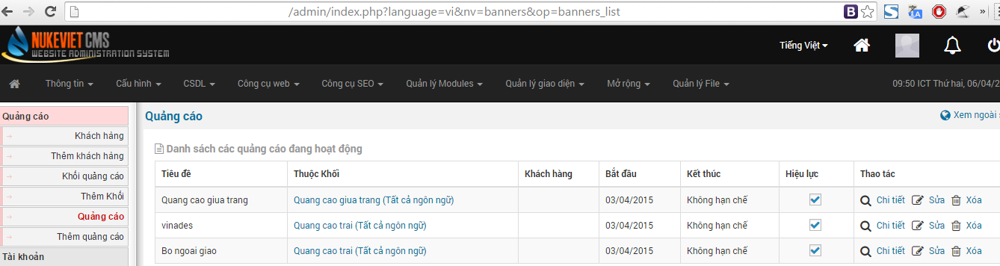

## Thêm quảng cáo

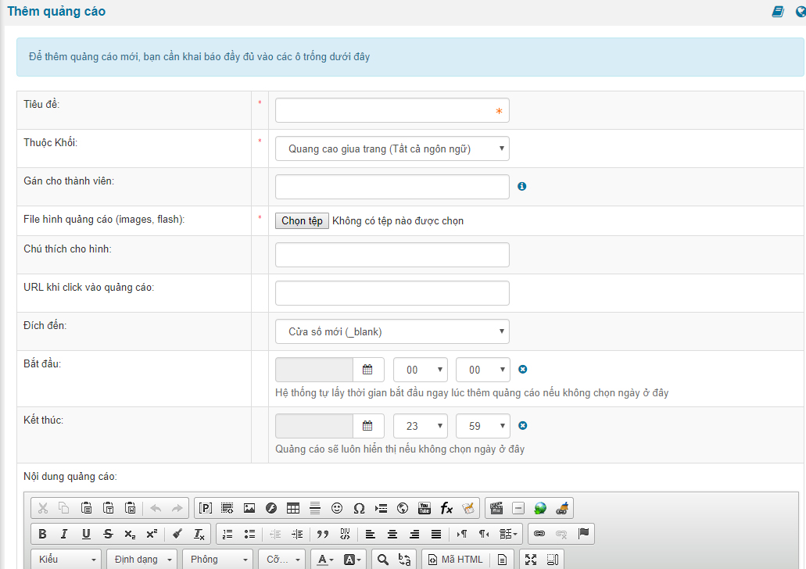

### Phiên bản NukeViet 4.5.06

- Tại trường “Thêm quảng cáo”, “File hình quảng cáo (images)” chỉ còn image (bỏ flash). Bổ sung “Hình quảng cáo nếu trình duyệt là mobile”.

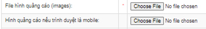

## Hiển thị quảng cáo lên website

Để đưa quảng cáo hiển thị lên website. Bằng cách thêm block quảng cáo vào vị trí thích hợp, quảng cáo sẽ tự động hiển thị tại vị trí quy định. Xem Cách thêm block để biết chi tiết cách thêm.

1.  Xem trang chủ rồi bật kéo thả block
2.  Chọn một vị trí block nào đó trên websiet sau đó thêm block
3.  Xuất hiện form thiết lập quảng cáo. Ta chọn module quảng cáo
4.  chọn loại quảng cáo
5.  chọn quảng cáo

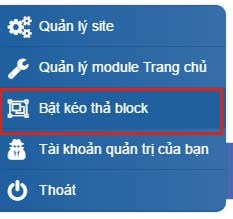

Để biết quản cáo đã được bao nhiêu click chúng ta vào như hình sau

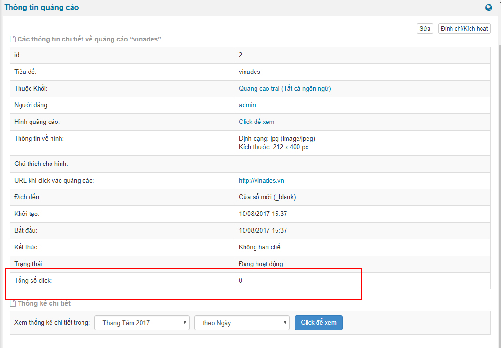

### Phiên bản NukeViet 4.6.0

- Giao diện thay đổi khi bấm vào *'Thông tin về khối Banner'*: 4 nút bấm *‘Sửa’, ‘Đình chỉ/Kích hoạt’, ‘Thêm quảng cáo’, ‘Xóa’* được chuyển xuống dưới bảng ‘thông tin về khối banner’
- Có thêm các panel mới

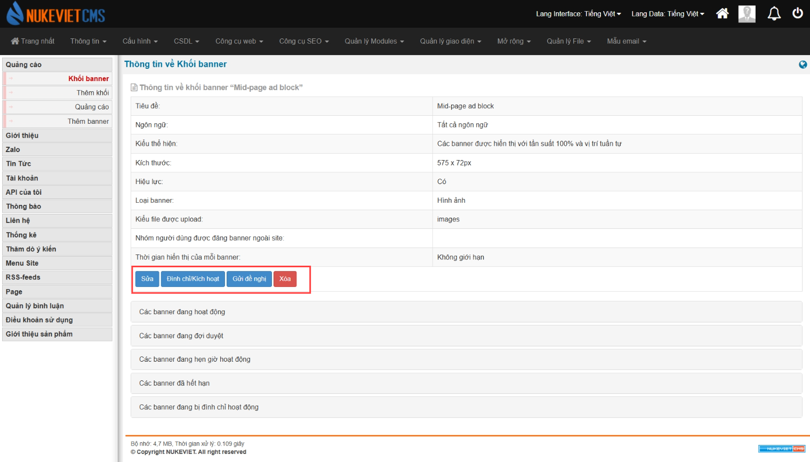 **Thêm khối**

- Mục *‘Kiểu thể hiện’* chuyển từ dropbox sang checkbox
- Mục *‘Kiểu file được upload’* loại bỏ lựa chọn ‘flash’

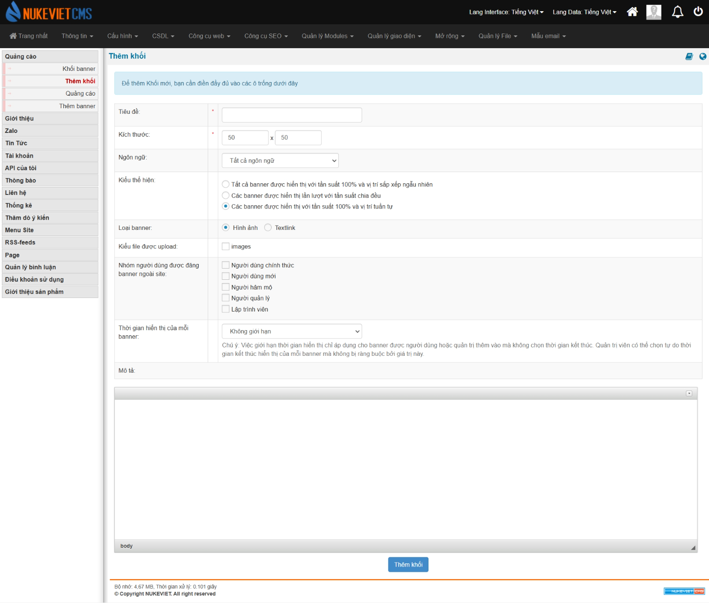
