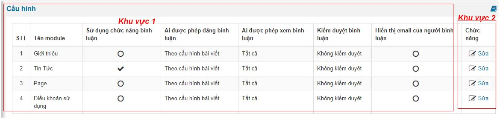
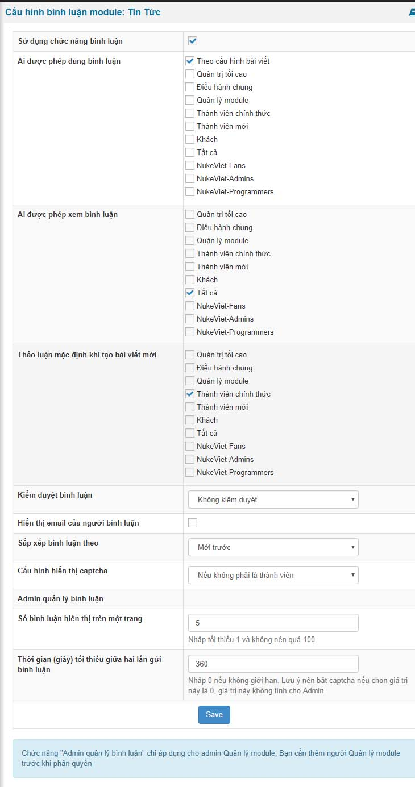

Cấu hình module bình luận giúp bạn cho phép thiết lập module nào trong hệ thống nukeviet được phép bình luận cũng như các quyền hạn khác nhau của người truy cập vào từng module.

Để cấu hình module bình luận bạn làm theo các bước sau.

Bước 1: truy cập vào module bình luận

Bước 2: click vào "Cấu hình" trong module bình luận và nó sẽ hiện ra như hình sau.

- Bạn tùy chọn module sử dụng module bình luận thì bấm vào nút sửa ở khu vực 2 tương ứng với module khu vực 1.

Bước 3: Bạn tiến hành các thiết lập quyền hạn thông số kỹ thuật

