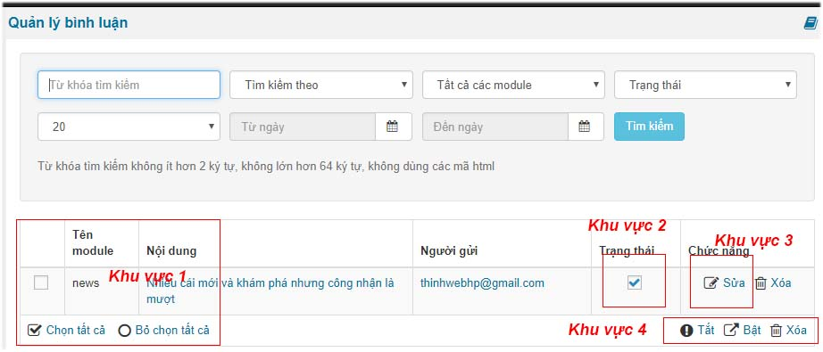
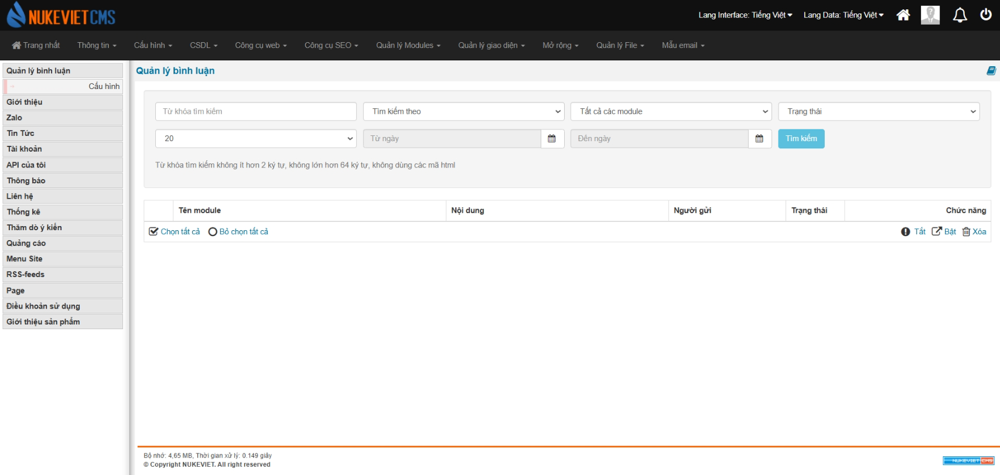

Có 3 cách phê duyệt bình luận trong nukeviet

Cách 1:

1.  Tích chọn từng bình luận hoặc tích chọn tất cả ở khu vực 1
2.  Tiếp đến bạn tùy chọn bật tắt xóa ở khu vực số 4.

Cách 2:

1.  Bạn tích từng bình luận ở khu vực 2 để phê duyệt

Cách 3:

1.  Bạn bấm sửa từng bình luận để sửa lại nội dung bình luận và thay đổi trạng thái sang bật trong trang edit bình luận

### Phiên bản NukeViet 4.6.0

Mục *‘Sửa và phê duyệt bình luận’* đã bị loại bỏ 
