Form contact mặc định tại trang người dùng

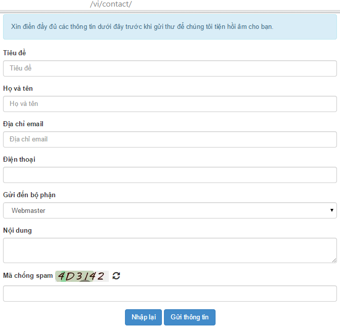 Vào control quản trị chức năng liên lạc 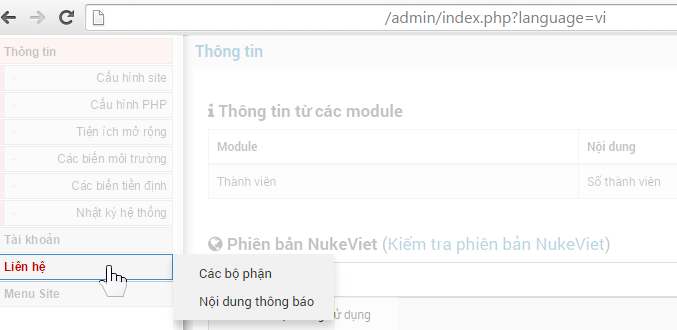

## Quản lý các liên hệ gửi tới

Hiển thị danh sách các liện hệ người dùng gửi tới

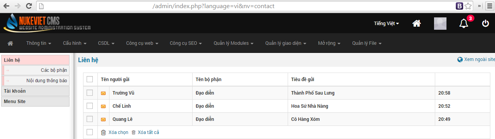

Click vào tên người gửi để xem nội dung chi tiết liên lạc 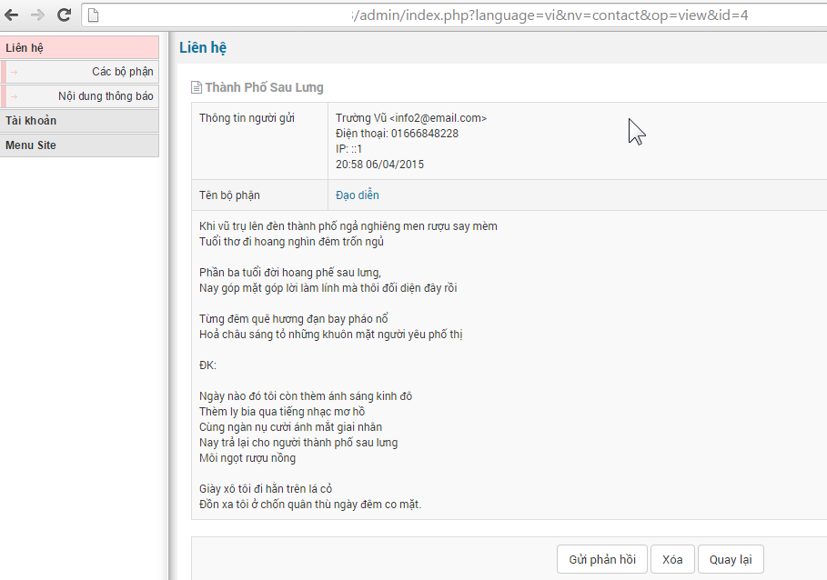 Cảm thấy cần phản hồi thì click vào “gửi phản hồi” 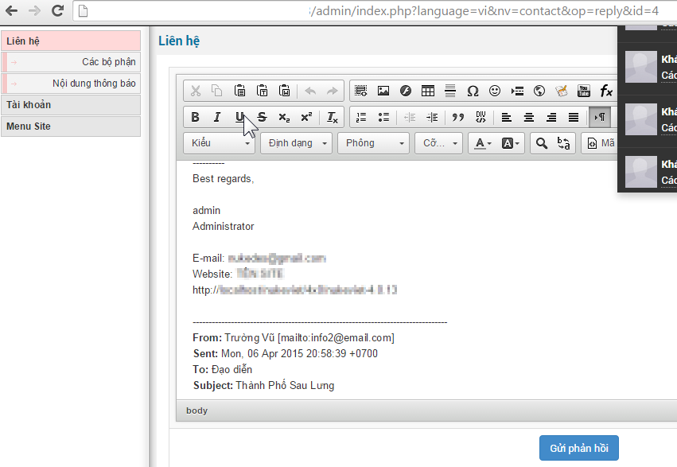

## Quản lý các bộ phận

Chức năng này giúp ta thêm, sửa, xóa các bộ phận nhận phản hồi ý kiến của người dùng. Giúp cho việc phân quyền quản lý tiếp nhận thông tin được thuận tiện hơn. 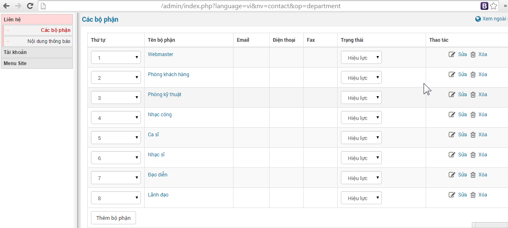

## Nội dung thông báo trên trang liên hệ

> Phần này ở NukeViet 3.4.02 trở đi đã chuyển về trang cấu hình module

Nội dung thông báo sẽ hiện ra khi người dùng liên hệ với chúng ta. Để soạn nội dung thông báo, ta làm theo các bước sau: 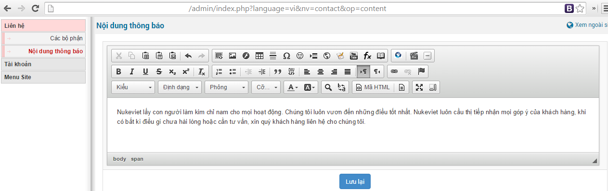 Nội dung này sẽ hiển thị mặc định khi người dùng vào form liên hệ 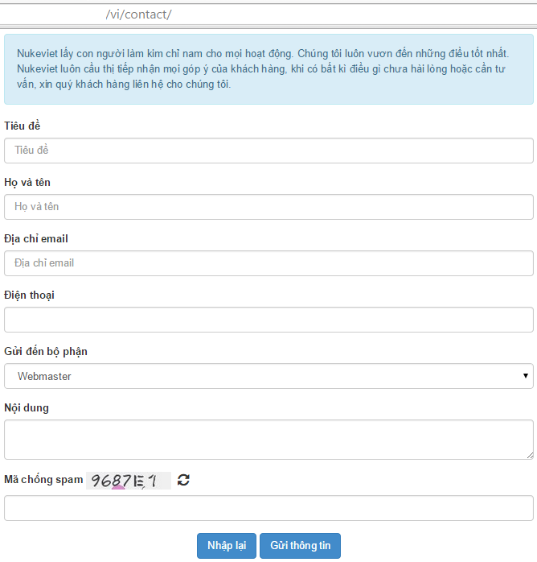

## Hiển thị danh sách các nhân viên hỗ trợ

Sau khi đăng nhập quản trị, trở lại trang người dùng -\> Bật kéo thả block -\> Thêm mới block. Sau đó chọn loại block: Liên hệ; Tên block là global supporter. Tiếp tục chọn các cấu hình block khác rồi Lưu lại 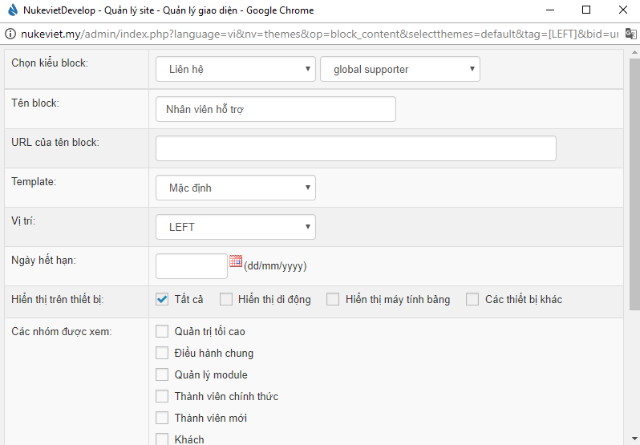

## Gửi phản hồi

Truy cập module liên hệ -\> Bấm "Gửi phản hồi" -\> biên soạn nội dung và nhập tiêu đề và email nhận -\> Bấm nút "Gửi phản hồi"

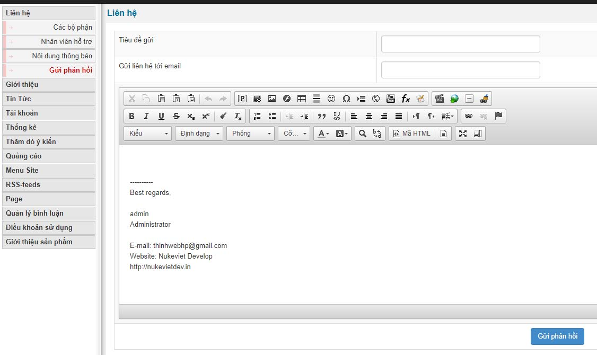

## Thêm nhân viên hỗ trợ

Để thêm nhân viên hỗ trợ bạn cần thực hiện thao tác như sau

Bước 1: Đăng nhập trang quản trị

Bước 2: Bấm vào module liên hệ

Bước 3: Bấm vô "Nhân viên hỗ trợ". Tại đây bạn chọn nhóm các phòng sau đó thì bấm "Thêm nhân viên hỗ trợ"

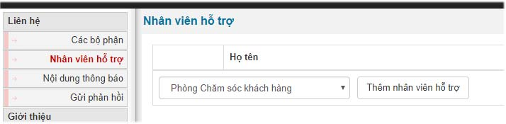

Bước 4: Điền các thông tin cần thiết và bấm lưu lại.

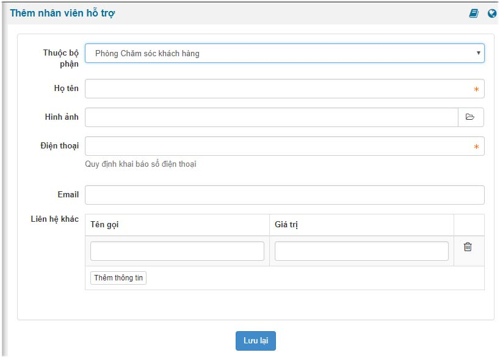

## Thêm bộ phận

Để thêm bộ phận bạn cần truy cập vào trang quản trị =\> module liên hệ =\> Các bộ phận =\> bấm vào nút "Thêm bộ phận" như hình sau.

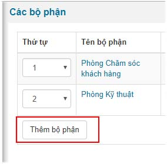

Tiếp đến bạn tiến hành điền các thông số kỹ thuật cần thiết rồi bấm nút "Thực hiện" để lưu lại thông số vừa điền

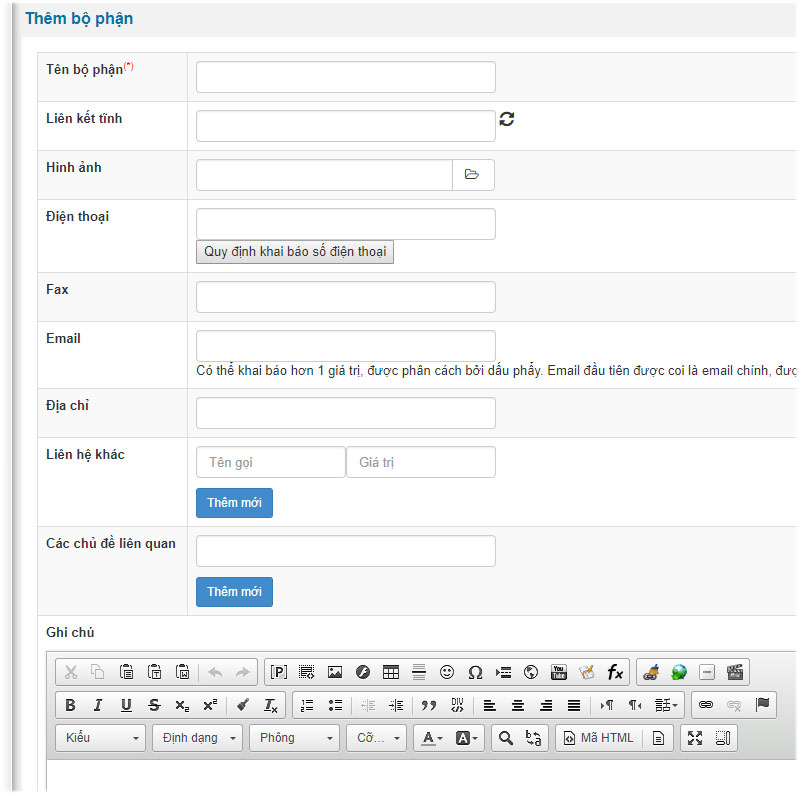

## Phiên bản NukeViet 4.5.06

- Tương tự như phiên bản 4.6.0

## Phiên bản NukeViet 4.6.0

- Có 2 mục mới được thêm vào là *‘Nhân viên hỗ trợ’* và *‘Cấu hình module’*

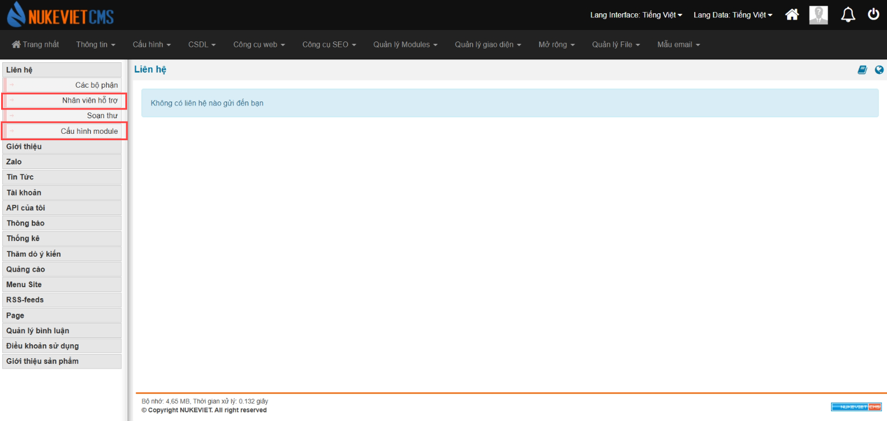

- Mục *‘Nội dung thông báo’* được chuyển vào *‘Cấu hình module’*

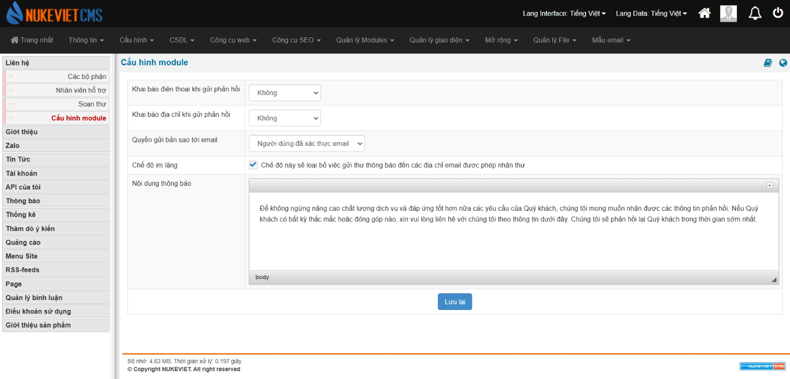

- Giao diện chọn *‘Thêm bộ phận’* trong mục *‘Các bộ phận’* đã thay đổi: Có thêm phần *‘Mô tả’*

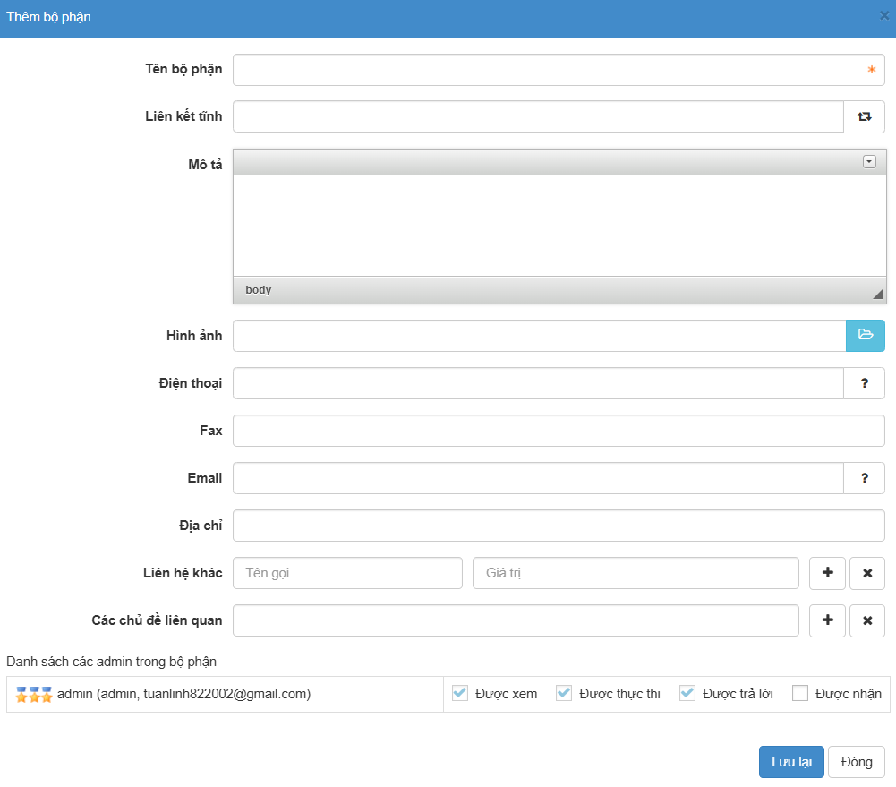
