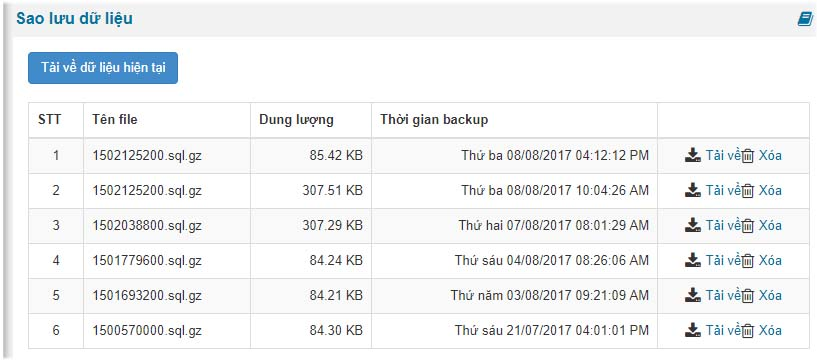

Nếu bạn không thực hiện sao lưu dữ liệu theo bài: [Hướng dẫn lưu cơ sở dữ liệu](/nukeviet4/admin/database/save)

Ở bài hướng dẫn này sử dụng tính năng sao lữu liệu mà hệ thống ghi lại.

Bước 1: Truy cập admin

Bước 2: Bấm vào "CSDL"

Bước 3: Bấm vào tính năng "Sao lưu dữ liệu". Tại đây hiển thị ra tính năng và danh sách các database mà hệ thống tự backup cho bạn tải về.

Bạn tải về thì bấm vào bên phải hoặc xóa nó. Nếu như bạn muốn tải bản database hiện tại đang sử dụng thì bấm vô "Tải về dữ liệu hiện tại"
