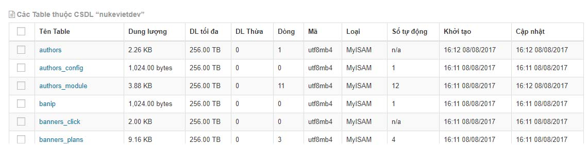
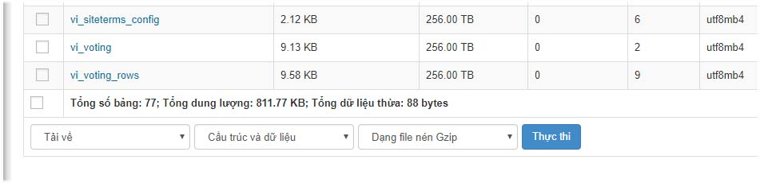

Việc sao lưu rất quan trọng trong quá trình quản trị 1 website nukeviet. Sao lưu database giúp bạn có thể khôi phục lại database website bất cứ lúc nào khi website gặp sự cố

Bước 1: truy cập admin

Bước 2: Bấm vào CSDL hiển thị danh sách các bảng trong csdl.

Bước 3: Tích chọn các bảng cần sao lưu hoặc chọn tất cả

Bước 4: tùy chọn sao lưu ở cuối site

