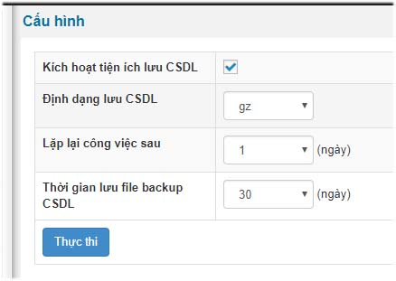

Cấu hình cơ sở dữ liệu sẽ thiết lập thông số tự động tạo database theo lịch trình riêng để bạn tiến hành tải về bản cơ sở dữ liệu theo từng thời điểm lựa chọn.

- Kích hoạt tiện ích lưu CSDL: Kích hoạt tiện ích tự động sao lưu cơ sở dữ liệu
- Định dạng lưu CSDL: các định dạng cho việc nén file csdl để tải về.
- Lặp lại công việc sau: Thời gian công việc lặp lại việc tạo bản sao lưu mới theo thời gian cố định.
- Thời gian lưu file backup CSDL: thời gian cho phép file sao lưu tồn tại trên hosting, vps. Sau thời gian đó hệ thống sẽ tự đếm thời gian và tiến hành lệnh xóa ngầm định
