Module download là chương trình quan lý các file, cho phép người dùng tải về máy một cách chuyên nghiệp. Module phân loại các chủ đề file, ghi chú thông tin cụ thể từng file (dung lượng, bản quền, …), đếm số lượt tải, cấp quyền tải cho từng nhóm đối tượng, …

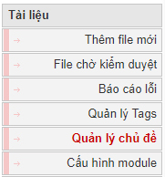

## Thêm chủ đề

Đầu tiên bạn cần thêm chủ đề, sau đó để thêm file và phân loại file theo từng chủ đề đã định.

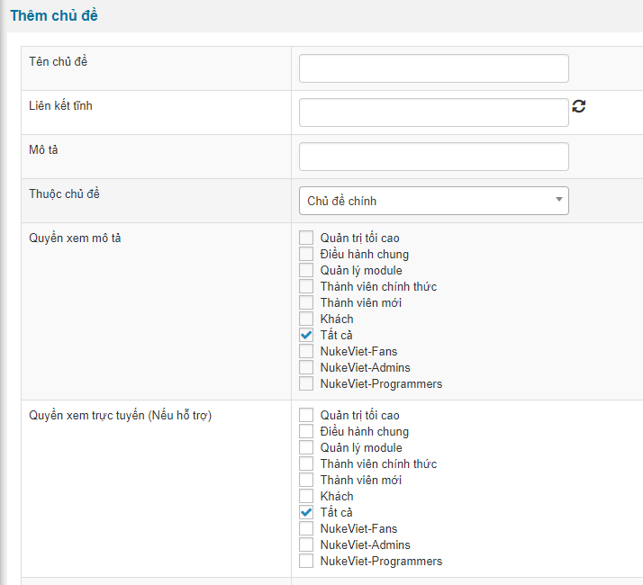

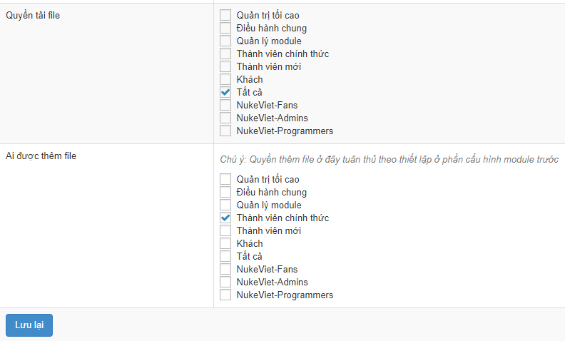

Sau khi thêm các chủ đề, chúng ta có danh sách các chủ đề

## Quản lý chủ đề

Module sẽ yêu cầu bạn thêm chủ đề trước khi làm bất cứ thao tác nào khác. Sau khi thêm chủ để thì các chủ đề hiện lên thành một danh sách và có các tính năng tùy chọn cho bạn sắp xếp hiển thị hoặc hoạt động hay ngừng hoạt động

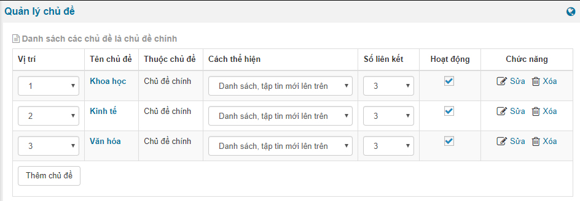

## Thêm file mới

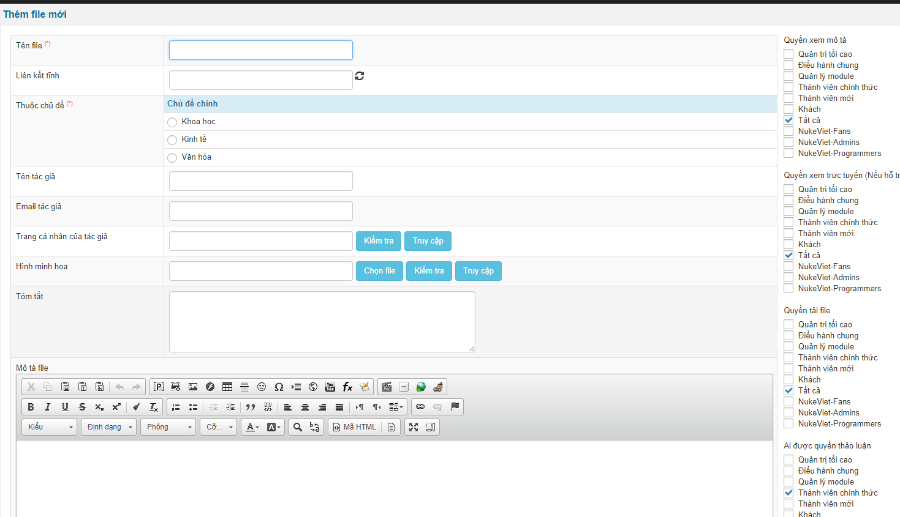

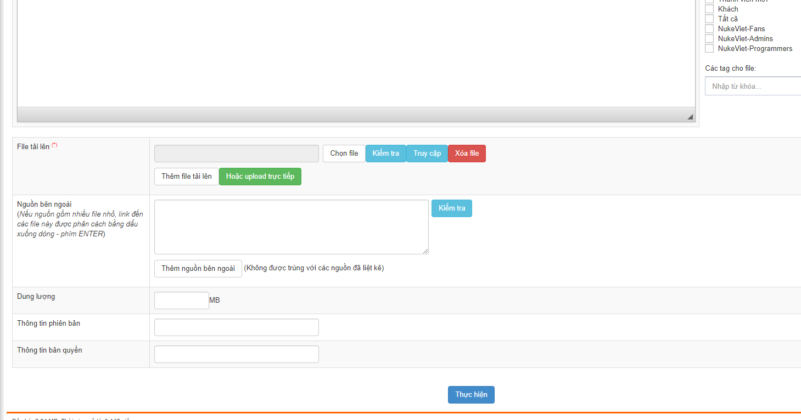

Sau khi thêm các file ta được danh sách các file trong control admin như sau

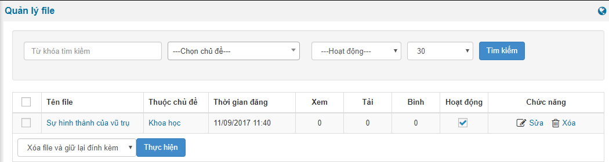

Đồng thời ngoài site, khách truy cập sẽ thấy danh sách file như sau

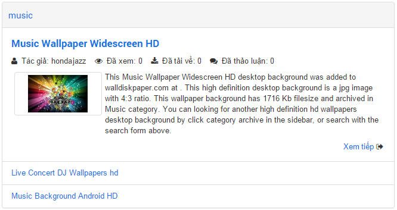

Nội dung chi tiết

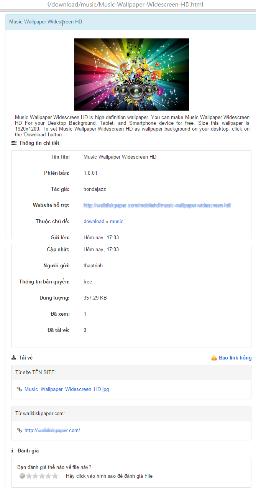

## File chờ kiểm duyệt

Cho phép quản lý các file thành viên gửi tới.

## Báo cáo lỗi

Cho phép theo dõi các báo lỗi gửi tới. 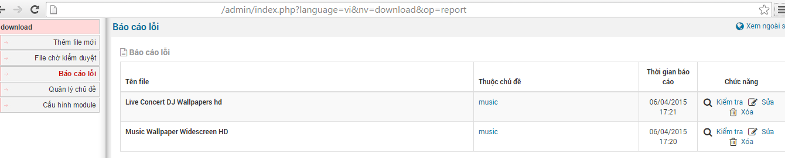

Bạn bấm vào kiểm tra link download, nếu không có bất thường, hệ thống báo

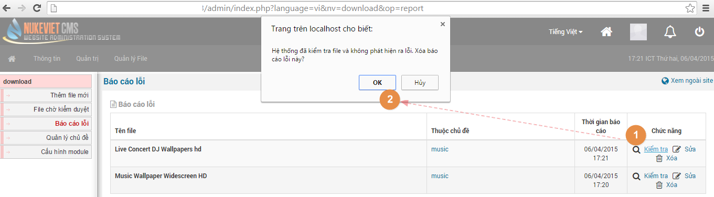

Trường hợp nếu file download có lỗi hệ thống sẽ thống báo, bạn cần kiểm tra lại file hoặc up lại file mới

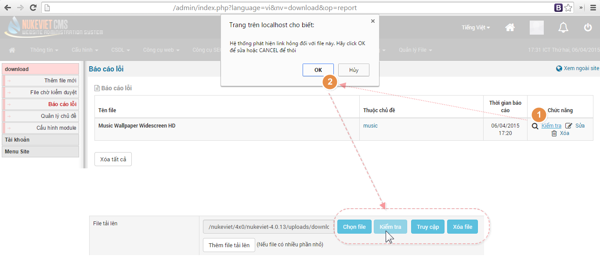

## Cấu hình module

Trong phần cấu hình module bạn có các tùy chọn hiển thị, upload file, quyền upload file,... Đặc biệt tính năng "Thiết lập các trường đăng" giúp bạn sét quyền cho một số trường mà bạn muốn cho nhóm admin và nhóm thành viên ở giao diện cả admin và ngoài site

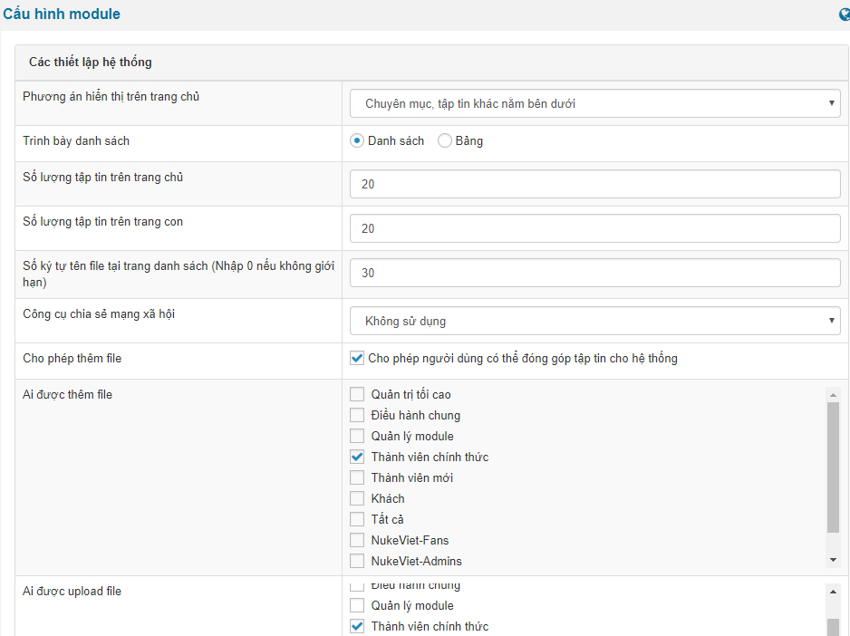

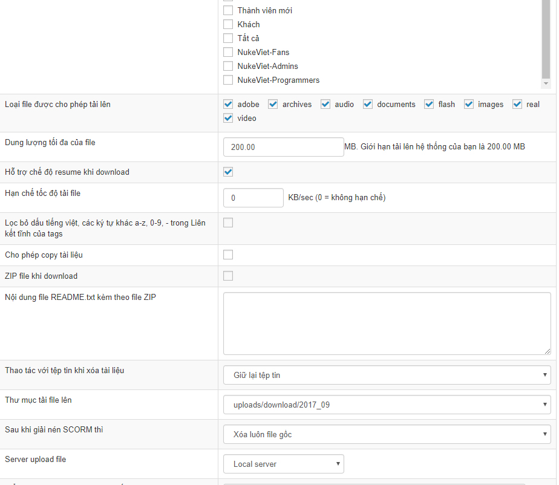

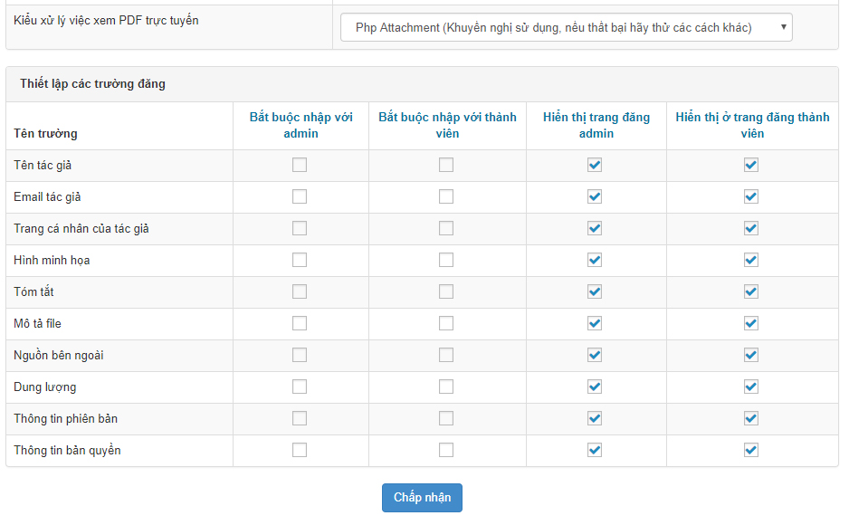
