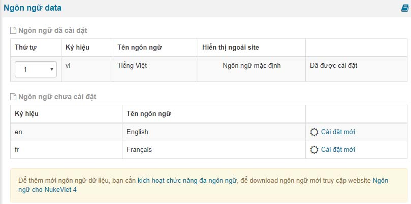

Ngôn ngữ data danh sách các ngôn ngữ được cài đặt trên hệ thống và có trong database

Nếu bạn muốn cài đặt mới chỉ việc bấm cài đặt mới là ngôn ngữ mới sẽ được cài đặt với điều kiện bạn cần phải kích hoạt chế độ đa ngôn ngữ trong phần cấu hình chung

