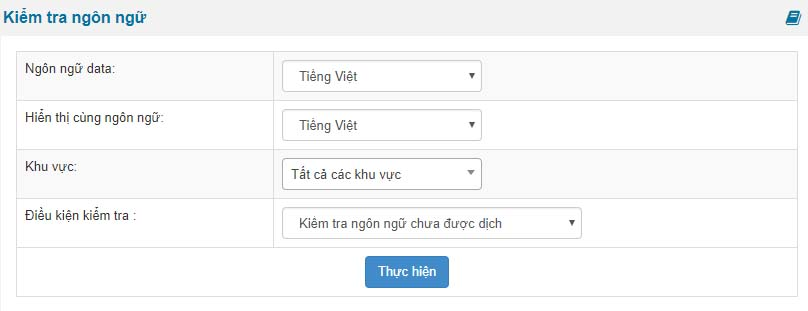

Nếu như trong trường hợp ngôn ngữ website của bạn chưa được dịch hết thì bạn sử dụng tính năng này để kiểm tra các vị trí cũng nhưu tất cả các vị trí chưa dịch.

Nếu nhiều hơn 2 ngôn ngữ thì trong phần

- Hiển thị cùng ngôn ngữ: bạn chọn là tiếng việt (đã được hoàn thiện 100%)
- Ngôn ngữ data: là ngôn ngữ mới ví dụ tiếng anh, tiếng pháp.
- Khu vực: tùy chọn khu vực bạn muốn kiểm tra
- Điều kiện kiểm tra: kiểm tra phần chưa dịch hoặc các tùy chọn khác

Lúc này nó sẽ liệt kê tương ứng để bạn bổ sung khi bạn bấm nút thực hiện

