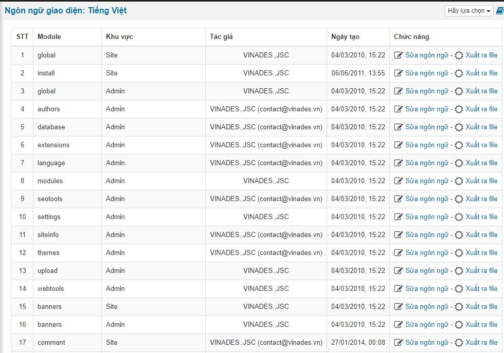

Ngôn ngữ giao diện là phần ngôn ngữ được hiển thị ngoài site và nó nằm trong các file vi.php, en.php, fr.php,... của module và hệ thống.

Nếu nhưu bạn bấm Sửa ngôn ngữ của từng vị trí khu vực tương ứng thì sau khi bạn bổ sung thêm bạn cần tiến hành xuất ra file để hệ thống ghi nhận ngôn ngữ đó load trong file php hiển thị ra ngoài site

