Module văn bản là module quản lý văn bản dùng để quản lý các công văn do cơ quan ban hành và các file văn bản đi kèm

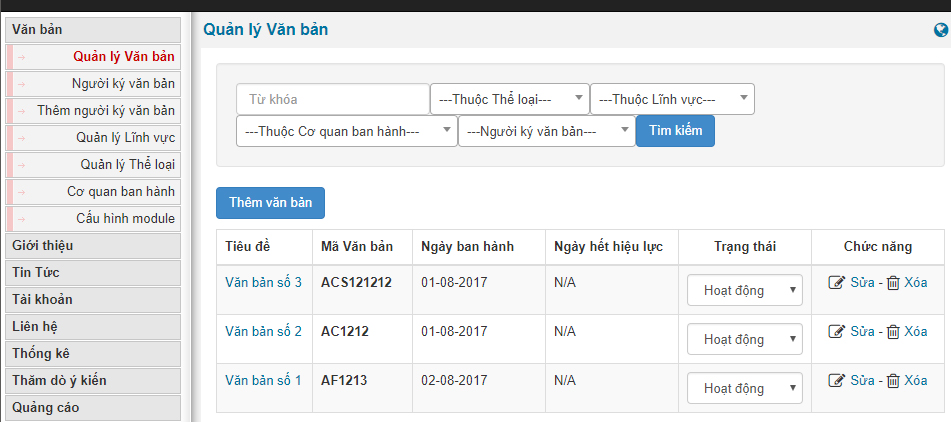

## Cấu hình module

Cấu hình module là phần cấu hình hiển thị nội dung module văn bản ngoài site và cách trình bày module

1.  Số văn bản tại trang chủ: là số lượng văn bản cho phép hiển thị trên trang main của module
2.  Số văn bản tại các trang con: là số văn bản hiển thị trên các trang category của module
3.  Phương án hiển thị: là cách trình bày hiển thị
    -  Ngày ban hành, mới lên trên
    -  Ngày ban hành, cũ lên trên
    -  Phân theo cơ quan ban hành
    -  Ngày thêm văn bản, mới lên trên
    -  Ngày thêm văn bản, cũ lên trên
4.  Download trên trang chính: kích hoạt tính năng cho phép trên trang main
5.  Hiển thị các văn bản cùng loại

``` text
    * Cùng thể loại
    * Cùng lĩnh vực
    * Cùng cơ quan ban hành.
    * Cùng người ký
- Số liên kết cùng loại: là số lượng văn bản cùng loại hiển thị khi bạn xem chi tiết một văn bản.
- Ẩn các mục không có thông tin khi xem chi tiết văn bản.
- Hiển thị liên kết khi xem chi tiết văn bản tại các mục
    * Loại văn bản
    * Lĩnh vực
    * Cơ quan ban hành
    * Người ký
- Hiển thị nút xem nhanh các file PDF tại trang chi tiết văn bản
```

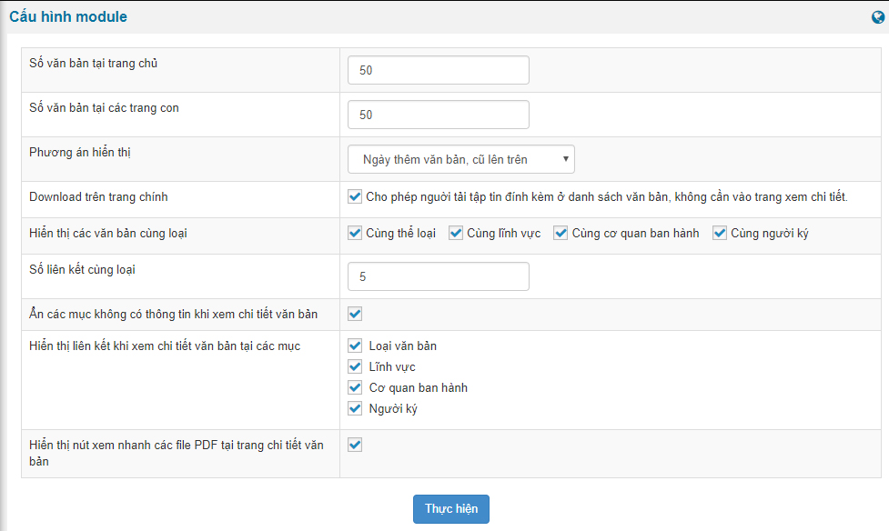

## Cơ quan ban hành

Cơ quan ban hành là nơi bạn điền danh sách các cơ quan ban hành các văn bản liên quan do cơ quan đó ban hành và được liệt kê trong danh sách dưới dạng như hình sau. Ngoài ra bạn có thể sửa hoặc xóa bất kỳ một cơ quan ban hành văn bản nào trong danh sách đã có.

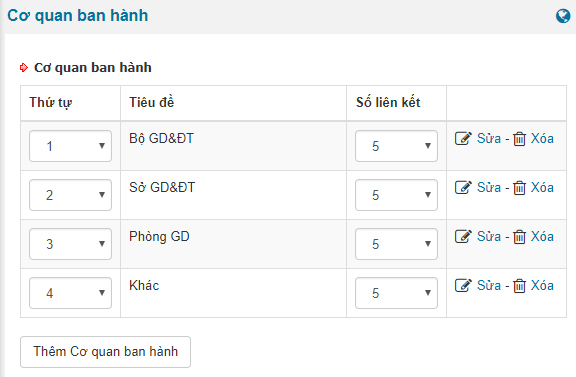

Để thêm mới ban hành thì như hình trên bạn bấm vào nút "Thêm cơ quan ban hành", tại đây bạn sẽ được điều hướng sang trang điền thông tin như hình sau và sau đó thì bấm nút "Thực hiện" là kết quả sẽ được lưu lại.

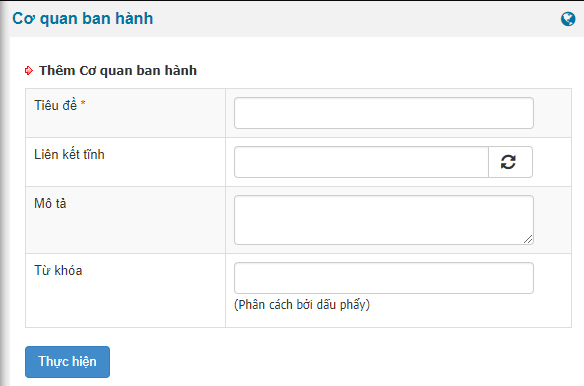

## Quản lý thể loại

Quản lý thể loại dùng để phân loại các văn bản như: công văn, Thông tư, nghị định,...

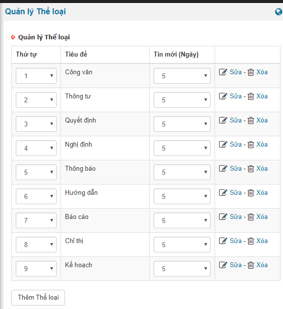

Bạn có thể sửa xóa hoặc thêm mới thể loại văn bản.

Để thêm mới bạn bấm nút "Thêm thể loại" và sau đó điền thông tin rồi lưu lại là có thể loại mới trong danh sánh thể loại.

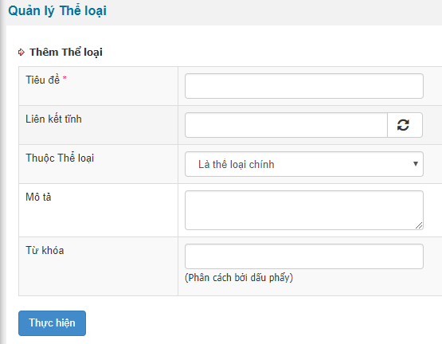

## Quản lý lĩnh vực

Quản lý lĩnh vực văn bản dùng để quán lý từng lĩnh vực ví dụ như: giáo dục, kinh tế, khoa học, nghiên cứu,...

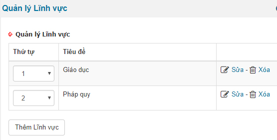

Bạn hoàn toàn có thể sửa xóa bất kỳ lĩnh vực mà bạn thêm vào.

Để thêm lĩnh vực mới bạn bấm nút "Thêm lĩnh vực" tại đây bạn điền thông tin như form sau và bấm "Thực hiện" để lưu lại kết quả lĩnh vực mà bạn mới thêm

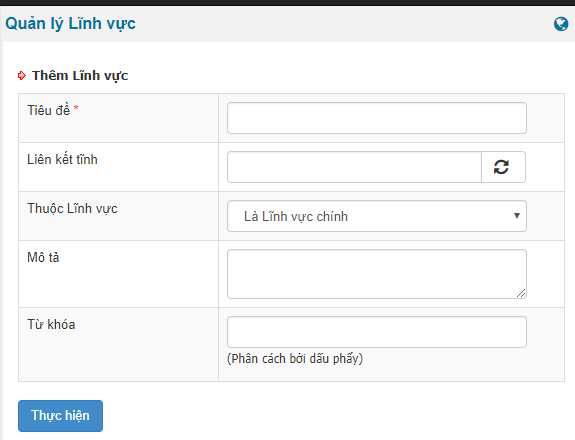

## Người ký văn bản

Người ký văn bản là người chính thức ký để văn bản đó chính thức được thông dụng và được thực thi.

Tại menu Người ký văn bản bạn sẽ có danh sách tên của người ký và thông tin chức vụ, cơ quan cũng như tính năng sửa xóa lại người ký văn bản.

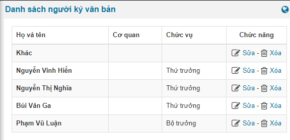

Ngoài ra để thêm người ký văn bản thì bạn cầm bấm vào "Thêm người ký văn bản" ở menu bên tay trái của module sẽ ra form điền và bạn tiến hành điền rồi lưu lại là người ký văn bản sẽ hiển thị ở menu "người ký văn bản"

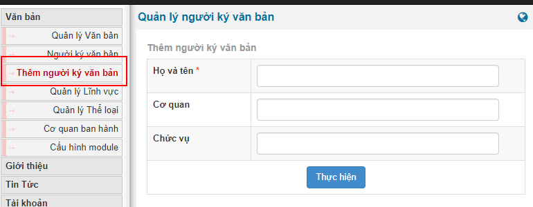

## Quản lý Văn bản

Chức năng Quản lý Văn bản hiển thị danh sách các văn bản bạn đã thêm vào module. Ngoài ra bạn có thể tiến hành xóa, sửa, thay đổi trạng thái hoạt động của bất kỳ văn bản nào bạn muốn hoặc thêm một văn bản mới bằng nút "Thêm văn bản"

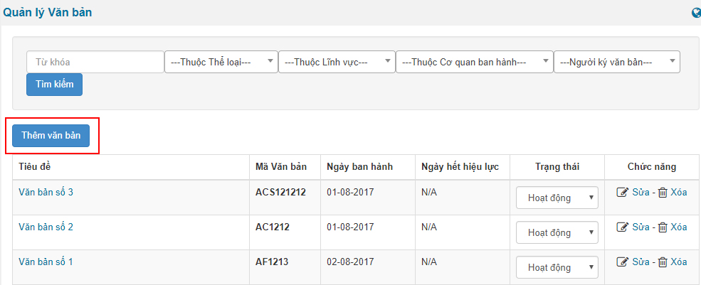

Khi bạn bấm nút thêm văn bản sẽ điều hướng bạn tới trang thêm văn bản và tại đây bạn điền đầy đủ thông tin và bấm "Thực hiện" là văn bản sẽ được lưu lại.

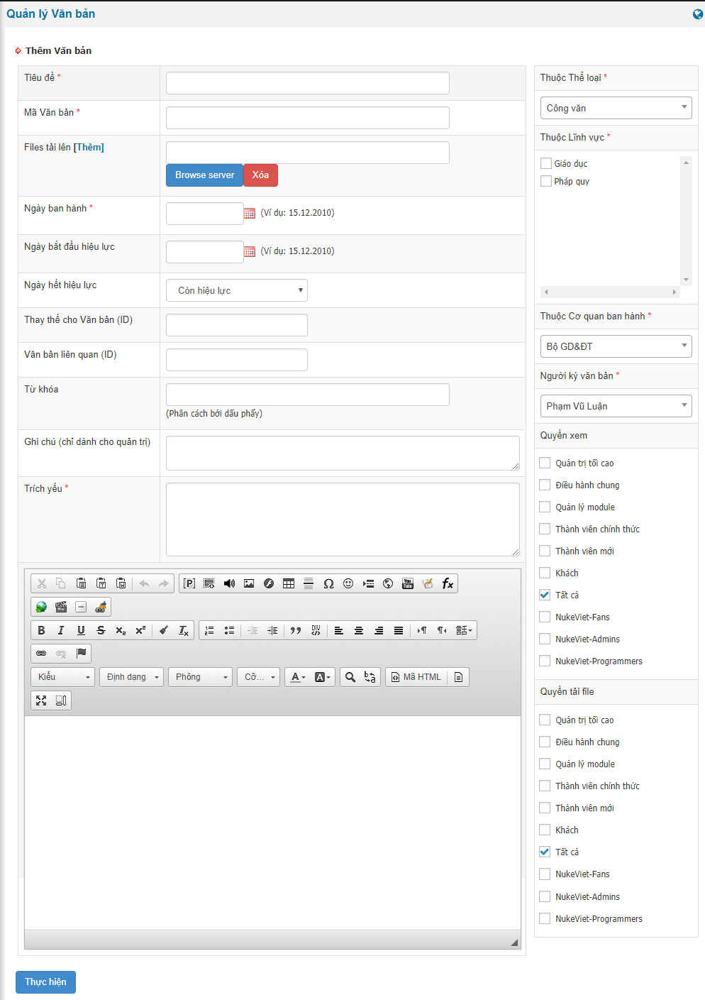

Lưu ý: vị trí nào có biểu tượng dấu (\*) thì bạn cần phải điền thông tin là bắt buộc
