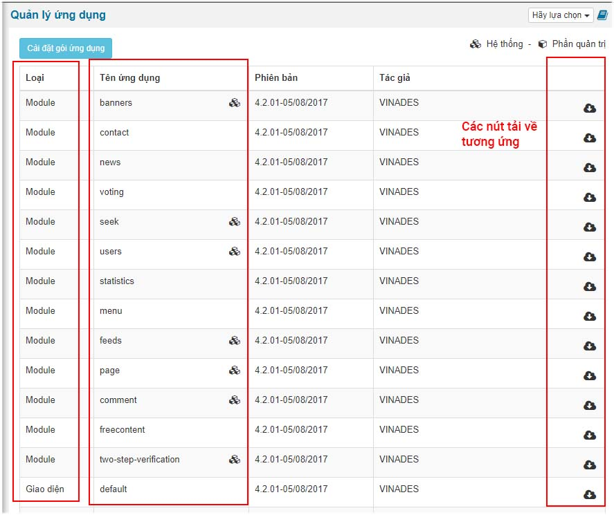
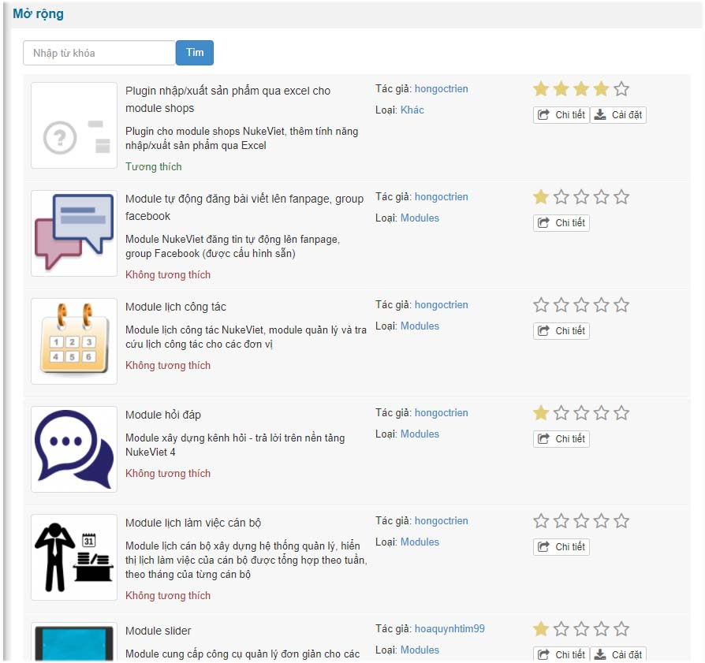
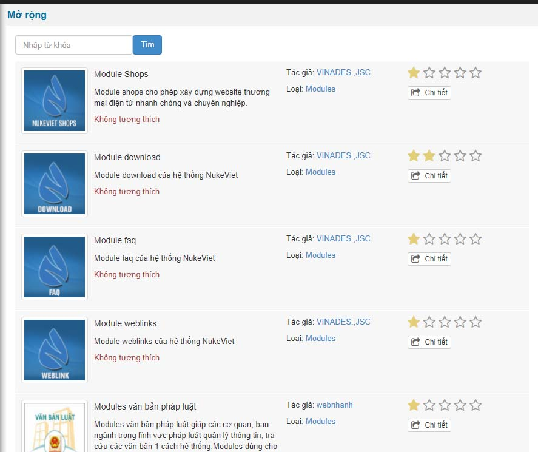
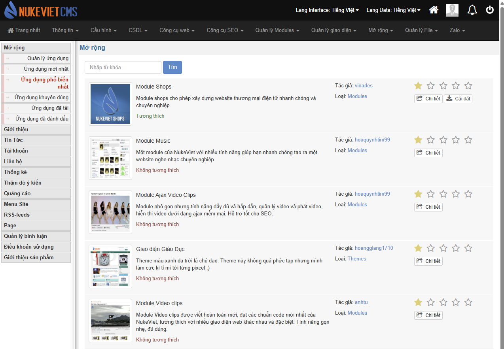

Mở rộng là một tính năng mới được tích hợp từ phiên bản 4.0.29 trở về sau này. Tính năng này hữu ích cho các webmaster trong quá trình quản trị website cũng như developer.

Tính năng nổi bật

- Tải về module, giao diện ngay trong trang mở rộng của website.
- Liệt kê danh sách ứng dụng mới nhất được thêm vào NukeViet Store
- Liệt kê danh sách ứng dụng phổ biến.
- Danh sách ứng dụng khuyên dùng
- Ứng dụng đã tải
- Ứng dụng đã đánh dấu

### Danh sách themes và modue có trên website

### Danh sách các ứng dụng mới nhất

### Ứng dụng khuyên dùng

### Ứng dụng phổ biến nhất

### Hướng dẫn về cách đóng gói ứng dụng

Xem chi tiết tại: [https://wiki.nukeviet.vn/programming4:thematic:packageextensions](https://wiki.nukeviet.vn/programming4:thematic:packageextensions)
