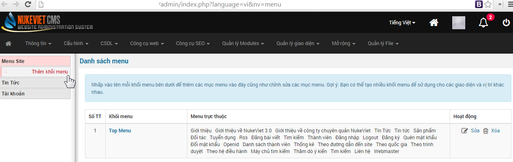
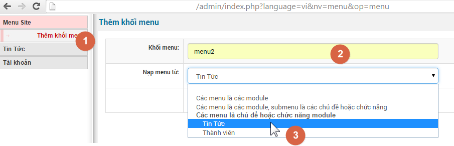
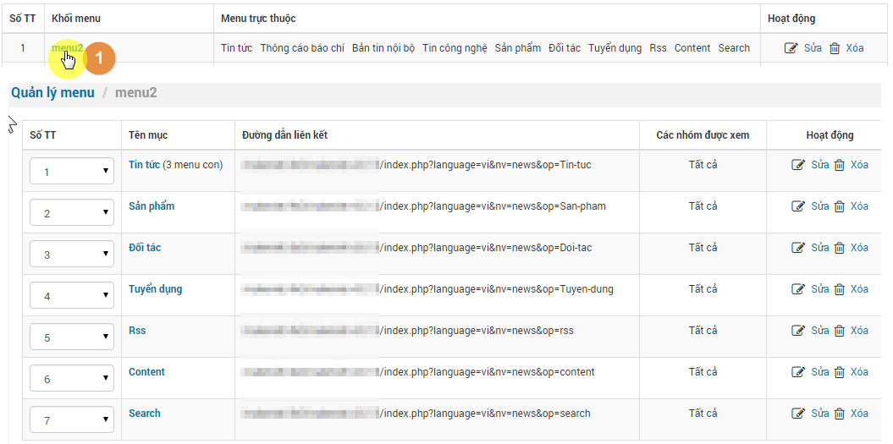
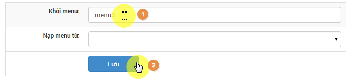
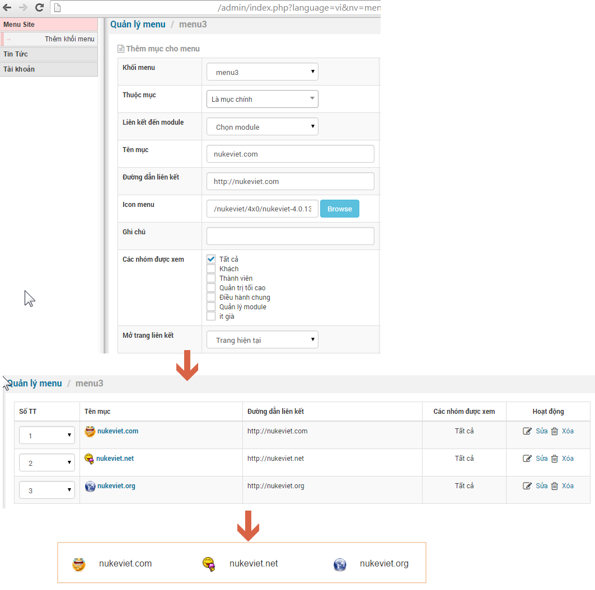
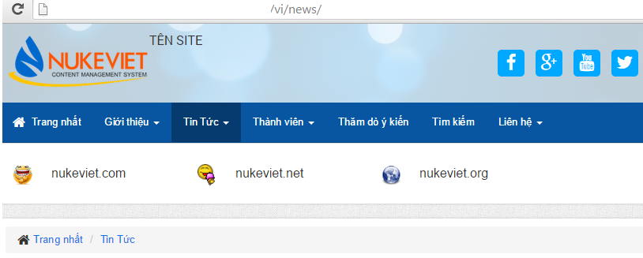
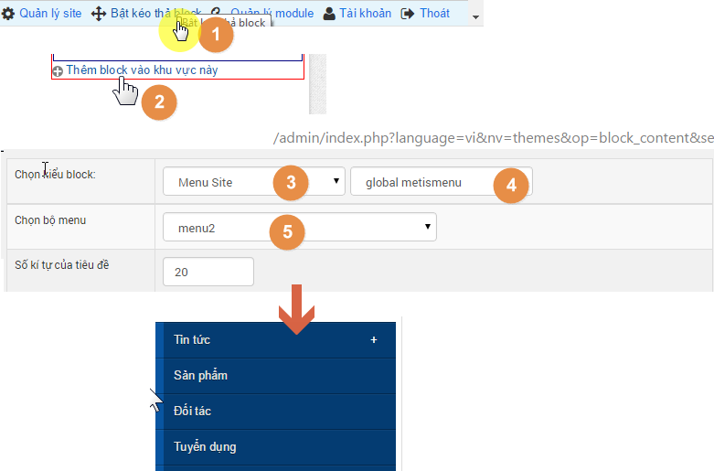
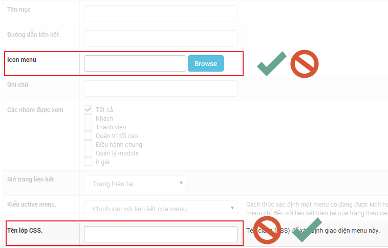
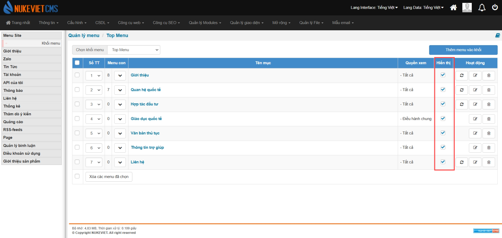

.

## Lấy menu tự động từ tên các chuyên mục, module

## Xem & sửa khối

## Tạo menu tự do

  

## Hiển thị khối menu lên website

## Thêm icon vào đầu các tiêu đề menu

*Có 2 cách:*

1.  upload icon
2.  thêm class

*Bạn chỉ nên chọn 1 trong 2 cách* 

*Cho dù cách nào thì người dùng cũng phải biết chút kiến thức về code thì menu mới hiển thị như ý muốn.*

### Phiên bản 4.5.06

- Giao diện tương tự phiên bản 4.6.0

### Phiên bản 4.6.0

Giao diện quản lý Menu thay đổi

- Bỏ cột *‘Đường dẫn liên kết’*
- Thêm cột *‘Hiển thị’*

