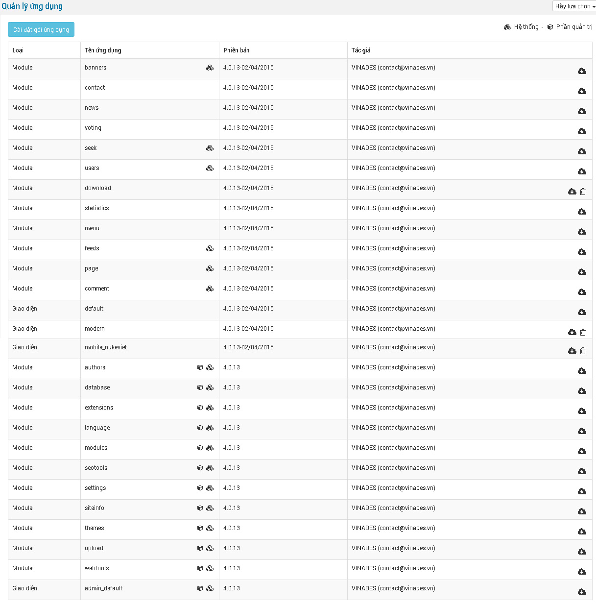

Để mở mục này bạn vào phần: **Mở rộng/Quản lý ứng dụng**

\- Bấm Cài đặt gói ứng dụng: Chọn ứng dụng mà bạn muốn cài đặt, sau đó bấm Tải lên

\- Bạn muốn đóng gói ứng dụng thì bấm vào mũi tên xuống trong đám mấy ở bên lề phải để thực hiện

