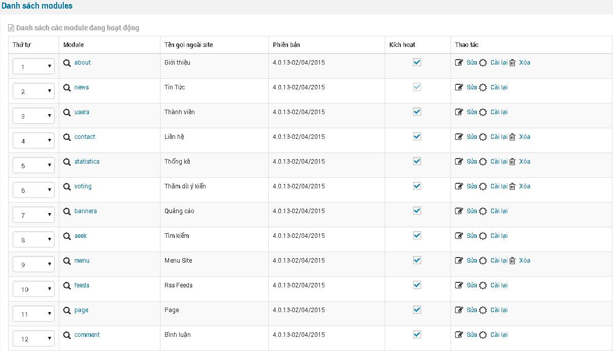
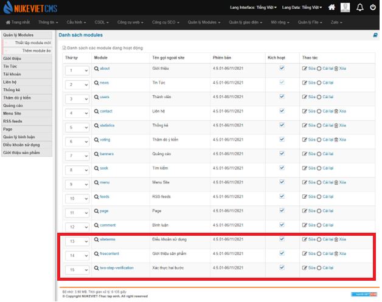

Danh sách các module mặc định của Nuke Việt 4.x

\- Trong những module này nếu bạn thấy module nào không dùng đến có thể bấm **Xoá** để loại bỏ nó.

\- Nếu bạn muốn xoá dữ liệu mặc định của module hãy bấm cài lại để thực hiện việc này.

\- Tất cả module được lưu tại thư mục nukeviet/modules/ \* Note: So với bản 4.0, Nukeviet 4.5 có thêm 3 modules mặc định là siteterms, freecontent và two-step-vertification. 
