## Quản lý chuyên mục

Chú ý: khi thêm chuyên mục, ngoài việc viết Tiêu đề, bạn nên viết đầy đủ các thông tin như Tùy chỉnh Tiêu đề site, Từ khóa, Miêu tả, Hình minh họa, Nội dung chi tiết. Điều đó rất cần thiết cho SEO. 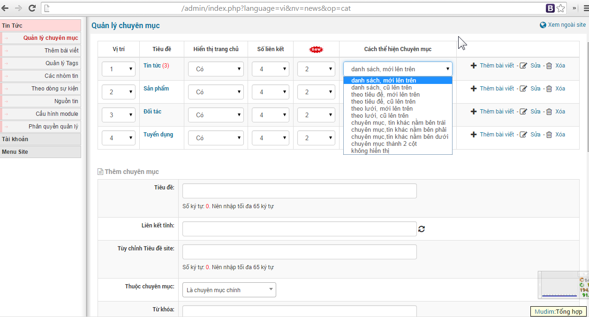

**So với phiên bản NukeViet 4 thì từ phiên bản NukeViet 4.5.01 đến phiên bản NukeViet 4.5.06 đã có một số thay đổi:**

\- Có một số thay đổi nhỏ về thứ tự sắp xếp các mục và icon

\- Cột "Hiển thị trang chủ" được thay thế bởi cột "Trạng thái"

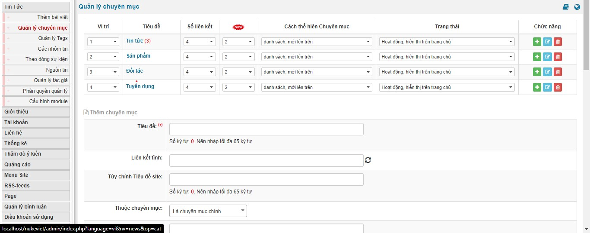

Giải thích các thông số trong phần quản lý chuyên mục 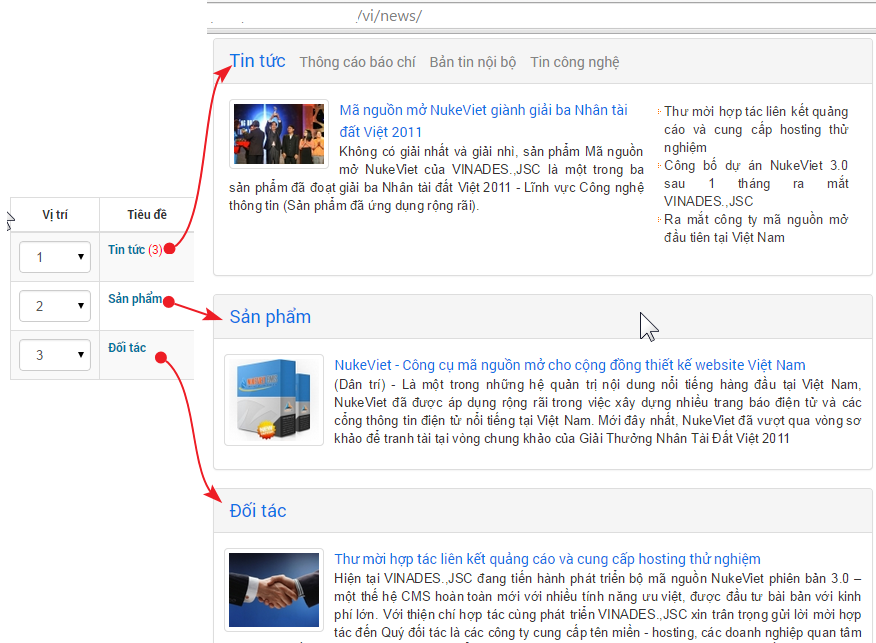

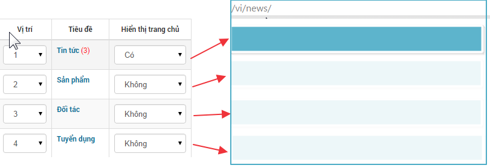

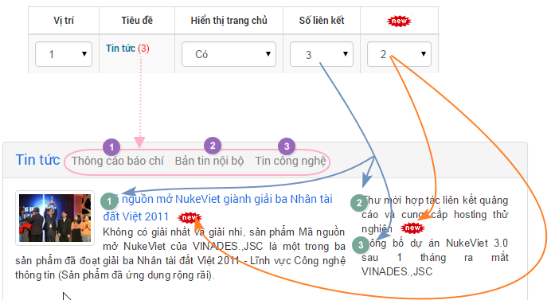

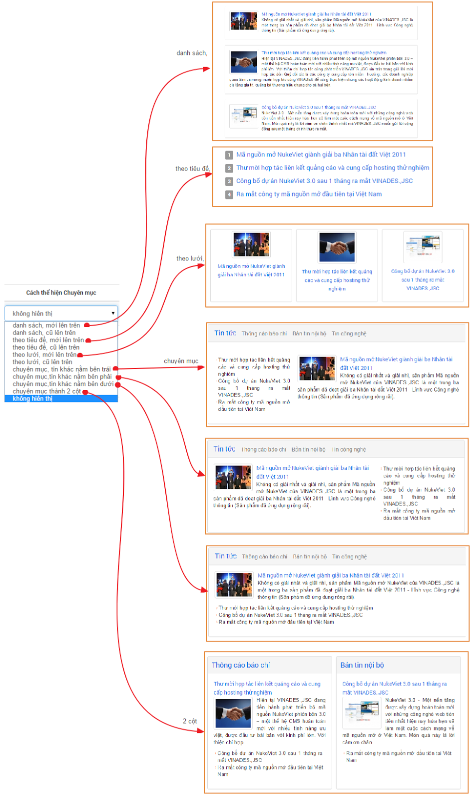

## Thêm bài viêt

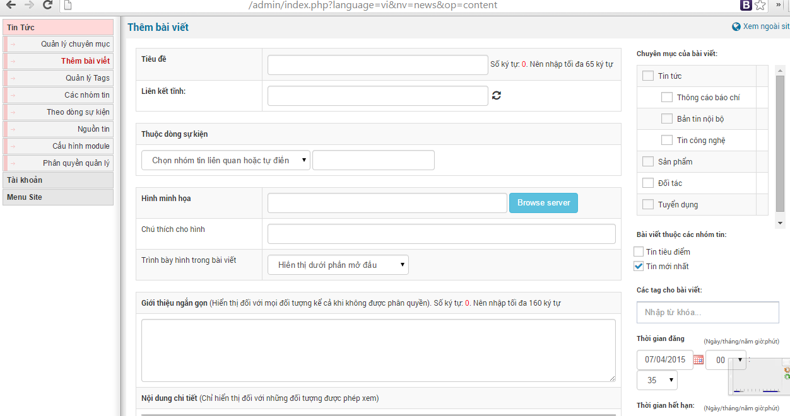

## Sửa chữa, xóa tin tức

Sửa xóa tin là tính năng quan trọng trong quá trình đăng tin

- Sửa tin dùng mục đích sửa lại nội dung tin hoặc điều chỉnh cho vấn đề seo bài viết.
- Xóa tin là xóa vĩnh viễn bài viết vì một lý do nào đó.

Để xóa tin thì khi bạn truy cập module tin tức nó hiển thị ra danh sách các tin và bạn bấm tùy chọn sửa hoặc xóa tin như ở hình sau.

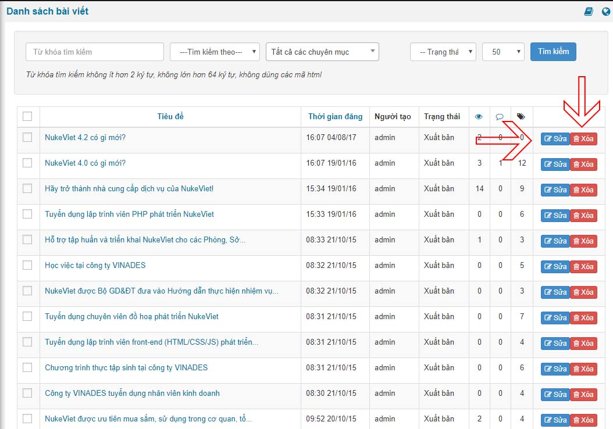

## Quản lý tags

Quản lý tags là các từ khóa khi bạn điền trong phần thêm bài viết mới hoặc bạn cũng có thể thêm mới trong phần quản lý tags

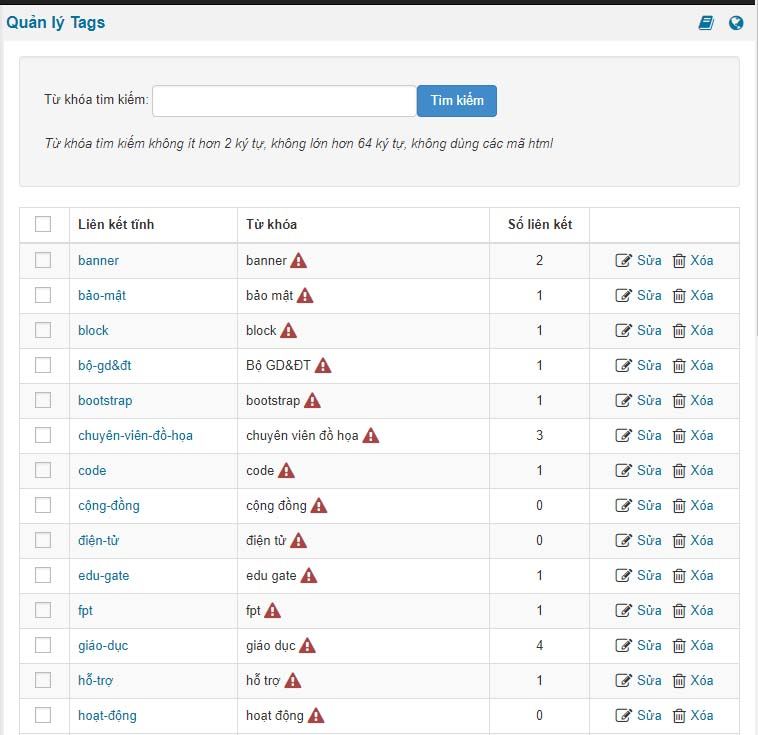

Để thêm tags mới bạn điền vào form dạng như hình sau

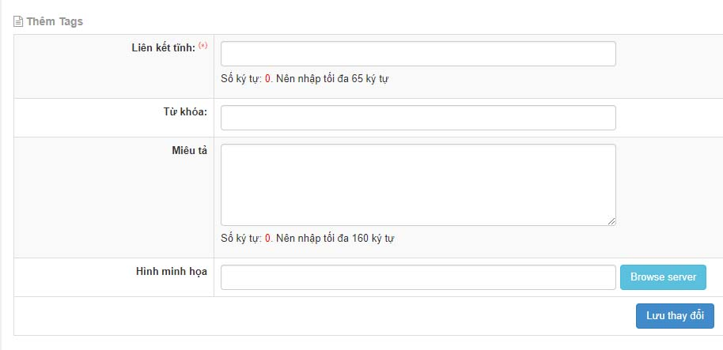

## Các nhóm tin

- Sắp xếp thứ tự nhóm tin
- Kích hoạt mặc định nhóm tin nào có ngay trong phần tích chọn nhóm
- Số liên kết
- Chức năng sửa xóa
- Thêm mới nhóm tin

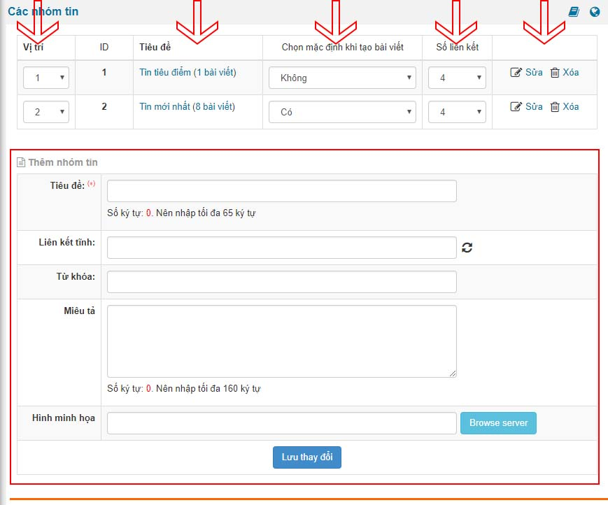

## Theo dòng sự kiện

Theo dòng sự kiện giống như các nhóm tin giúp tạo nhóm riêng cho các block truy vấn dữ liệu tùy chọn theo ý của bạn.

- Sắp xếp lại vị trí.
- Chức năng sửa xóa.
- Thêm mới dòng sự kiện

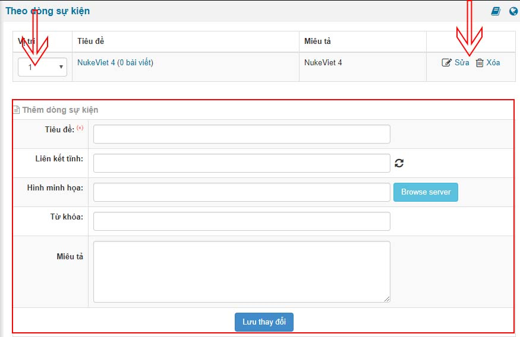

## Nguồn tin

Nguồn tin giúp khi bạn đăng bài viết xác định nguồn tin cho từng bài viết từ link nguồn bài viết nó sẽ hiển thị ra nguồn tin phù hợp

Để thêm sửa xóa bạn truy cập vào "Nguồn tin" trong module news (module tin tức)

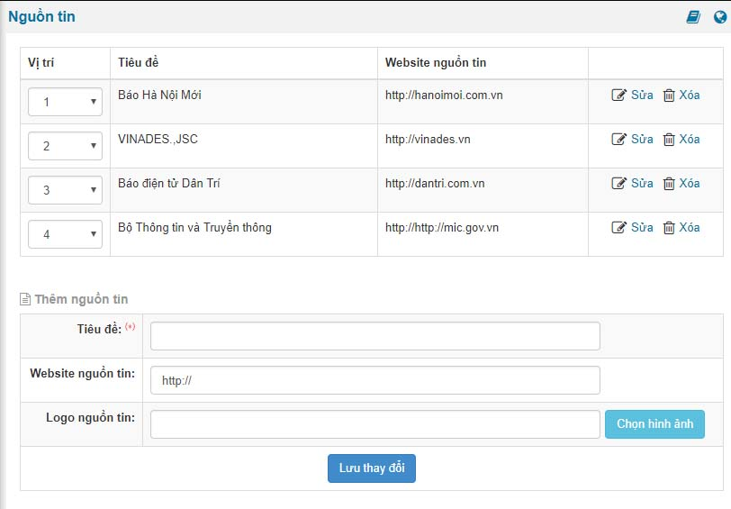

## Quản lý tác giả

Thêm tác giả để quản lí trong module tin tức

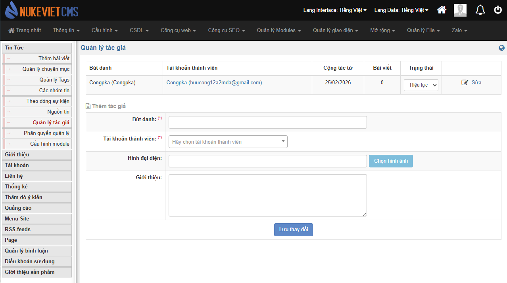

## Phân quyền quản lý

\- Danh sách các tài khoản đã được quản lý Module Tin tức 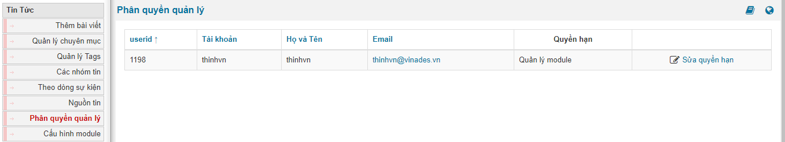 - Sửa quyền hạn của 1 thành viên bất kỳ

- **Quyền quản lý chuyên mục**: Cho phép thành viên đó chỉ được đăng bài viết hoặc sửa, xóa bài viết trong chuyên mục được chọn.
- **Quyền quản lý module**: Cho phép thành viên đó có toàn quyền với module Tin tức. Tức là được phép thêm, sửa, xóa bài viết.
- **Toàn quyền module**: Cho phép thành viên toàn quyền với module Tin tức. Tức là được phép thêm chuyên mục cũng như sửa xóa các bài viết của các thành viên khác.

## Cấu hình module

Phần cấu hình module bạn có các thiết lập dành cho

1.  Cấu hình hiển thị: cách trình bày ngoài site và các tính năng phụ trợ cho hiển thị.
2.  Cấu hình đăng bài
3.  Cấu hình sử dụng máy chủ tìm kiếm Elasticseach
4.  Cấu hình bài viết tức thời: dành cho facebook
5.  Cấu hình đăng bài viết tại trang người dùng

*Nếu còn điều gì chưa rõ, bạn có thể xem thêm phần [Hướng dẫn quản trị module Tin tức](/nukeviet/admin/news)*

### Phiên bản NukeViet 4.5.06

- Giao diện tương tự phiên bản 4.6.0

### Phiên bản NukeViet 4.6.0

- Giao diện thay đổi
- Có thêm mục ‘Quản lý tác giả’ và ‘Báo cáo lỗi’

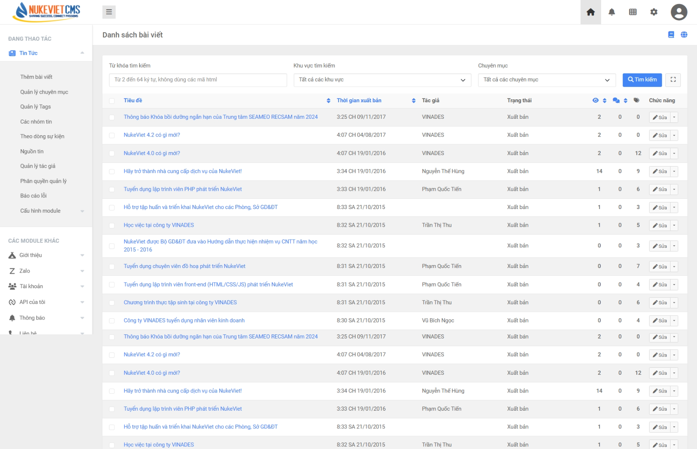 **Mục Quản lý tags:**

- Giao diện thay đổi
- Cột *‘Số liên kết’* được ghép cùng vào cột *‘Sửa’, ‘Xóa’* và có thể thể bấm vào xem được số liên kết
- Có thêm các tùy chọn như *‘Tất cả tags’, ‘Tags có mô tả’, ‘Tags chưa có mô tả’, ‘Thêm tags’, ‘Thêm nhiều tags*’

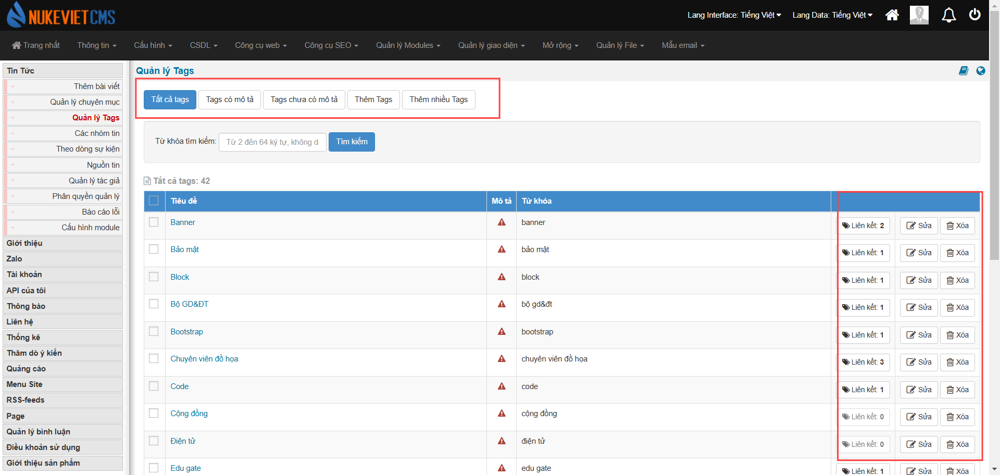
