Để theo dõi được số lượng truy cập vào website và các thông tin đã được index lên Google thì không thể thiếu Google Analytics và Google Webmasters. Hai công cụ không thể thiếu đối với bất cứ một webmaster nào.

Sau đây là hưỡng dẫn tích hợp Google Analytics và Webmasters vào website sử dụng bộ mã nguồn NukeViet của bạn.

# Google Analytics

## Bước 1: Đăng nhập Google Analytics

Đăng nhập trang quản trị [Google Analytics](http://www.google.com/analytics/), giao diện Google Analytics như sau:

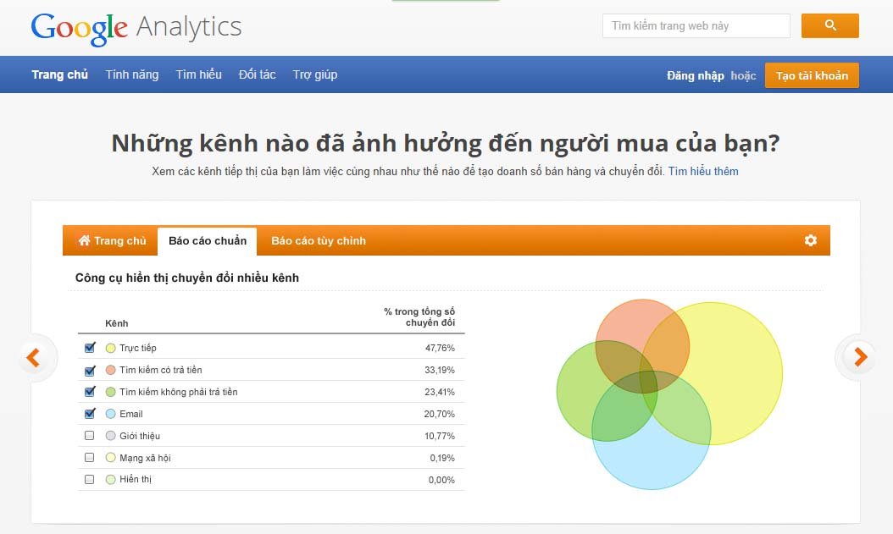

\- Bạn click vào dòng chữ "Đăng nhập" nếu bạn đã có tài khoản gmail của google. Trong trường hợp bạn chưa có thì bạn tiến hành tạo tài khoản để tạo tài khoản gmail.

\- Nếu tài khoản của bạn lần đầu tiên sử dụng thì trạng thái trang quản trị Google Analytics như sau:

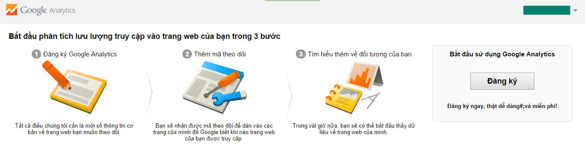

**Ghi chú:** Trường hợp bạn đang sử dụng Google Analytics, trạng thái trang quản trị sẽ là danh sách các website bạn đã add vào Google Analytics.

## Bước 2: Đăng ký website để sử dụng Google Analytics

\- Bạn tiến hành click vào nút "Đăng ký". Sau khi bạn click, Google sẽ chuyển bạn về form đăng ký đẻ nhận ID theo dõi và điền đầy đủ thông tin và đọc các điều khoản sử dụng của Google Analytics như hình sau

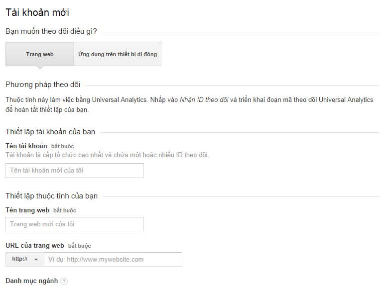

\- Bạn kéo chuột xuống cuối trang click vào nút "Nhận ID theo dõi" và tiến hành click vào nút "Tôi chấp nhận" của bảng thông báo "Thỏa thuận điều khoản dịch vụ của Google Analytics"

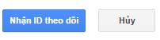

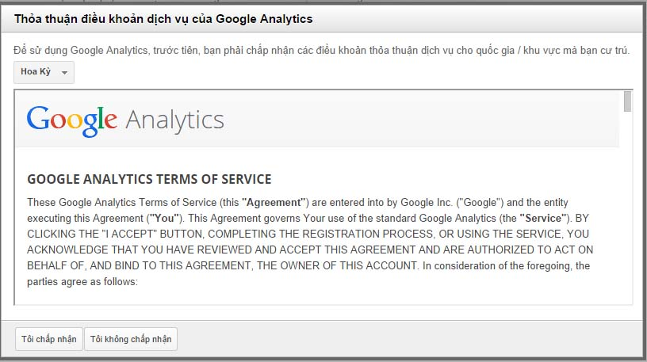

\- Sau khi thực hiện các bước trên bạn sẽ được "ID theo dõi".

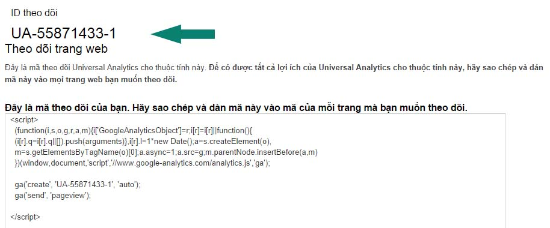

## Bước 3: Add "ID theo dõi" vào website

\- Click "Công cụ web" ở menu ngang

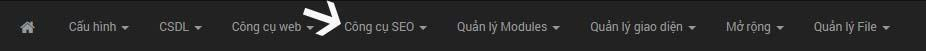

\- Sau khi click sẽ hiển thị danh sách menu chức năng của "Công cụ web". Bạn tiến hành click vào "Cấu hình thống kê" và điền thông tin "ID theo dõi" của Google mà bạn vừa tạo vào form "ID tài khoản Google Analytics" và tiến hành click "Thực hiện" để lưu lại như hình sau:

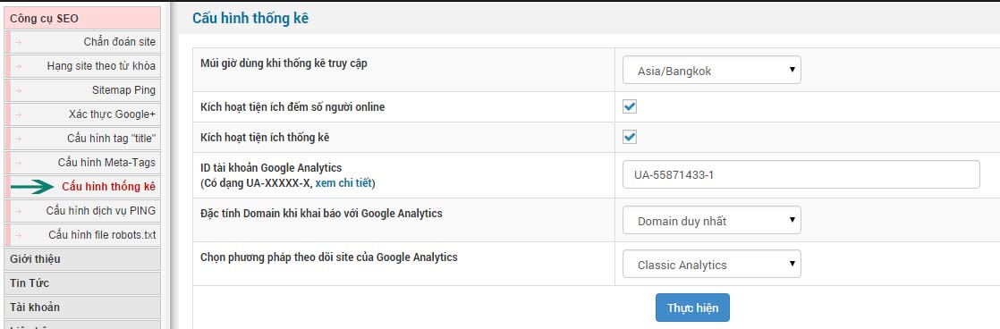

**Ghi chú:** ngoài ra bạn cần phải chỉnh múi giờ phù hợp với múi giờ bạn đang sinh sống và các thông tin khác.

# Google Webmaster

## Bước 1: Đăng ký

Đăng nhập công cụ [Gooogle Webmasters](http://www.google.com/webmasters/)

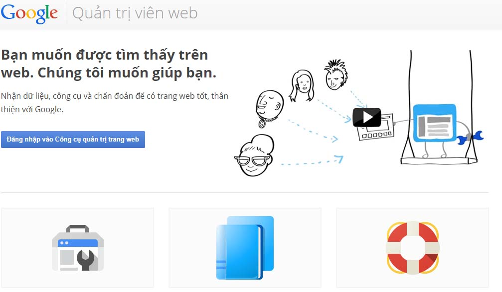

\- Bạn sử dụng tài khoản mà bạn vừa đăng ký Google Analytics để tiến hành đăng nhập Google Webmasters hoặc là một tài khoản gmail khác. (Tốt nhất là dùng chung tài khoản gmail cho 2 dịch vụ này để thuận tiện cho việc SEO web của bạn).

\- Nếu tài khoản gmail của bạn sử dụng lần đầu tiên thì giao diện trang web như hình sau, trường hợp bạn đang sử dụng Google Webmaster thì sẽ hiển thị danh sách các website mà bạn đã thêm vào.

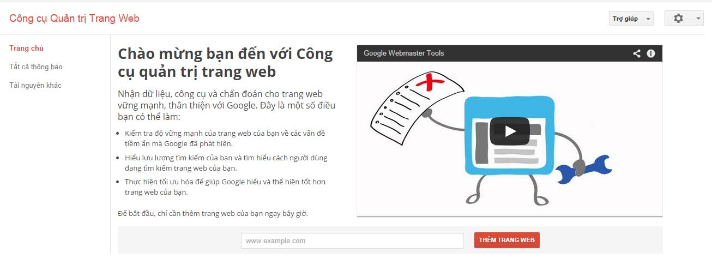

\- Như hình trên bạn tiến hành điền trang web của bạn vào form "www.example.com" và tiến hành click nút "Thêm trang web"

## Bước 2: Xác minh trang web

- Có rất nhiều lựa chọn để bạn xác minh website của bạn với hệ thống Google Webmaster bao gồm: Phương thức khuyến nghị và Phương thức thay thế
- Nếu bạn sử dụng và toàn quyền sử dụng code được xây dựng bằng NukeViet và toàn quyền hosting thì bạn nên dử dụng "Phương thức khuyến nghị". Phương thức này có ưu điểm là bạn không bị quên bạn thay đổi gì đó trong quản trị website.
- Nếu bạn không phải là người quản trị hosting mà chỉ là người quản trị trên website hoặc sử dụng dịch vụ NukeViet SaaS thì bạn sử dụng "Phương thức thay thế" là tốt nhất.

1.  Đối với "Phương thức khuyến nghị" bạn chỉ cần upload file do google cung cấp lên ngang hàng với thư mục admin và tiến hành xác minh là được
2.  Đối với "Phương thức thay thế" bạn có 4 lựa chọn: Thẻ HTML, Nhà cung cấp tên miền, Google Analytics, Trình quản lý thẻ của Google. Phương thức xac minh này thường được xác minh bằng thẻ HTML và Google Analytics, 2 phương thức còn lại phức tạp và liên quan đến máy chủ vvv...

### Thẻ HTML

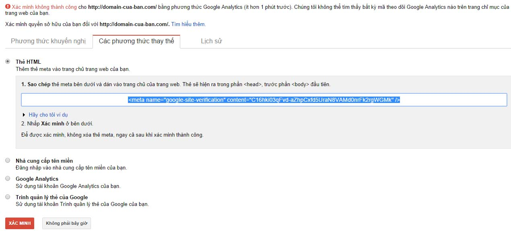

\- Bạn lấy các dữ liệu cần thiết như ví dụ sau:

\+ Đây là ví dụ về thẻ html khi bạn được Google Webmasters cung cấp

**\<meta name="google-site-verification" content="C16hki03qFvd-aZhpCxfd5UraN8VAMd0nrFk2rgWGMk" /\>**

\+ Bạn sẽ lấy các thông số như sau:

- Name: **google-site-verification**
- Content: **C16hki03qFvd-aZhpCxfd5UraN8VAMd0nrFk2rgWGMk**

\+ Bạn vào phần "Cấu hình Meta-Tags" của menu "Công cụ SEO" và điền các thông số và click nút "Thực hiện" để lưu lại như hình sau:

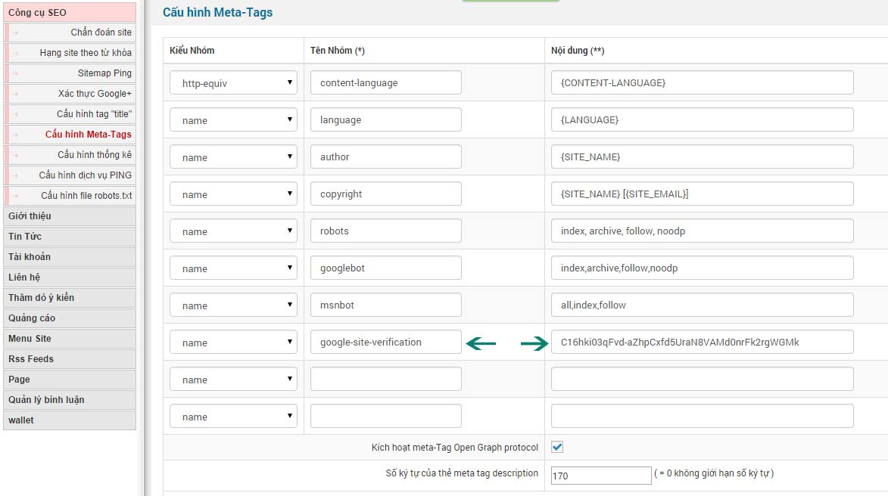

\+ Tiếp theo: bạn quay trở lại Google Webmaster và tiến hành "Xác minh", kết quả sau khi xác minh mà Google trả về như hình sau:

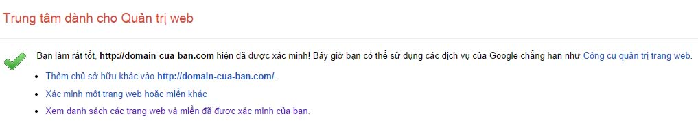

\+ Để website của bạn được index đầy đủ lên Google, bạn tiến hành quay trở về trang quản trị Google Webmasters. Tại đây, website của bạn vừa mới được thêm vào sẽ được hiển thị và bạn click vào website đó. Tiếp đến click vào "sơ đồ trang web". Sau khi click xuất hiện nút "Thêm/kiểm tra sơ đồ trang web", bạn click vào nút đó và tiến hành gửi sơ đồ trang web. Cấu trúc sitemap của NukeViet có định dạng như sau: [http://domain-cua-ban.com/Sitemap.xml](http://domain-cua-ban.com/Sitemap.xml), bạn chỉ cần điền là Sitemap.xml và click "Gửi sơ đồ trang web" là bạn đã làm chủ được công cụ của Google.

### Phiên bản NukeViet 4.6.0

- Mục *‘Chẩn đoán site’* bị loại bỏ
- Có thêm mục *‘Các công cụ SEO khác’*
- Không còn xác thực Google+ nữa

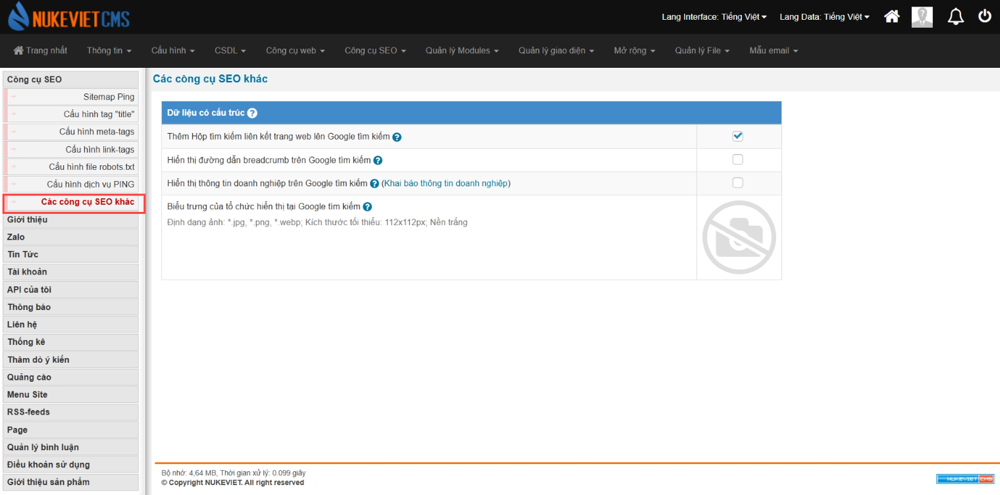
