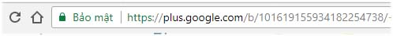
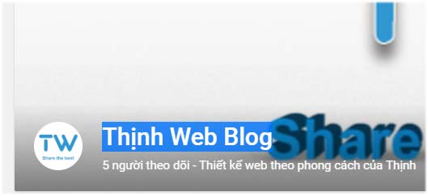

Ghi chú:

- Google đã thông báo Hủy bỏ tất cả tích hợp web Google+ từ ngày vào ngày 07 tháng 3 năm 2019
- Từ NukeViet 4.3.05 cũng đã bỏ tính năng này

Xác thực Google Plus dùng trong vấn đề seo và bản quyền bài viết được share lên môi trường internet cũng như dùng vào nhiều vấn đề khác nhau.

Để xác thực thì bạn cần có ID của Google Plus như hình sau.

ID là chuối số: 101619155934182254738 tùy theo tài khoản Google Plus của bạn.

Tên tài khoản Profile Google Plus

Để xác thực bạn làm như sau

1.  Đăng nhập trang quản trị
2.  Truy cập phần "Công cụ SEO"
3.  Chọn "Xác thực Google+".
4.  Tại đây thì điền ID có dạng như hình trên và Profile là tên như trên. Ví dụ: Thinh Web Blog và ID là: 101619155934182254738
5.  Điền xong bấm nút "Xác thực" là xong
