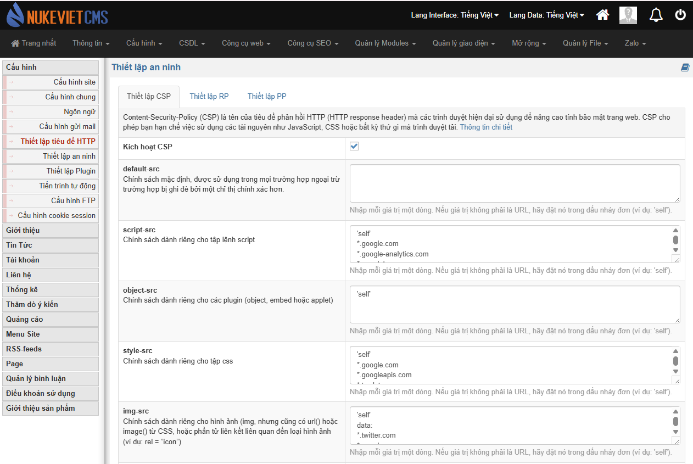
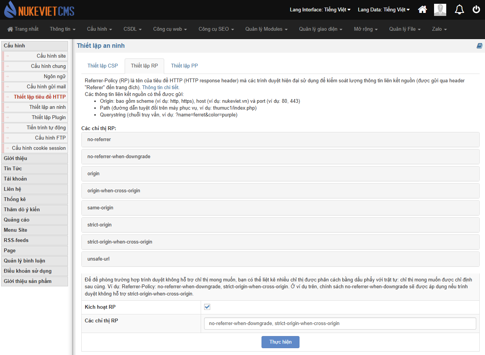
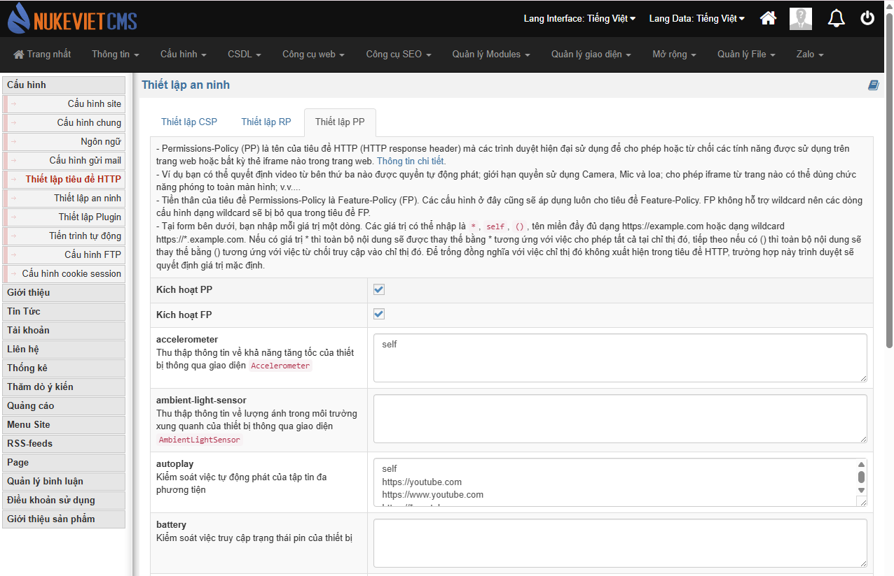

 Content-Security-Policy (CSP) là tên của tiêu đề phản hồi HTTP (HTTP response header) mà các trình duyệt hiện đại sử dụng để nâng cao tính bảo mật trang web. CSP cho phép bạn hạn chế việc sử dụng các tài nguyên như JavaScript, CSS hoặc bất kỳ thứ gì mà trình duyệt tải.

# Thiết lập RP

 Referrer-Policy (RP) là tên của tiêu đề HTTP (HTTP response header) mà các trình duyệt hiện đại sử dụng để kiểm soát lượng thông tin liên kết nguồn (được gửi qua header "Referer" đến trang đích). Các thông tin liên kết nguồn có thể được gửi:

- Origin: bao gồm scheme (ví dụ: http, https), host (ví dụ: nukeviet.vn) và port (ví dụ: 80, 443)
- Path (đường dẫn tuyệt đối trên máy phục vụ, ví dụ: thumuc1/index.php)
- Querystring (chuỗi truy vấn, ví dụ: ?name=ferret&color=purple)

# Thiết lập PP

- Permissions-Policy (PP) là tên của tiêu đề HTTP (HTTP response header) mà các trình duyệt hiện đại sử dụng để cho phép hoặc từ chối các tính năng được sử dụng trên trang web hoặc bất kỳ thẻ iframe nào trong trang web.
- Ví dụ bạn có thể quyết định video từ bên thứ ba nào được quyền tự động phát; giới hạn quyền sử dụng Camera, Mic và loa; cho phép iframe từ trang nào có thể dùng chức năng phóng to toàn màn hình; v.v....
- Tiền thân của tiêu đề Permissions-Policy là Feature-Policy (FP). Các cấu hình ở đây cũng sẽ áp dụng luôn cho tiêu đề Feature-Policy. FP không hỗ trợ wildcard nên các dòng cấu hình dạng wildcard sẽ bị bỏ qua trong tiêu đề FP.
- Tại form bên dưới, bạn nhập mỗi giá trị một dòng. Các giá trị có thể nhập là \*, self, (), tên miền đầy đủ dạng [https://example.com](https://example.com) hoặc dạng wildcard \<https://>\*.example.com. Nếu có giá trị \* thì toàn bộ nội dung sẽ được thay thế bằng \* tương ứng với việc cho phép tất cả tại chỉ thị đó, tiếp theo nếu có () thì toàn bộ nội dung sẽ thay thế bằng () tương ứng với việc từ chối truy cập vào chỉ thị đó. Để trống đồng nghĩa với việc chỉ thị đó không xuất hiện trong tiêu đề HTTP, trường hợp này trình duyệt sẽ quyết định giá trị mặc định.
