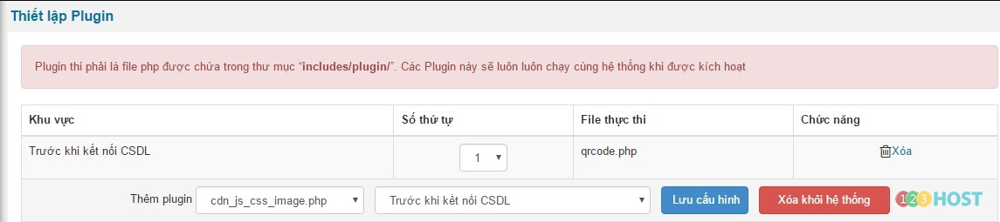
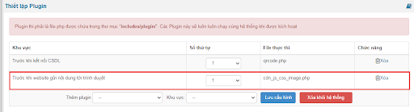
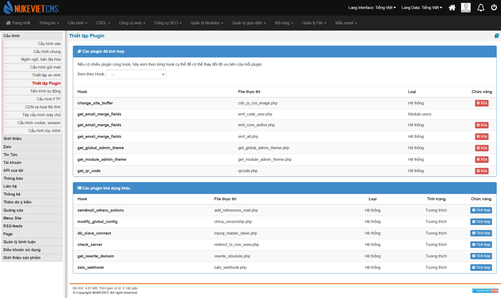

Plugin thi phải là file php được chứa trong thư mục “includes/plugin/”. Các Plugin này sẽ luôn luôn chạy cùng hệ thống khi được kích hoạt

Đăng nhập khu vực quản trị với quyền quản trị tối cao (ACP)/Cấu hình/Thiết lập plugin



Bước 1: Tại mục Thêm plugin, từ danh sách (1), chọn plugin muốn thêm

Bước 2: Bên cạch Thêm plugin, từ danh sách (2), chọn vị trí mà plugin sẽ được kích họat (Với phiên bản NukeViet 4.3 trở đi, người lập trình cần khai báo vị trí plugin chạy trong file ini)

- Trước khi kết nối CSDL: Plugin sẽ được kích họat trước khi hệ thống kết nối với CSDL. Nên plugin này sẽ không xử lý những gì liên quan đến CSDL.
- Trước khi gọi các module: Plugin sẽ được kích họat sau khi kết nối CSDL, và trước khi hệ thống đọc dữ liệu từ các module.
- Sau khi gọi các module: Plugin sẽ được kích họat sau khi thực hiện xong các module
- Trước khi website gửi nội dung tới trình duyệt: Plugin được kích họat sau khi hệ thống đã xử lý xong phần dữ liệu, và trước khi nội dung đựoc hiển thị ra trình duyệt.

Phiên bản NukeViet 4.5.01 có thêm file **cdn_js_css_image.php**:



**Ghi chú khi lập trình**

Với phiên bản NukeViet 4.3 trở đi, Với mối plugin thêm 1 file .ini để khai báo vị trí cho phép cấu hình.

Ví dụ cdn_js_css_image.php sẽ có file cdn_js_css_image.ini với nội dung

``` text
<?xml version="1.0" encoding="utf-8"?>
<plugin>
    <info>
        <name>Plugin cdn_js_css_image</name>
        <author>Vũ Thảo</author>
        <website>http://nukeviet.vn</website>
        <description></description>
    </info>
    <positions>
     <position>
         <id>3</id>
         <note>Trước khi website gửi nội dung tới trình duyệt</note>
    </position>             
    </positions>
</plugin>
```

Nếu plugin chạy được nhiều vị trí thì sẽ có nhiều position, trong position chỉ bắt buộc có id, note chỉ có để ghi chú.

Với NukeViet 4.3.01 Nếu cần hướng dẫn cụ thể ghì khi cấu hình trong quản trị cần cập nhật hướng dẫn vào phần description của file ini.

### Phiên bản NukeViet 4.6.0

- Giao diện thay đổi: Nút *‘Lưu cấu hình’*, dropbox *‘thêm plugin’* và *‘khu vực’* bị loại bỏ


