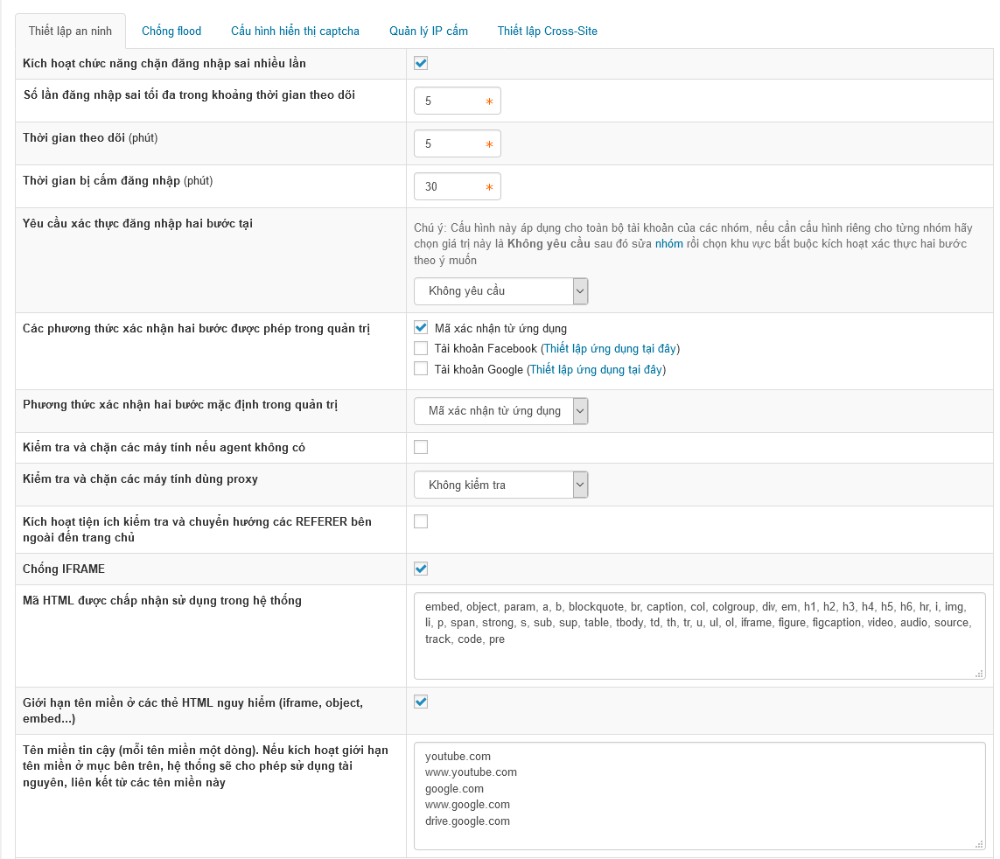

Đăng nhập tài khoản quản trị tối cao **Cấu hình**/**Thiết lập an ninh** 

- Kích hoạt chức năng chặn đăng nhập sai nhiều lần: Kích hoạt việc chặn người dùng đăng nhập sai nhiều lần vào trang quản trị
- Số lần đăng nhập sai tối đa trong khoảng thời gian theo dõi: Cài đặt số lần tối đa một người dùng được đăng nhập sai bao nhiêu lần khi đăng nhập vào trang quản trị
- Thời gian theo dõi (phút): Thời gian theo dõi việc đang đăng nhập của người dùng
- Thời gian bị cấm đăng nhập (phút): Thời gian cấm đăng nhập khi người dùng đăng nhập sai quá số lần cho phép
- Yêu cầu xác thực đăng nhập hai bước tại: Cho phép bật xác thực hai bước tại trang nào website. Khi người dùng đăng nhập buộc phải nhập thêm mã xác thực
- Các phương thức xác nhận hai bước được phép trong quản trị: Cho phép cấu hình thêm việc nhận xác thực 2 bước khi đăng nhập bằng facebook hoặc google
- Kiểm tra và chặn các máy tính nếu agent không có: Mỗi user kết nối đến máy chủ sẽ có một user agent, vì lý do nào đó trên đường truyền đi user bị mất trường user agent khi kết nối đến server sẽ bị lỗi:

We're sorry. The software you are using to access our website is not allowed. Some examples of this are e-mail harvesting programs and programs that will copy websites to your hard drive. If you feel you have gotten this message in error, please send an e-mail addressed to admin. \<Your I.P. address\> has been logged. Thanks.

- Kiểm tra và chặn các máy tính dùng proxy: Là phương thức ẩn danh truy cập trên internet. những máy dùng proxy sẽ bị chặn
- Kích hoạt tiện ích kiểm tra và chuyển hướng các REFERER bên ngoài đến trang chủ: Khi người dùng click vào 1 link liên kết trên site của bạn thông qua việc tìm kiếm google hoặc khác, thì đều dẫn đến trang chủ
- Chống IFRAME: iframe được sử dụng nhiều trong phương thức tấn công ddos, bật chức năng này sẽ giúp chèn thêm đoạn mã sau giúp chống hình thức ddos qua iframe
- Mã HTML được chấp nhận sử dụng trong hệ thống: Cho phép các mã HTML được sử dụng trong hệ thống
- Tên miền tin cậy (mỗi tên miền một dòng). Nếu kích hoạt giới hạn tên miền ở mục bên trên, hệ thống sẽ cho phép sử dụng tài nguyên, liên kết từ các tên miền này: Cho phép sử dụng tài nguyên liên kết từ các tên miền này
