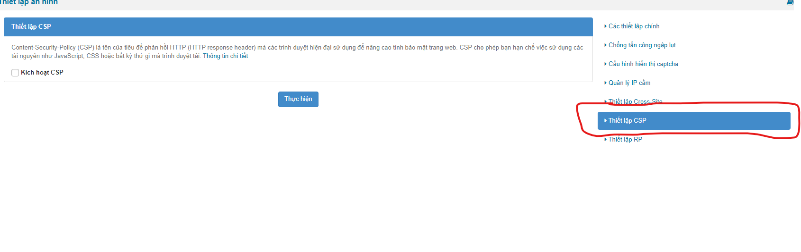
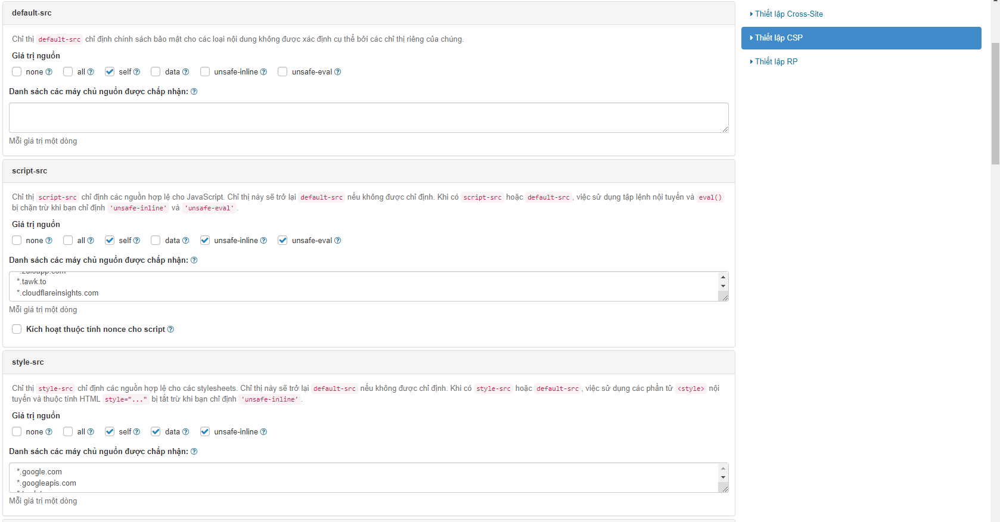
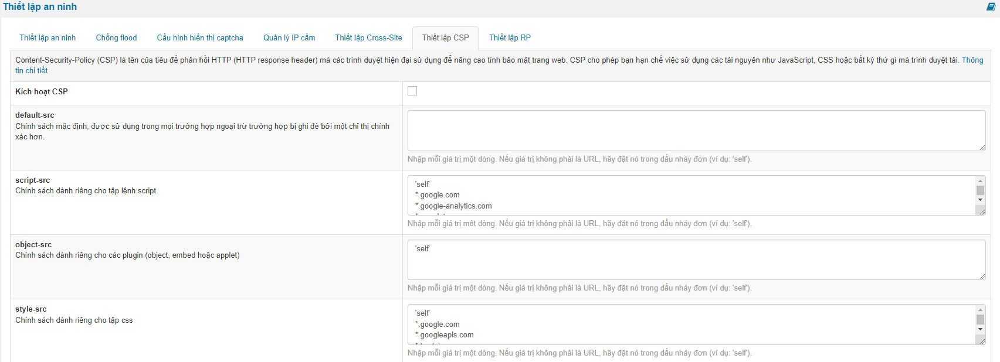
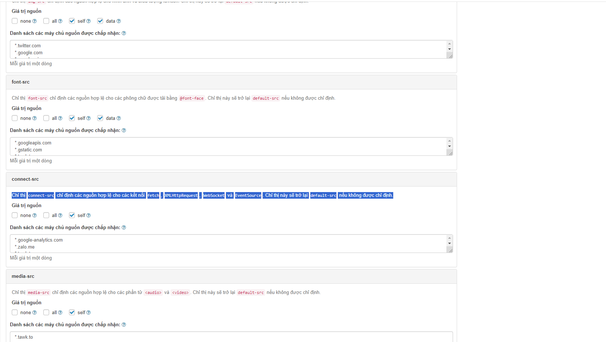
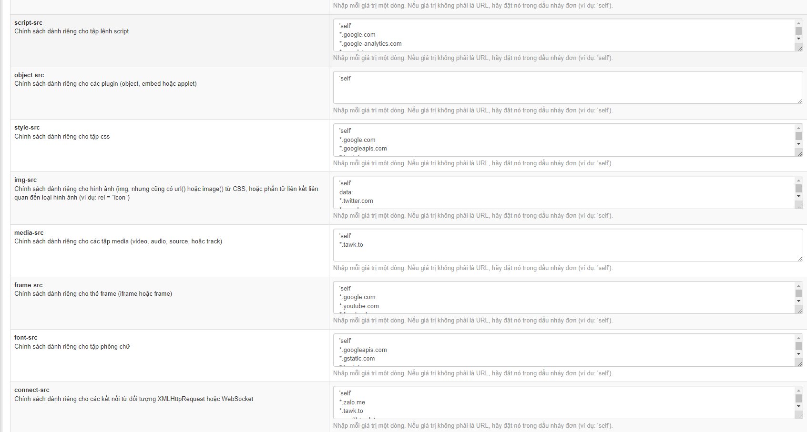
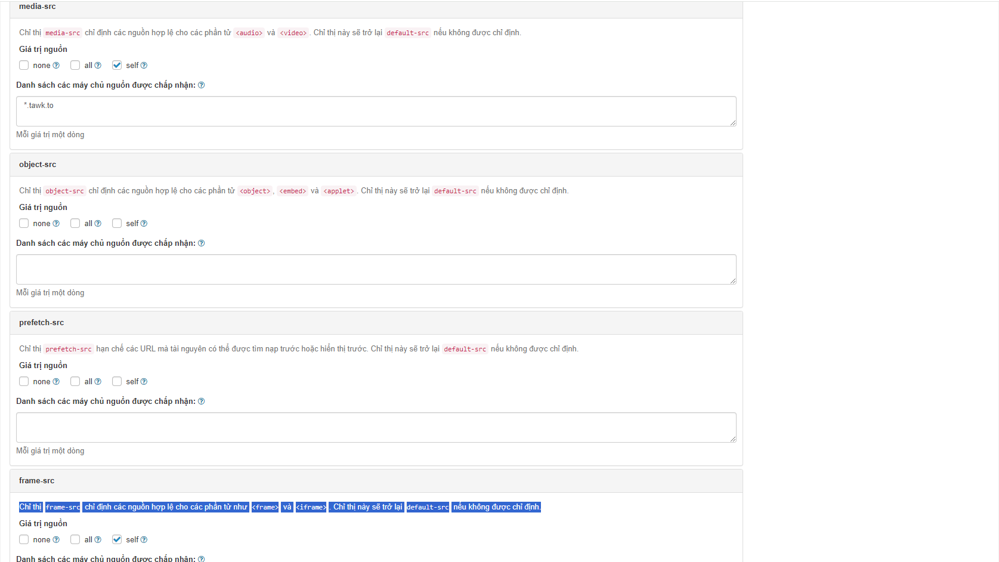
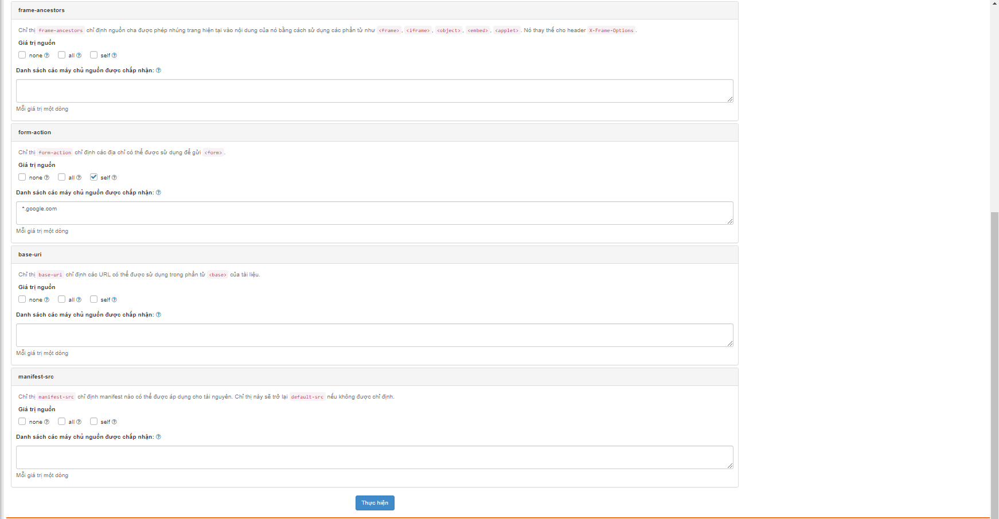
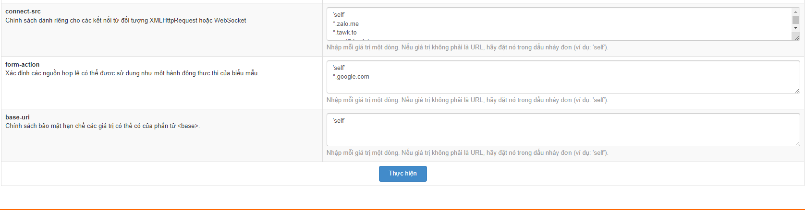

Content-Security-Policy (CSP) là một công cụ mạnh mẽ giúp ngăn chặn các loại tấn công như Cross-Site Scripting (XSS) và Data Injection bằng cách cung cấp một cách để các trang web xác định nguồn nào (domains, endpoints) là đáng tin cậy cho việc tải các tài nguyên như JavaScript, CSS, hình ảnh, v.v.



``` text
                              Ảnh: Trích ra từ nukeviet 4.6
```

Mặc định nukeviet sẽ tắt kích hoạt CSP nhưng người quản trị có thể bật tắt kích hoạt CSP

Khi kích hoạt CSP thì sẽ giúp tăng cường bảo mật và ngăn chặn các loại tấn công, đặc biệt là Cross-Site Scripting (XSS)

Các chỉ thị khi kích hoặt csp được bật:

**default-src**: Chỉ định chính sách mặc định cho các loại tài nguyên không được chỉ định bởi các chỉ thị riêng lẻ.

**script-src**: Chỉ thị script-src chỉ định các nguồn hợp lệ cho JavaScript. Chỉ thị này sẽ trở lại default-src nếu không được chỉ định. Khi có script-src hoặc default-src, việc sử dụng tập lệnh nội tuyến và eval() bị chặn trừ khi bạn chỉ định 'unsafe-inline' và 'unsafe-eval'.

**style-src**: Chỉ thị style-src chỉ định các nguồn hợp lệ cho các stylesheets. Chỉ thị này sẽ trở lại default-src nếu không được chỉ định. Khi có style-src hoặc default-src, việc sử dụng các phần tử \<style\> nội tuyến và thuộc tính HTML style="..." bị tắt trừ khi bạn chỉ định 'unsafe-inline'.



``` text
                              Ảnh: Trích ra từ nukeviet 4.6
```



``` text
                              Ảnh: Trích ra từ nukeviet 4.5.04
```

**img-src**: Chỉ thị img-src chỉ định các nguồn hợp lệ cho hình ảnh và biểu tượng favicon. Chỉ thị này sẽ trở lại default-src nếu không được chỉ định.

**font-src**: Chỉ thị font-src chỉ định các nguồn hợp lệ cho các phông chữ được tải bằng @font-face. Chỉ thị này sẽ trở lại default-src nếu không được chỉ định.

**connect-src**: Chỉ thị connect-src chỉ định các nguồn hợp lệ cho các kết nối fetch, XMLHttpRequest, WebSocket và EventSource. Chỉ thị này sẽ trở lại default-src nếu không được chỉ định.



``` text
                              Ảnh: Trích ra từ nukeviet 4.6
```



``` text
                              Ảnh: Trích ra từ nukeviet 4.5.04
```

**media-src**: Chỉ thị media-src chỉ định các nguồn hợp lệ cho các phần tử \<audio\> và \<video\>. Chỉ thị này sẽ trở lại default-src nếu không được chỉ định.

**object-src**: Chỉ thị object-src chỉ định các nguồn hợp lệ cho các phần tử \<object\>, \<embed\> và \<applet\>. Chỉ thị này sẽ trở lại default-src nếu không được chỉ định.

**prefetch-src**: Chỉ thị prefetch-src hạn chế các URL mà tài nguyên có thể được tìm nạp trước hoặc hiển thị trước. Chỉ thị này sẽ trở lại default-src nếu không được chỉ định.

**frame-src**: Chỉ thị frame-src chỉ định các nguồn hợp lệ cho các phần tử như \<frame\> và \<iframe\>. Chỉ thị này sẽ trở lại default-src nếu không được chỉ định.



**frame-ancestors**: Chỉ thị frame-ancestors chỉ định nguồn cha được phép nhúng trang hiện tại vào nội dung của nó bằng cách sử dụng các phần tử như \<frame\>, \<iframe\>, \<object\>, \<embed\>, \<applet\>. Nó thay thế cho header X-Frame-Options.

**form-action**: Chỉ thị form-action chỉ định các địa chỉ có thể được sử dụng để gửi \<form\>.

**base-uri**: Chỉ thị base-uri chỉ định các URL có thể được sử dụng trong phần tử \<base\> của tài liệu.

**manifest-src**: Chỉ thị manifest-src chỉ định manifest nào có thể được áp dụng cho tài nguyên. Chỉ thị này sẽ trở lại default-src nếu không được chỉ định.



``` text
                              Ảnh: Trích ra từ nukeviet 4.6
```



``` text
                              Ảnh: Trích ra từ nukeviet 4.5.04
```
