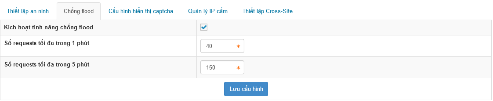
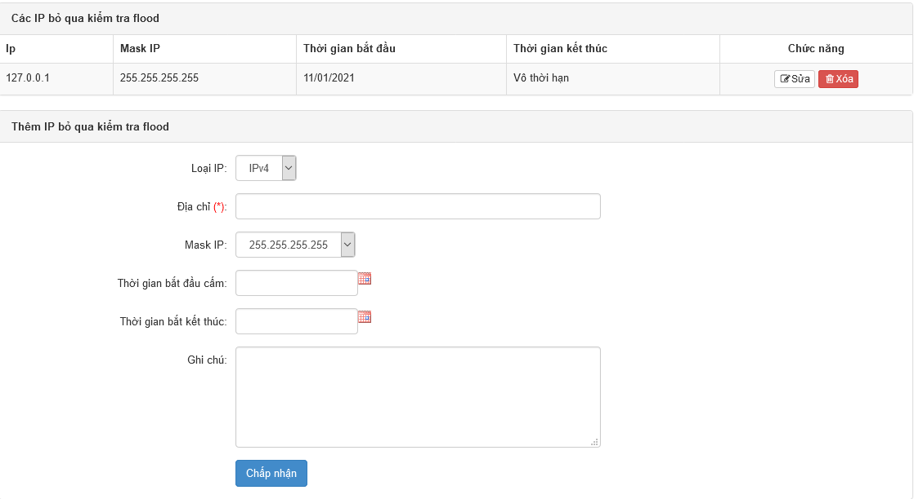

NukeViet mặc định đã kích hoạt sẵn chức năng chống flood cho website, tuy nhiên người quản trị có thể bật, tắt hoặc thay đổi cách thức chống flood riêng cho website của mình. Để bật hoặc tắt chức năng chống flood truy cập khu vực Quản trị ⇒ Cấu hình ⇒ Thiết lập an ninh

Tại ô Kích hoạt tính năng chống flood chọn hoặc bỏ chọn để bật hoặc tắt chức năng. Tại ô Số requests tối đa trong 1 phút và Số requests tối đa trong 5 phút thay đổi giá trị khác nếu muốn

Cuối cùng nhấp nút Lưu cấu hình để hoàn tất

Cấu hình từng IP để bỏ qua các IP đó ra khỏi danh sách chống flood

\- Địa chỉ: Điền IP mặc định bỏ qua chống flood
