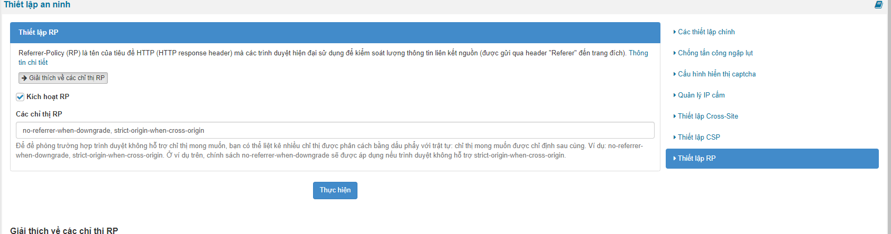
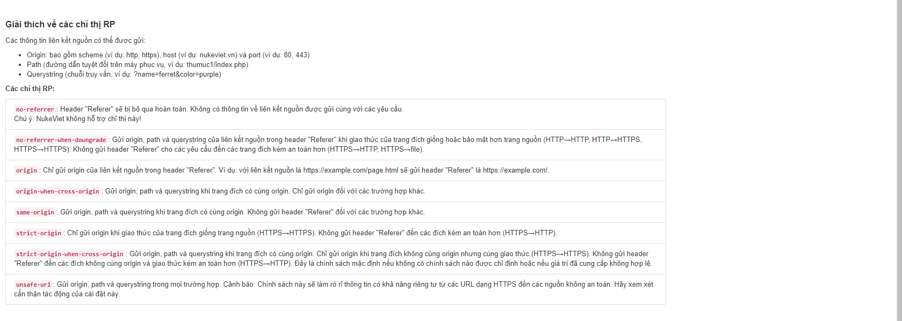
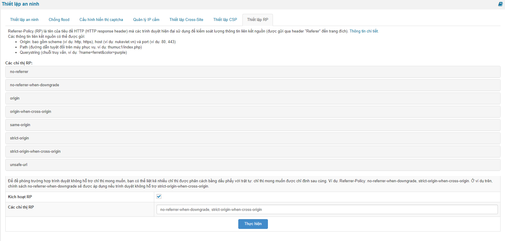

**Dựa trên phiên bản NukeViet 4.6 thì có giao diện như sau:**

**Referrer-Policy (RP)** là một tiêu đề phản hồi HTTP được sử dụng để kiểm soát thông tin liên kết nguồn mà trình duyệt gửi đi qua tiêu đề "Referer" đến một trang web đích. Cài đặt chính sách này giúp tăng cường quyền riêng tư và bảo mật cho người dùng bằng cách hạn chế hoặc điều chỉnh thông tin referrer được gửi

**no-referrer**: Header "Referer" sẽ bị bỏ qua hoàn toàn. Không có thông tin về liên kết nguồn được gửi cùng với các yêu cầu.( Chú ý: NukeViet không hỗ trợ chỉ thị này!)

**no-referrer-when-downgrade**: Gửi origin, path và querystring của liên kết nguồn trong header "Referer" khi giao thức của trang đích giống hoặc bảo mật hơn trang nguồn (HTTP→HTTP, HTTP→HTTPS, HTTPS→HTTPS). Không gửi header "Referer" cho các yêu cầu đến các trang đích kém an toàn hơn (HTTPS→HTTP, HTTPS→file).

**origin**: Chỉ gửi origin của liên kết nguồn trong header "Referer". Ví dụ: với liên kết nguồn là [https://example.com/page.html](https://example.com/page.html) sẽ gửi header "Referer" là [https://example.com/](https://example.com/).

**origin-when-cross-origin**: Gửi origin, path và querystring khi trang đích có cùng origin. Chỉ gửi origin đối với các trường hợp khác.

**same-origin**: Gửi origin, path và querystring khi trang đích có cùng origin. Không gửi header "Referer" đối với các trường hợp khác.

**strict-origin**: Chỉ gửi origin khi giao thức của trang đích giống trang nguồn (HTTPS→HTTPS). Không gửi header "Referer" đến các đích kém an toàn hơn (HTTPS→HTTP).

**strict-origin-when-cross-origin**: Gửi origin, path và querystring khi trang đích có cùng origin. Chỉ gửi origin khi trang đích không cùng origin nhưng cùng giao thức (HTTPS→HTTPS). Không gửi header "Referer" đến các đích không cùng origin và giao thức kém an toàn hơn (HTTPS→HTTP). Đây là chính sách mặc định nếu không có chính sách nào được chỉ định hoặc nếu giá trị đã cung cấp không hợp lệ.

**unsafe-url**: Gửi origin, path và querystring trong mọi trường hợp. Cảnh báo: Chính sách này sẽ làm rò rỉ thông tin có khả năng riêng tư từ các URL dạng HTTPS đến các nguồn không an toàn. Hãy xem xét cẩn thận tác động của cài đặt này.

**Dựa trên phiên bản NukeViet 4.5.04 thì có giao diện như sau:**

