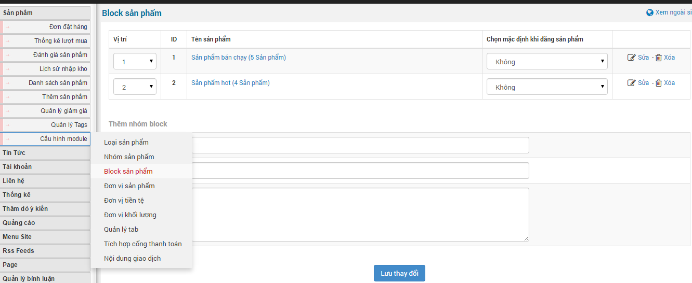
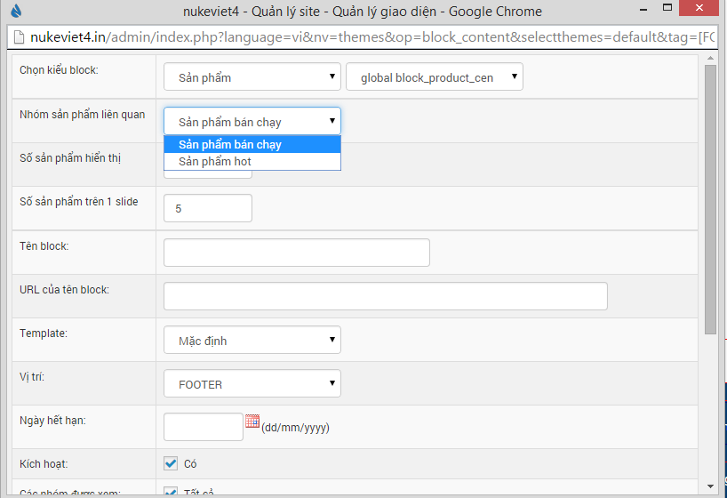
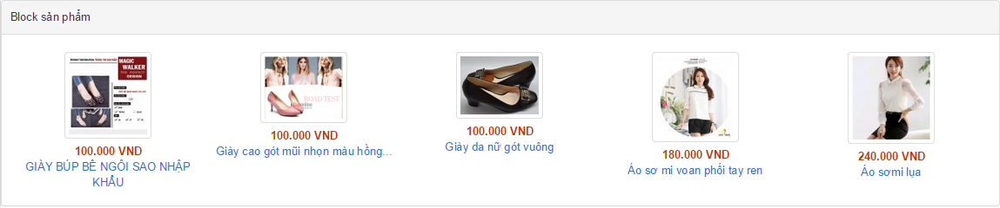

1.  Quản lý thêm, sửa, xóa block sản phẩm.
2.  Để thêm nhóm sản phẩm , nhập các thông tin:

- Tên block sản phẩm.
- Từ khóa: nhập từ khóa để khi tìm kiếm được nhanh hơn.
- Miêu tả: miêu tả block sản phẩm.

Để thêm "Block sản phẩm"

**Bước 1:** Di chuyển con trỏ chuột vào "**Cấu hình module**".

**Bước 2:** Nhấp chuột "**Block sản phẩm**" thuộc menu con của "**Cấu hình module**" .

**Bước 3:** Điền thông tin vào "**Thêm nhóm block**" và Lưu thay đổi.

Để sửa xóa thì bạn nhấp chuột vào chữa "**Sửa**" và "**Xóa**" ở phần danh sách block sản phẩm phí trên "**Thêm nhóm block**".

Để hiển thị "Block sản phẩm" ở ngoài site bạn cần làm theo hướng dẫn sau

**Bước 1:** Ra ngoài site bật kéo thả block và nhấp chuột vào "**Thêm block ở khu vực này**" ở bất kỳ vị trí bạn muốn hoặc vào "**Quản lý giao diện**" chọn "**Quản lý block**" và nhấp chuột vào "**Thêm block**".

**Bước 2:** Chọn block có hỗ trợ lấy dữ liệu thông qua "**Block sản phẩm**" thuộc module shops.

**Bước 3:** Điền thông số cấu hình của block và nhấp chuột "**Chấp nhận**".

