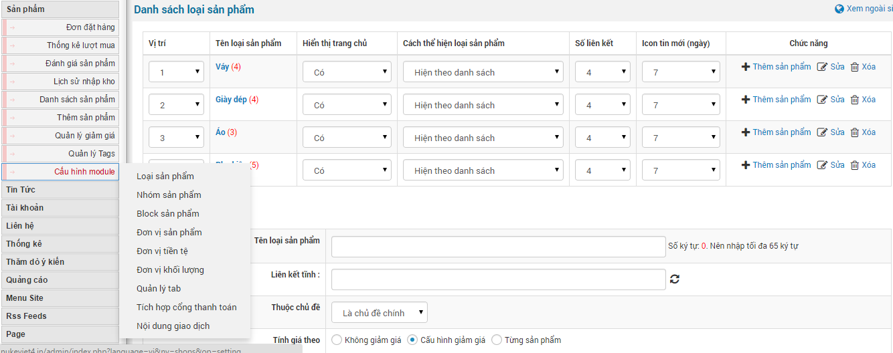
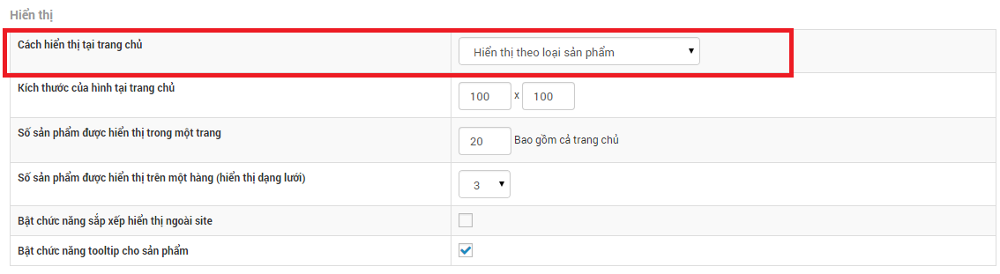
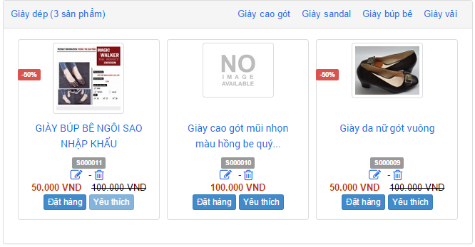
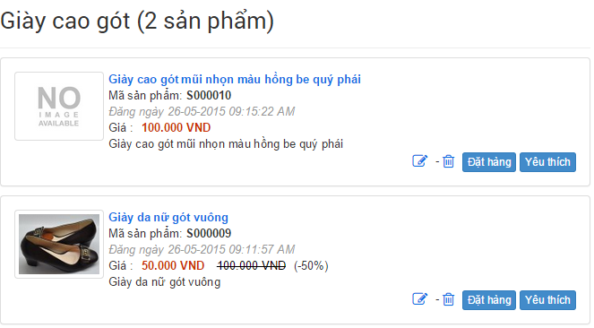
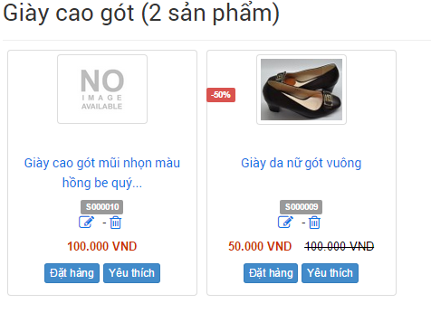
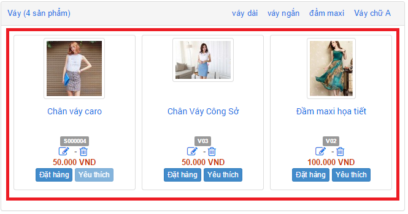
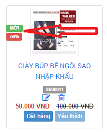

Để thêm loại sản phẩm ta cần di chuyển con trỏ chuột vào "**Cấu hình module**" để hiển thị các menu con và nhấp chuột chọn "**Loại sản phẩm**"

Quản lý thêm, sửa, xóa loại sản phẩm.

1\. Quản lý thêm, sửa, xóa loại sản phẩm.

2\. Để thêm loại sản phẩm nhập các thông tin sau :

- Tên loại sản phẩm.
- Liên kết tĩnh : giúp tạo liên kết đến loại sản phẩm, tạo sự thân thiện cho các bộ máy tìm kiếm. Hệ thống sẽ tự tạo ra liên kết tĩnh dựa trên tên loại sản phẩm hoặc bạn có thể tự chỉnh sửa lại.
- Chọn chủ đề: Khi mới tạo loại sản phẩm thì hệ thống chỉ cho phép tạo chủ đề chính, sau khi thêm loại sản phẩm sẽ cho phép chọn các chủ đề tương ứng.
- Tính giá theo: áp dụng cho chương trình giảm giá thông qua [quản lý giảm giá](/nukeviet4/admin/shops/discount)
- Từ khóa : chính là từ khóa để khi tìm kiếm được nhanh hơn.
- Miêu tả : thông tin miêu tả về loại sản phẩm.
- Hình minh họa: là hình ảnh địa diện cho loại sản phẩm.
- Nội dung chi tiết: là phẩn mô tả chi tiết về loại sản phẩm.
- Hiển thị nội dung chi tiết khi xem chủ đề: cho phép bạn hiển thị ở tất cả các trang thuộc chủ đề hoặc một số chủ đề hoặc không cho hiển thị ở bất kỳ chủ đề nào.
- Quyền xem : cho phép đối tượng được xem loại sản phẩm này.
- Khoảng giá cho phép bạn lọc sản phẩm theo khoảng giá nhất định, tính năng này thuận tiện cho khách hàng khi vào một loại sản phẩm và lọc giá sản phẩm trong một khoảng nhất định. Phần này bạn có thể tự điền hoặc lấy thông tin [từ cấu hình Module](/nukeviet4/admin/shops/setting).

4\. Chọn “**Lưu thay đổi**” để lưu lại.

5\. Danh sách loại sản phẩm gồm có:

- Vị trí: là vị trí hiển thị giữa các loại sản phẩm ngoài trang, cái nào trên cái nào dưới
- Tên loại sản phẩm
- Hiển thị tại trang chủ: là trường hợp cho phép hiển thị hay không hiển thị khi bạn cấu hình module "**Cách hiển thị tại trang chủ**" ở dạng hiển thị theo loại sản phẩm . Nếu bạn cấu hình là có tức là cho phép hiển thị ngoài trang chủ  hoặc ngược lại.
- Cách thể hiện loại sản phẩm gồm có: "**Hiển thị theo danh sách**"  và "**Hiển thị theo dạng lưới**" 
- Số liên kết là số lượng sản phẩm hiển thị tại trang chủ theo dạng "**Hiển thị theo loại sản phẩm**" 
- Icon tin mới (ngày) là thông báo trạng thái "**Mới**" hiển thị trên trang chủ cho phép sau bao nhiêu ngày thì biểu tượng đó ẩn đi tính từ lúc đăng. 

### Để thêm loại sản phẩm bạn cần làm theo các bước sau

**Bước 1:** Di chuyển con trỏ chuột vào "**Cấu hình module**" sẽ hiển thị ra các thành phần menu con.

**Bước 2:** Bạn nhấp chuột chọn "**Loại sản phẩm**". Tại đây sẽ hiện các loại sản phẩm đã có và form thêm loại sản phẩm.

**Bước 3:** Nhập thông tin vào form điền thông tin. Nhập thông tin đầy đủ và nhấp chuột vào nút "**Lưu thay đổi**".

### Để sửa hoặc xóa loại sản phẩm

**Bước 1:** Hover vào "**Cấu hình module**", tính năng hover sẽ show ra các menu con.

**Bước 2:** Hover sang submenu "**Loại sản phẩm**". Tại đây sẽ hiện các loại sản phẩm đã có và form thêm loại sản phẩm.

**Bước 3:** Bạn chọn loại sản phẩm hiện có và nhấp chuột vào sửa và xóa.
