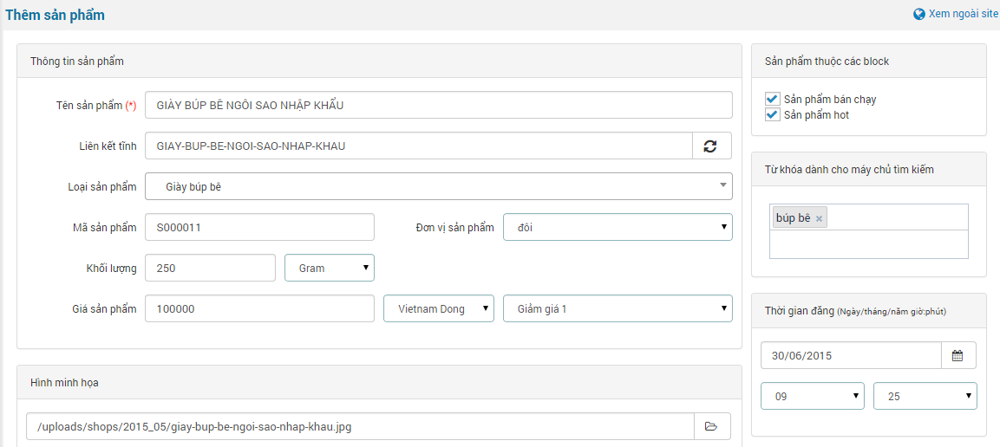
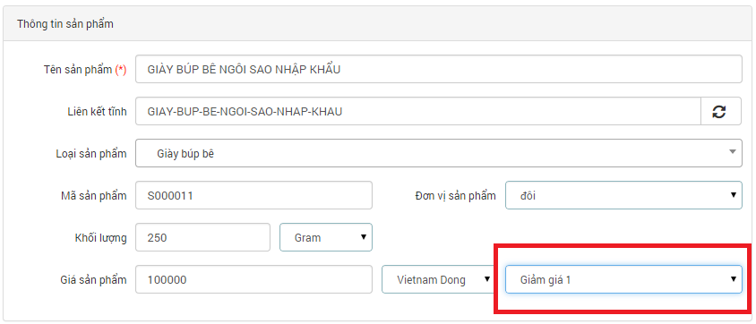

**Để thêm sản phẩm trước tiên chúng ta cần phải tạo:**

- [Loại sản phẩm.](/nukeviet4/admin/shops/cat).
- [Đơn vị sản phẩm.](/nukeviet4/admin/shops/unit).

**Để thêm mới sản phẩm, các bạn cần làm theo hướng dẫn sau:**

**Bước 1:** Nhấp chuột vào "**Thêm sản phẩm**" ở menu trái của module sản phẩm.

**Bước 2:** nhập thông tin (Các phần đánh dấu \* là bắt buộc nhập, các phần còn lại có thể có hoặc không):

- Tên sản phẩm cần thêm.
- Liên kết tĩnh: giúp tạo liên kết đến sản phẩm, tạo sự thân thiện cho các bộ máy tìm kiếm. Hệ thống sẽ tự tạo ra liên kết tĩnh dựa trên tên sản phẩm hoặc bạn có thể tự chỉnh sửa lại.
- [Loại sản phẩm](/nukeviet4/admin/shops/cat).
- Mã sản phẩm: Bạn có thể tự nhập hoặc để tự động theo cấu hình module.
- [Đơn vị sản phẩm](/nukeviet4/admin/shops/unit).
- [Khối lượng](/nukeviet4/admin/shops/weight) dùng trong trường hợp website sử dụng tính năng cấu hình vận chuyển
- Giá sản phẩm dùng để điền giá thực của sản phẩm muốn bán.
- Giảm giá: chọn gói cấu hình giảm giá được tạo ra ở [quản lý giảm giá](/nukeviet4/admin/shops/discount) 
- Hình minh họa: nhấn Browse để tìm kiếm và upload ảnh lên.
- Chú thích hình ảnh thêm vào: dùng để seo hình ảnh.
- Giới thiệu ngắn gọn về sản phẩm.
- Nội dung chi tiết.
- Quà tặng dùng để ghi chú thông tin chương trình khuyến mại. Ví dụ: mua sản phẩm A được tặng kèm 1 sản phẩm B hoặc tặng bao nhiêu tiền... tùy vào đơn vị kinh doanh sản phẩm.
- [Là sản phẩm thuộc nhóm](/nukeviet4/admin/shops/group).
- [Sản phẩm thuộc các block](/nukeviet4/admin/shops/block).
- [Từ khóa dành cho máy chủ tìm kiếm](/nukeviet4/admin/shops/tags).

**Bước 3:** Tiến hành thực hiện nhấp chuột nút "**Đăng sản phẩm**" hoặc "**Lưu sản phẩm nhưng không đăng**".
