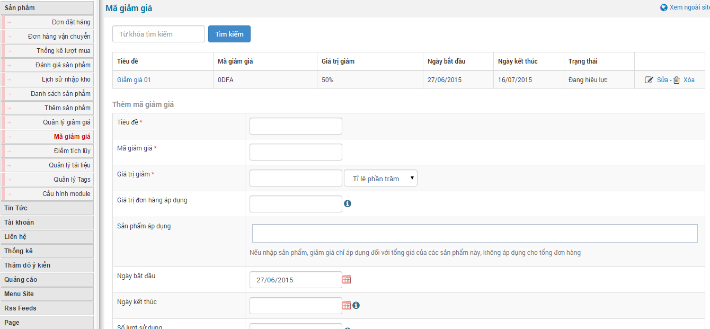
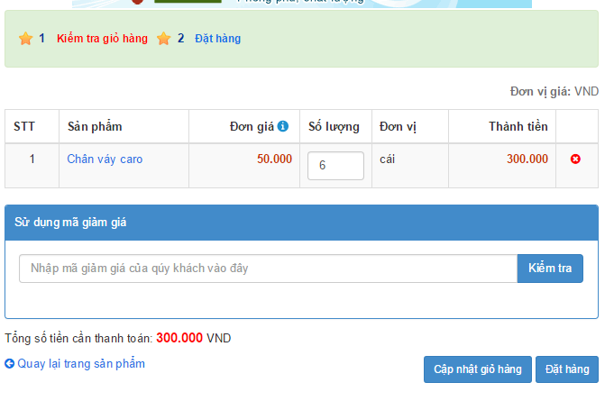

Mã giảm giá là hình thức khuyến mại sử dụng coupon để thêm vào nếu khách hàng muốn giảm giá sản phẩm khi thanh toán online ngay trên website.

**Lưu ý:** Để sử dụng tính năng mã giảm giá bạn cần vào "**cấu mình module**" sản phẩm sau đó tích vào ô "**Sử dụng mã giảm giá**" và lưu lại kết quả

- Cho phép thêm mã giảm giá mới.
- Sửa và xóa thông tin như thời gian khuyến mã...
- Giới hạn lượt sử dụng coupon hoặc để vô hoạn.

Lưu ý: với hình thức này, người quản trị sẽ phải đi quảng bá cung cấp mã cuopon qua các diễn đàn, forum, blog, và các mạng kết nối adnetwork khác để người dùng biết được mã coupon đó.

**Để thêm mới mã giảm giá bạn làm theo các bước sau đây**

**Bước 1:** Nhấp chuột vào "**Mã giảm giá**" ở danh sách menu của module shops.

**Bước 2:** Điền thông tin "**Mã giảm giá**" vào form "**Thêm mã giảm giá**".

Lưu ý: Form nào có đánh dấu (\*) màu đỏ là bắt buộc bạn phải điền.

**Bước 3:** Lưu thay đổi.

**Đối với khách hàng khi truy cập đặt hàng online**

**Bước 1:** Khách hàng đặt hàng một sản phẩm bất kỳ trên website trong thời gian mã giảm giá còn hiệu lực.

**bước 2:** Điền thông tin mã giảm giá vào form để được chương trình khuyến mại.

