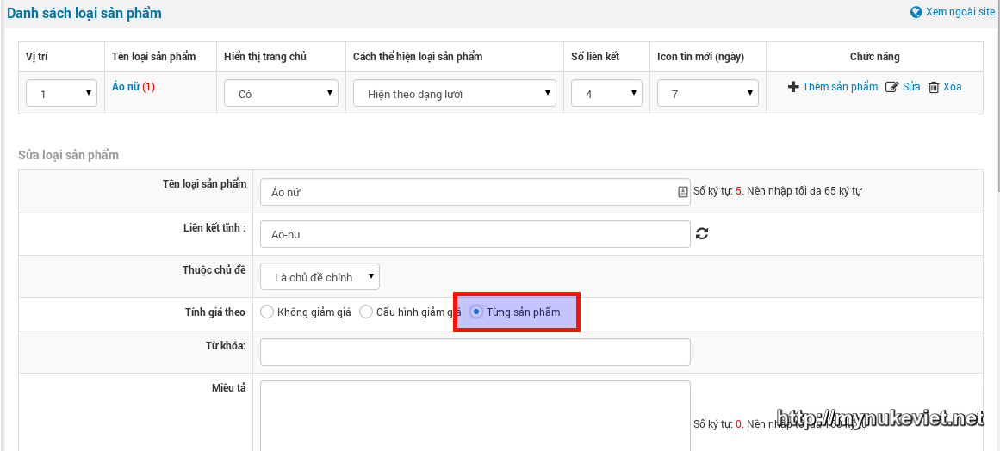
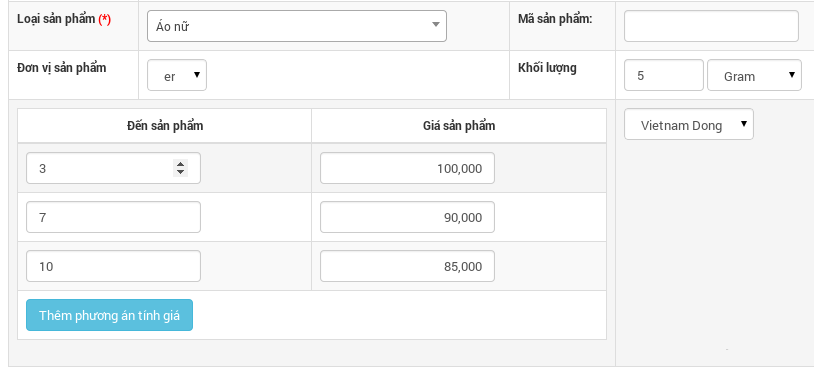
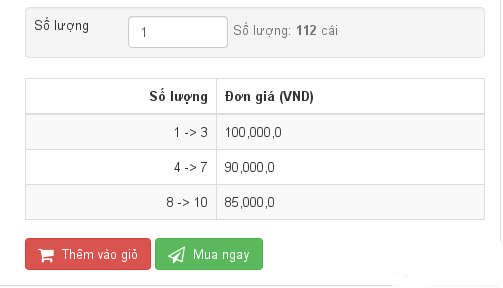
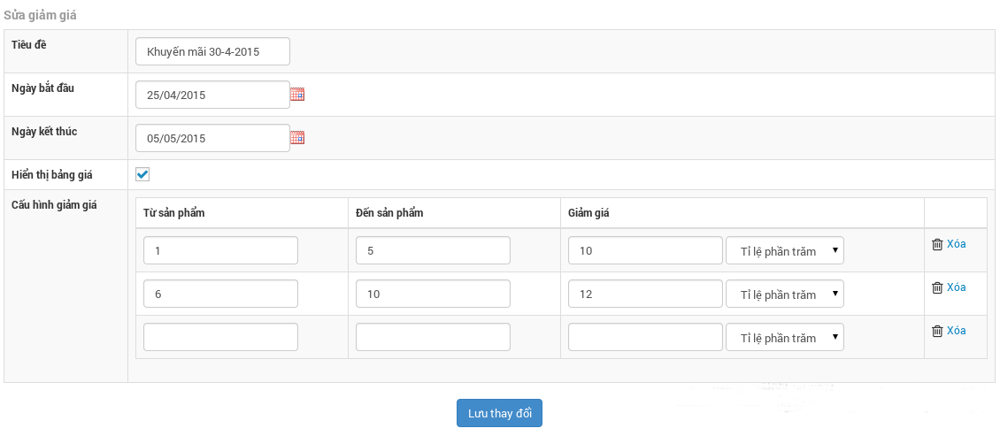
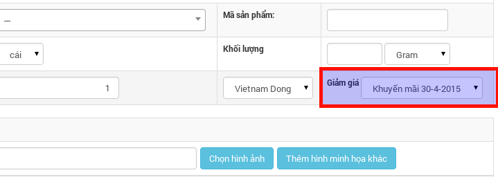
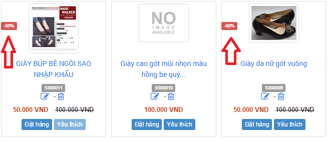

Shops 4 chia làm 2 loại giảm giá chính, cấu hình theo loại sản phẩm (Mỗi loại sản phẩm có thể áp dụng một loại giảm giá khác nhau)

## 1. Giảm giá từng sản phẩm

### 1.1. Mô tả

Là loại giảm giá áp dụng cho các cửa hàng giảm giá bán theo số lượng sản phẩm.

``` text
Ví dụ:

- Mua từ 1 -> 5 cái áo thì đơn giá là 100.000 VNĐ / cái.

- Mua từ 6 -> 10 cái áo thì đơn giá là 90.000 VNĐ / cái.

- Mua từ 7 -> 15 cái áo thì đơn giá là 80.000 VNĐ / cái.

......................
```

### 1.2. Các bước cấu hình

**Bước 1:** Khi cập nhật (thêm/sửa) loại sản phẩm (chủ đề), chọn "**Tính giá theo**" là "**Từng sản phẩm**".



**Bước 2:** Thêm phương án tính giá khi cập nhật sản phẩm.



Sau khi hoàn tất việc cấu hình và nhập liệu, ở trang xem chi tiết sản phẩm sẽ hiển thị bảng giá theo số lượng, đồng thời hệ thống tự động áp dụng giá theo số lượng khi khách đặt hàng.



## 2. Giảm giá theo cấu hình

### 2.1. Mô tả

Hình thức này áp dụng cho các cửa hàng có nhu cầu tạo các đợt khuyến mãi theo số lượng sản phẩm, tại các khoảng thời gian khác nhau.

``` text
Ví dụ:

Nhân dịp lễ 30/04, cửa hàng giảm giá 30% cho các sản phẩm Áo thun gia đình, áo sơ mi công sở,.........
```

### 2.2. Các bước cấu hình

**Bước 1:** Khi cập nhật (thêm/sửa) loại sản phẩm (chủ đề), chọn "**Tính giá theo**" là "**Cấu hình giảm giá**".

**Bước 2:** Truy cập khu vực "Cấu hình giảm giá" từ menu quản lý shops.

**Bước 3:** Truy cập khu vực "Quản lý giảm giá" từ menu quản lý shops. Thêm gói giảm giá với thông tin tương tự như bên dưới.



**Bước 4:** Cập nhật (thêm/sửa) sản phẩm cần áp dụng gói giảm giá vừa tạo, tại mục "**Giảm giá**", từ hộp chọn chọn tên gói cấu hình vừa tao.



Sau khi hoàn tất việc cấu hình và nhập liệu, hệ thống tự động áp dụng giá theo số lượng khi khách đặt hàng.

Sau khi áp dụng giảm giá người truy cập sẽ thấy giá sản phẩm được khuyến mại như hình sau.



Và với giá khuyến mãi như vậy sẽ được áp dụng ngày vào sản phẩm và giá sản phẩm sẽ được tính giá mới sau khi áp dụng tính giảm giá. Khi khách hàng thực hiện thanh toán đối với sản phẩm có giảm giá chỉ tính giá mới.
