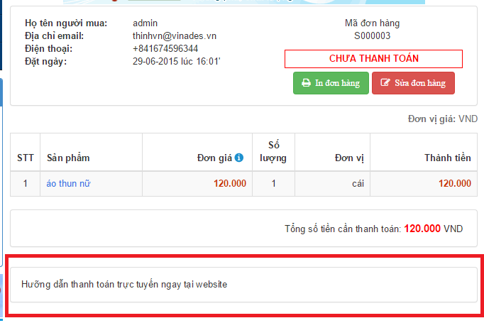
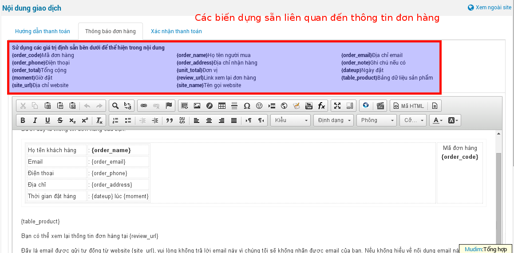

Nội dung giao dịch là thông tin cấu hình mặc định sẽ gửi bằng email đến khách hàng những thông tin cần thiết đã được thiết lập trong phần email gửi đi khi khách hàng đặt mua sản phẩm và gủi thông tin xác nhận đã thanh toán thành công đơn hàng trên hệ thống website tới khách hàng với thông số sản phẩm được cấu hình trước.

"**Hướng dẫn tanh toán**": là thông báo thanh toán tích hợp cổng thanh toán như paypal, onepay và hiển thị ngoài site ở bước cuối cùng của thanh toán.

"**Thông báo đơn hàng**": là dạng form định dạng gưi thông báo tới khách hàng khi đặt hàng sản phẩm.

"**Xác nhận thanh toán**": là dạng form định dạng gửi thông báo xác nhận thanh toán đơn hàng tới khách hàng.

1\. Tại menu quản lý shops, tuy cập chức năng "**Nội dung giao dịch**".

2\. Tùy chỉnh nội dung:

- Mặc định, nội dung email gửi đi sẽ hiển thị như trong hình. Khi người quản trị chỉnh sửa lại nội dung thì hệ thống sẽ lưu lại nội dung mới - nội dung vừa tùy chỉnh.
- Có thể sử dụng các biến dựng sẵn. Ví dụ: \{order_code\} để gọi nội dung tương ứng, như mô tả trong bảng.
- Tương tự cho nội dung email "**Xác nhận thanh toán**".

