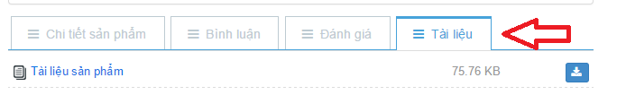
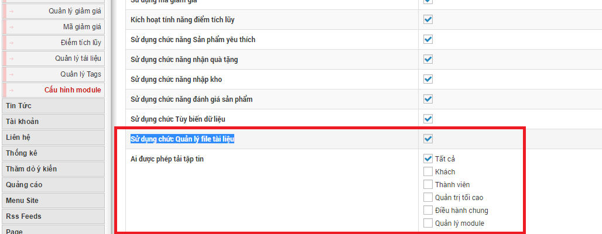
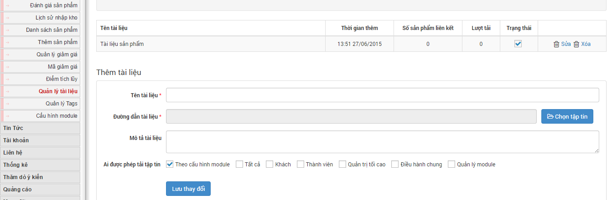
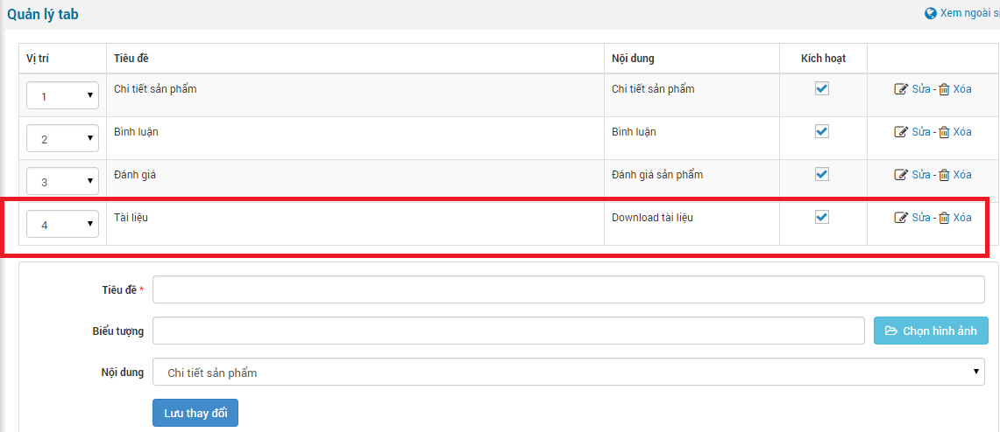
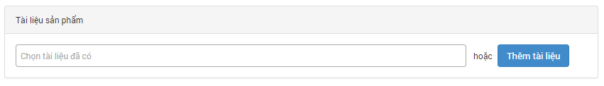

Quản lý tài liệu là quản lý các tệp tin cho phép khách hàng, người truy cập tải về để xem ở chế độ offline thay vì phải xem online ngay trên website. Quản lý tài liệu có thể là thông tin sản phẩm, tài liệu hướng dẫn, thông số kỹ thuật,... do người đăng sản phẩm đính kèm tệp tin.

Để sử dụng được "**Quản lý tài liệu**".

**Bước 1:** bạn cần phải truy cập vào "**Cấu hình module**" và tích vào ô "**Sử dụng chức Quản lý file tài liệu**" rồi Lưu lại để kích hoạt tính năng này.

**Lưu ý:** bạn cần phải chọn quyền "**Ai được phép tải tập tin**" để người truy cập có thể tải về máy hoặc xem trực tiếp ngay trên trình duyệt".

**Bước 2:** Bổ sung tài liệu sản phẩm bằng cách quay về menu "**Quản lý tài liệu**".

**Bước 3:** Tiếp theo bạn cần chuyển qua khu vực "[Quản lý tab](/nukeviet4/admin/shops/tabs)" để bổ sung tab tài liệu hiển thị ngoài site.

**Lưu ý:** trong phần nội dung khi bổ sung tab tài liệu, bạn cần phải chọn "**Download tài liệu**".

Sau khi làm theo các bước trên, tab tài liệu sẽ hiển thị ngoài site và cho phép người truy cập có thể thấy được tab tài liệu, còn việc download được hay không do bạn cấu hình ở phần cấu hình module và cấu hình theo từng tài liệu.

## Thêm tài liệu khi đăng sản phẩm mới hoặc sửa sản phẩm

Khi đăng sản phẩm mới hoặc sửa một sản phẩm bất kỳ mà muốn đính kèm thêm tài liệu cho sản phẩm đó bạn làm theo hưỡng dẫn sau.

**Bước 1:** Nhấp chuột vào "**Thêm sản phẩm**" và điền các thông tin như bình thường, bạn kéo xuống dưới sẽ thấy phần "**Tài liệu sản phẩm**" hoặc vào "**Danh sách sản phẩm**" nhấp chuột biểu tượng sửa (edit) sản phẩm và kéo xuống dưới cũng sẽ thấy phần "**Tài liệu sản phẩm**".

**Bước 2:** bạn nhấp chuột vào form tài liệu để chọn tài liệu (hiện tại hình ảnh sau là tôi chưa có tài liệu nào) hoặc bạn nhấp chuột vào "**Thêm tài liệu**" để thêm tài liệu mới cho sản phẩm.

