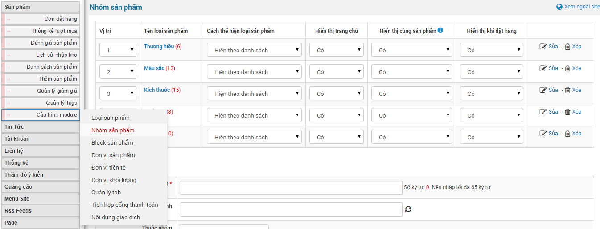
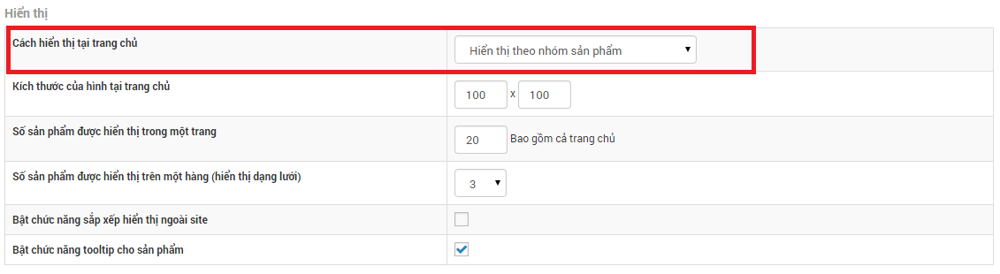
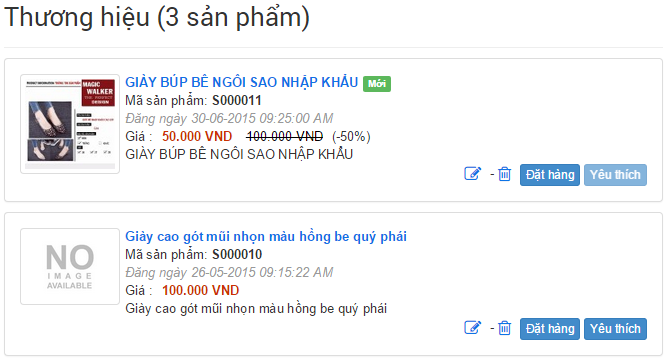
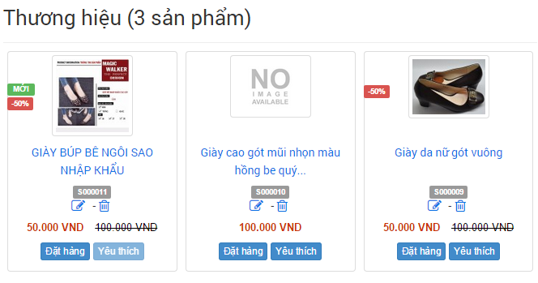
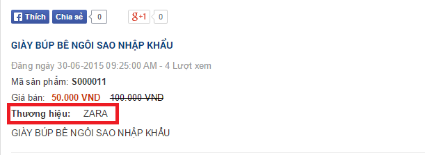
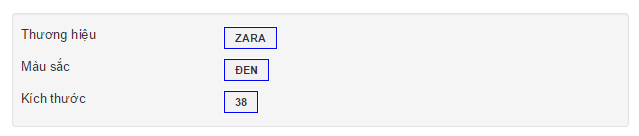

Để hiển thị nhóm sản phẩm ngoài site bạn cần phải vào "**Cấu hình module**" tìm đến "**Cách hiển thị tại trang chủ**" chọn "**Hiển thị theo nhóm sản phẩm**" và lưu lại thông số cấu hình.

1\. Quản lý thêm, sửa, xóa nhóm sản phẩm.

2\. Cho phép lựa chọn vị trí hiển thị của nhóm sản phẩm.

3\. Danh sách nhóm sản phẩm.

- Vị trí: cho phép bạn tùy chọn cái nào đứng trước cái nào đứng sau thuận tiện cho việc hiển thị ngoài trang chủ.
- Tên nhóm sản phẩm.
- Cách thể hiện nhóm sản phẩm gồm có "**Hiển thị theo danh sách**"  và “**Hiển thị theo dạng lưới**” 
- Hiển thị tại trang chủ: cho phép nhóm sản phẩm được phép hay không được phép hiển thị tại trang chủ của module shops.
- Hiển thị cùng sản phẩm: nếu bạn cho phép có thì thông tin nhóm sản phẩm sẽ được hiển thị trong phần thông tin sản phẩm. 
- Hiển thị khi đặt hàng là hiển thị thông số nhóm sản phẩm trong khung như sau 

4\. Cho phép lựa chọn cách thể hiện nhóm sản phẩm- Để thêm nhóm sản phẩm, nhập các thông tin:

- Tên nhóm sản phẩm.
- Liên kết tĩnh : giúp tạo liên kết đến nhóm sản phẩm, tạo sự thân thiện cho các bộ máy tìm kiếm. Hệ thống sẽ tự tạo ra liên kết tĩnh dựa trên tên nhóm sản phẩm hoặc bạn có thể tự chỉnh sửa lại.
- Chọn nhóm sản phẩm: nhóm chính hoặc các nhóm đã tạo.
- Bắt buộc chọn khi nhập liệu: Nếu chọn tính năng này thì khi nhập dữ liệu sản phẩm mới bạn cần phải tích vào "**Nhóm sản phẩm**" thì mới tiến hành lưu được.
- Của loại sản phẩm: Chọn loại sản phẩm cho nhóm (có thể chọn nhiều) hoặc bạn không cần chọn nếu sản phẩm không thuộc nhóm sản phẩm trong quá trình đăng sản phẩm.
- Từ khóa : chính là từ khóa để khi tìm kiếm được nhanh hơn.
- Miêu tả : thông tin miêu tả về nhóm sản phẩm.
- Quyền xem : cho phép đối tượng được xem nhóm sản phẩm này.

**Để thêm nhóm sản phẩm bạn làm theo bước sau**

**Bước 1:** Di chuyển con trỏ chuột vào "**Cấu hình Module**" sẽ hiện ra menu con.

**Bước 2:** Nhấp chuột vào "**Nhóm sản phẩm**".

**Bước 3:** Điền thông tin vào form thông tin bên dưới danh sách nhóm sản phẩm thuộc "**Thêm nhóm sản phẩm**".

**Bước 4:** Lưu thay đổi.

Để sửa và xóa bạn làm theo bước trên cho tới bước 2, Bước tiếp theo bạn chuyển qua phần "Danh sách nhóm sản phẩm" để thực hiện nhấp chuột sửa và xóa.
