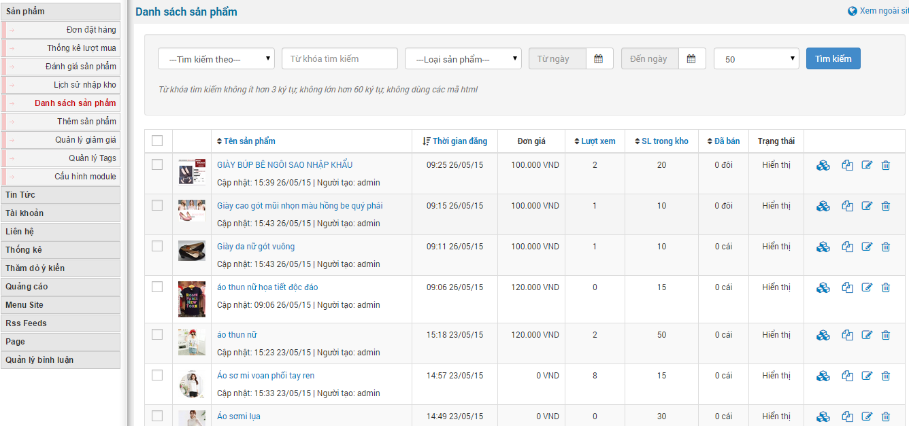
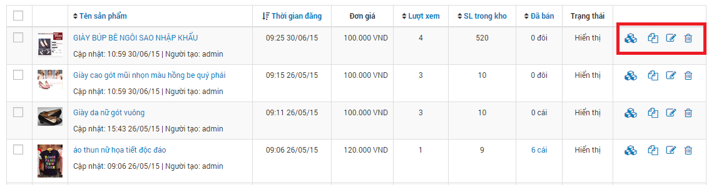
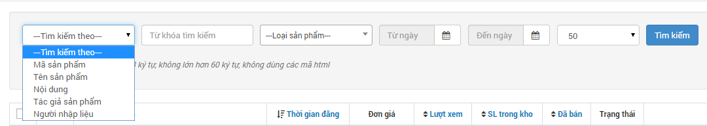
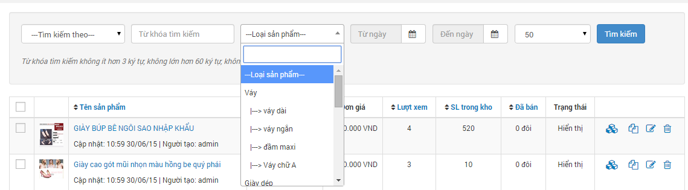
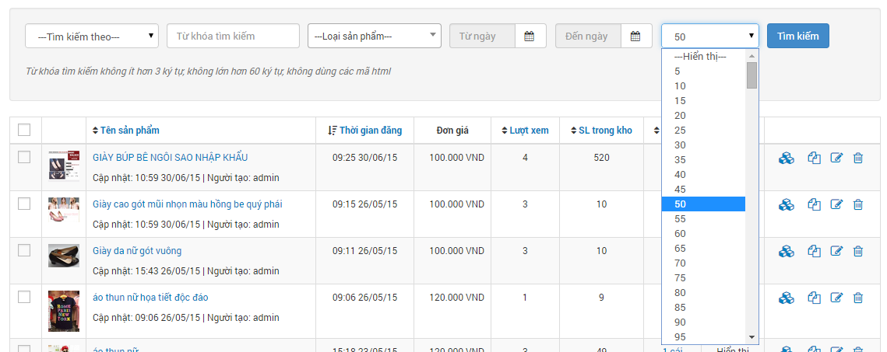
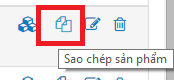
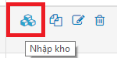
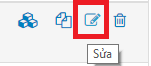
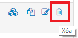
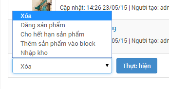

- Hiển thị danh sách các sản phẩm đã đăng bao gồm: tên sản phẩm, thời gian đăng, đơn giá, lượt xem, SL trong kho, đã bán, trạng thái và chức năng.
- Cho phép sửa, xóa thông tin của sản phẩm.
- Tìm kiếm theo từ khóa, theo các thuộc tính của sản phẩm.: cho phép bạn có thể tìm kiếm theo từng thông tin của sản phẩm như mã sản phẩm, tên sản phẩm, nội dung, tác giả sản phẩm, người nhập liệu  tìm kiếm theo loại sản phẩm:  hiển thị số lượng sản phẩm. 
- Sao chép sản phẩm. 
- Nhập kho sản phẩm. [Nhập sản phẩm vào kho](/nukeviet4/admin/shops/warehouse)

**4 nút trạng thái gồm:**

- Nhập kho. [Nhập sản phẩm vào kho](/nukeviet4/admin/shops/warehouse)
- Sao chép sản phẩm. 
- Sửa. 
- Xóa. 

**Nút chức năng thực hiện nhanh**

