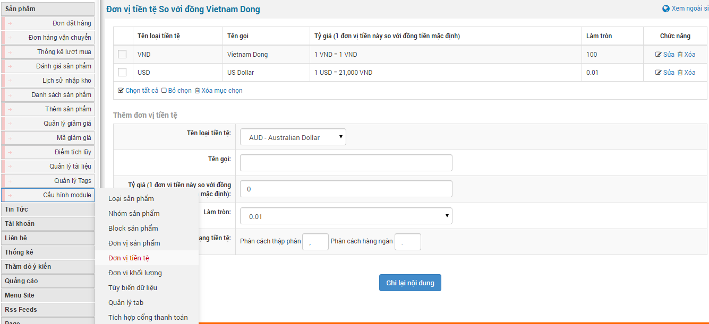
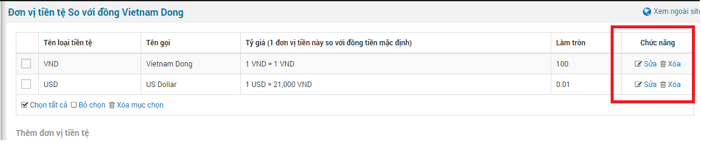
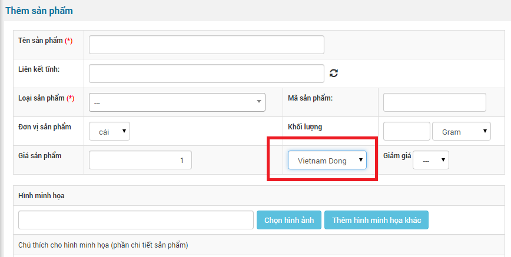

Đơn vị tiền tệ là đơn vị tiền để tính giá của từng sản phẩm và cho phép thanh toán theo loại tiền mà người quản trị cấu hình.

Ví dụ:

- Nếu website được thiết kế cho người Việt thì sử dụng đơn vị tiền tệ là Việt Nam Đồng.
- Nếu website được thiết kế cho người Mỹ thì sử dụng đơn vị tiền tệ là Dola Mỹ.

Ngoài ra, sử dụng đơn vị tiền tệ theo từng quốc gia chấp nhận thanh toán theo đơn vị tiền tệ mà quốc gia đó chấp nhận.

- Để thêm đơn vị tiền tệ mới bạn hover vào "**Cấu hình module**" chọn submenu "**Đơn vị tiền tệ**". Tiếp đến điền thông tin: Tên loại tiền tệ, Tên gọi, Tỷ giá (1 đơn vị tiền này so với đồng tiền mặc định), Làm tròn, Ký tự định dạng tiền tệ. Cuối cùng là nhấp chuột vào "**Ghi lại nội dung**".
- Sửa xóa đơn vị tiền tệ hiện có bản cũng làm tương tự như thêm mới nhưng bạn nhấp chuột vào "Sửa" hoặc "Xóa" đơn vị tiền tệ.

Đơn vị tiền tệ bắt buộc phải có đối với những website niêm yết giá sản phẩm và khi đăng sản phẩm đơn vị tiền tệ sẽ mặc định theo đơn vị tiền tệ đầu tiên. Vì vậy khi đăng sản phẩm bạn có thể tùy chọn lại đơn vị tiền tệ cho từng sản phẩm.

