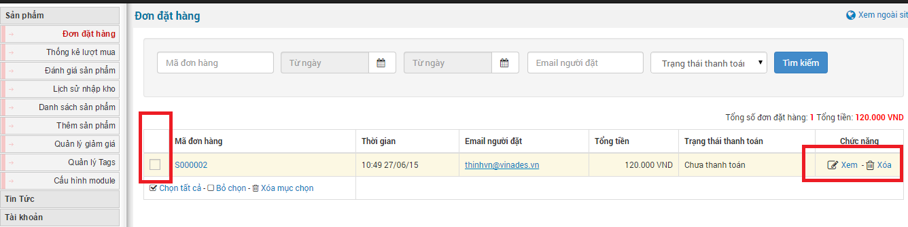
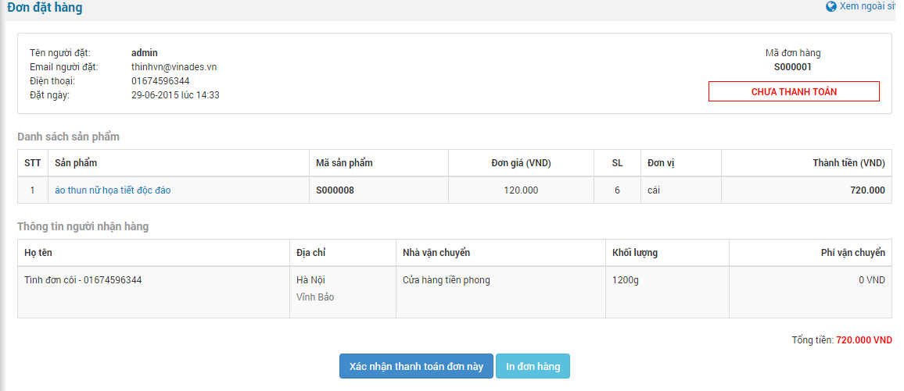

1\. Hiển thị danh sách các đơn đặt hàng.

2\. Cho phép xem thông tin tất cả các đơn đặt hàng, xóa đơn đặt hàng 

3\. Chọn xem đơn đặt hàng trong danh sách các đơn đặt hàng, ta có thể:

- Xem thông tin của người mua, các sản phẩm của đơn đặt hàng đó.
- Xem thông tin vận chuyển (nếu có hỗ trợ dịch vụ vận chuyển).
- Có thể in đơn đặt hàng.
- Có thể xác nhận người mua đã thanh toán đơn đặt hàng đó hay chưa.
- Gửi thông tin đơn hàng đến khách hàng bằng email: "**[Nội dung giao dịch](/nukeviet4/admin/shops/docpay)**".

**Để xóa bạn cần làm theo hướng dẫn sau**

**Bước 1:** Nhấp chuột vào "**Đơn đặt hàng**" ở khói menu của module shops.

**Bước 2:** Tích chọn tất cả hoặc chọn từng đơn đặt hàng và nhấp chuột "**Xóa mục chọn**" hoặc xóa riêng lẻ.

**Để xem và xác nhân đơn hàng bạn làm theo hướng dẫn sau**

**Bước 1:** Nhấp chuột vào "**Xem**" như hình trên và được thông tin đơn hàng dạng như sau

**Bước 2:** Bạn nhấp chuột vào "**Xác nhân thanh toán đơn hàng này**" để thay đổi trạng thái đơn hàng và gửi thông tin đơn hàng tới email của khách hàng.
