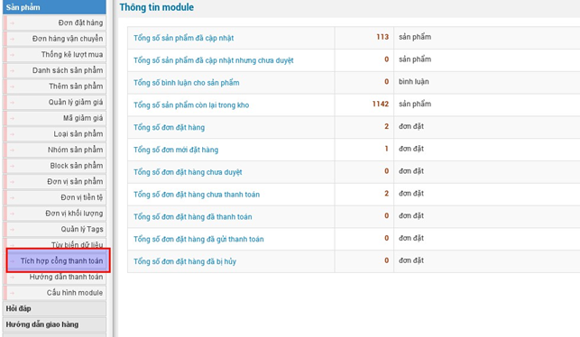
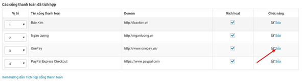
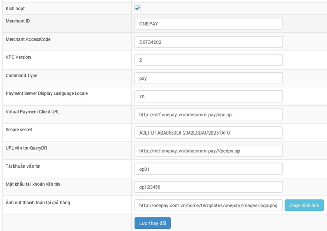
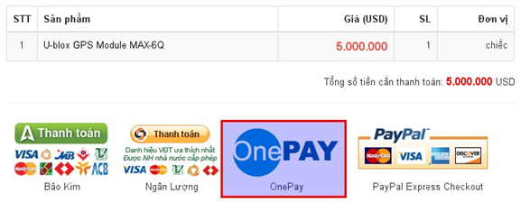
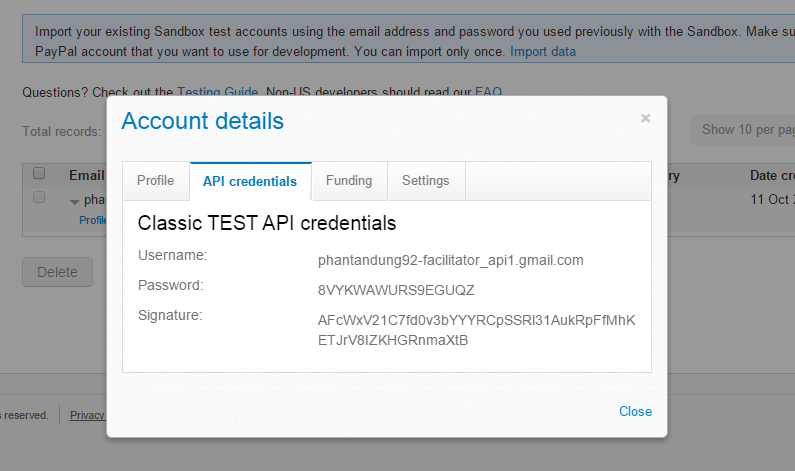
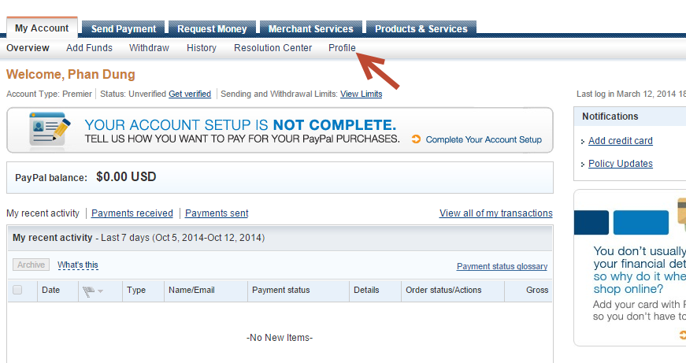
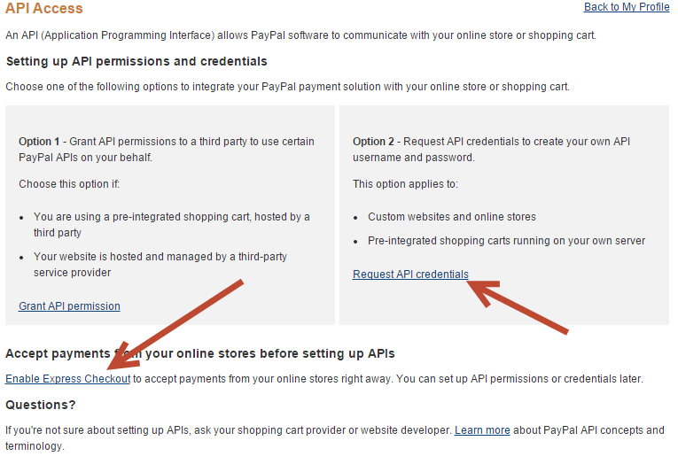
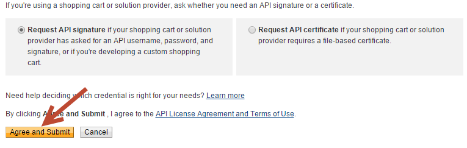
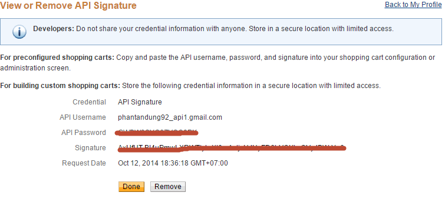

## I. Đăng ký tài khoản Onepay

Để có thể tích hợp cổng thanh toán Onepay vào website bán hàng bạn cần có một tài khoản nhận tiền. Việc đăng ký tài khoản tại Onepay không thể thực hiện qua hình thức đăng ký online, mà người bán phải làm việc trực tiếp với Onepay. Xem [quy trình tích hợp](http://onepay.com.vn/home/vi/tro-giup/dang-ky-dich-vu/quy-trinh-tich-hop.html).

## II. Tích hợp Onepay vào NukeViet Shops

Sau khi làm việc (đăng ký dịch vụ) xong với Onepay, Onepay sẽ cung cấp thông tin kỹ thuật kết nối trên môi trường thật. Các thông tin bao gồm:

- URL payment test: [https://onepay.vn/onecomm-pay/vpc.op](https://onepay.vn/onecomm-pay/vpc.op)
- Merchant ID (vpc_Merchant): Onepay cung cấp.
- Access code (vpc_AccessCode): Onepay cung cấp.
- Hash code (SECURE_SECRET): Onepay cung cấp.

Bước 1: Đăng nhập vào khu vực quản trị.

Bước 2: Chọn khu vực quản lý của module "Sản phẩm".

Bước 3: Chọn tích hợp cổng thanh toán.

Bước 4: Chọn sửa (Onepay).

Bước 5: Tiến hành cấu hình thông tin.

- Tên cổng thanh toán: OnePay.
- Domain: [http://www.onepay.vn/](http://www.onepay.vn/)
- Kích hoạt: Tích chọn nếu muốn cổng thanh toán Onepay hoạt động ngay sau khi cấu hình.
- Merchant ID: Điền merchant ID Onepay cung cấp.
- Merchant AccessCode: Điền access code Onepay cung cấp.
- Virtual Payment Client URL: [http://onepay.vn/onecomm-pay/vpc.op](http://onepay.vn/onecomm-pay/vpc.op)
- Secure secret (hash code): Onepay cung cấp.
- URL vấn tin QueryDR: [http://onepay.vn/onecomm-pay/Vpcdps.op](http://onepay.vn/onecomm-pay/Vpcdps.op)
- Các thông số khác: Giữ mặc định.

Sau khi tích hợp thành công, biểu tượng thanh toán của Onepay sẽ xuất hiện tại trang hóa đơn.

# Tích hợp cổng thanh toán "PAYPAL"

> Cổng thanh toán PayPal đã được tích hợp sẵn ở code module shops, đăng nhập quản trị module để kích hoạt cổng thanh toán này. Cần chú ý năm thông số sau: API Username, API Password, Signature, Environment, PaymentAction.

## Cách lấy các thông số trong môi trường sandbox

Truy cập trang [https://developer.paypal.com/webapps/developer/applications/accounts](https://developer.paypal.com/webapps/developer/applications/accounts) sau đó đăng nhập với tài khoản và mật khẩu paypal thực. Nhấp chuột vào `Profile`, sau đó chọn tab `API credentials` (ảnh), đây chính là ba thông số API Username, API Password, Signature cần điền vào phần cấu hình cổng thanh toán. Đối với môi trường sandbox, thông số Environment cần điền sandbox và thông số PaymentAction giữ nguyên mặc định.

## Cách lấy các thông số trong môi trường chạy thật

Truy cập [https://www.paypal.com](https://www.paypal.com) và đăng nhập với tài khoản paypal, sau đó chọn tab `Profile`.

Tiếp tục chọn menu `My selling tools`, tại dòng `Selling online => API access` chọn `Update` và chọn `Request API credentials` như ảnh.

> Chú ý: Để API có thể hoạt động, cần cho phép gọi API bằng cách nhấp chuột vào link `Enable Express Checkout` như ảnh trên.

Tiếp tục ấn `Agree And Submit`.

Thông tin về API sẽ hiển thị như ảnh bên dưới:

Đây là ba thông số API Username, API Password, Signature cần nhập vào phần cấu hình cổng thanh toán. Thông số **Environment** nhập `live` và thông số còn lại để mặc định.

Lưu ý: để tích hợp cổng thanh toán bạn cần di chuyển con trỏ chuột tới "**Cấu hình module**", nhấp chuột vào "**Tích hợp cổng thanh toán**".
