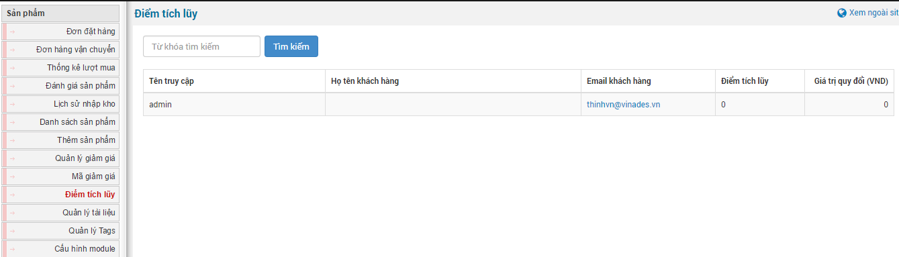
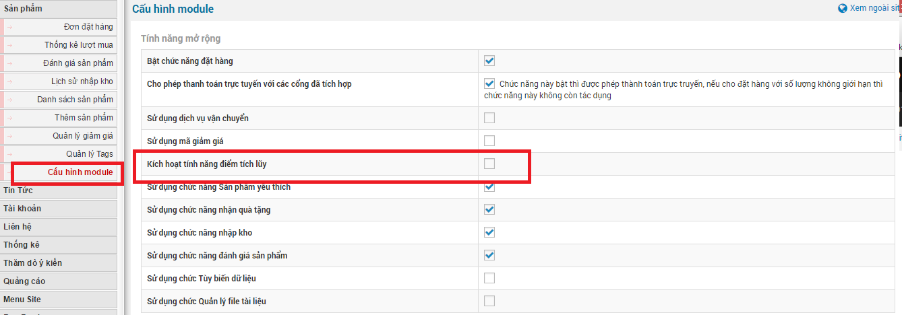
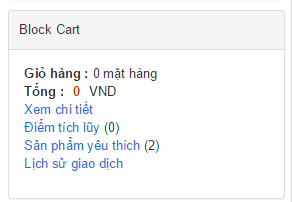
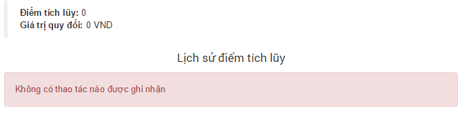

Điểm tích lũy là số điểm được tính sau mỗi lần khách hàng mua một sản phẩm bất kỳ và được thanh toán thành công theo đơn hàng. Số điểm tích lũy sẽ được quay đổi ra đơn vị tiền tệ và sẽ số tiền tương ứng vào sản phẩm tiếp theo mà khách hàng mua.

Số điểm sẽ được hiển thị ở từng người truy cập và số tiền đã được quy đổi.

Lưu ý: tính năng "**Điểm tích lũy**" mặc định không được kích hoạt. Nếu bạn muốn sử dụng tính năng này bạn cần vào phần "**Cấu hình module**" tìm đến "**Kích hoạt tính năng điểm tích lũy**" và tích vào ô. Sau đó là "**Lưu thay đổi**" để lưu cấu hình và kích hoạt chức năng này.

Sau khi bạn kích hoạt tính năng điểm tích lũy, bạn cần phải cấu hình quy đổi điểm tích lũy thành đơn vị tiền tệ

**Bước 1:** Nhấp chuột vào "**Cấu hình module**".

**Bước 2:** Tìm đến "**Cấu hình điểm tích lũy**" và điền thông số bạn muốn cấu hình, sau đó lưu lại để lưu thông tin cấu hình.

Đối với người dùng ngoài site thì điểm tích lũy sẽ được hiển thị thông qua block cart

và point (vid dụ domain của bạn có dạng abc.com và sử dụng module shops làm module sản phẩm thì url điểm tích lũy là abc.com/shops/point/).

Với số điểm tích lũy càng cao thì bạn quy đổi sang đơn vị tiền tệ càng được nhiều và khi đó bạn mua sản phẩm sử dụng điêm tích lũy sẽ giảm đáng kể số tiền phải thanh toán.
