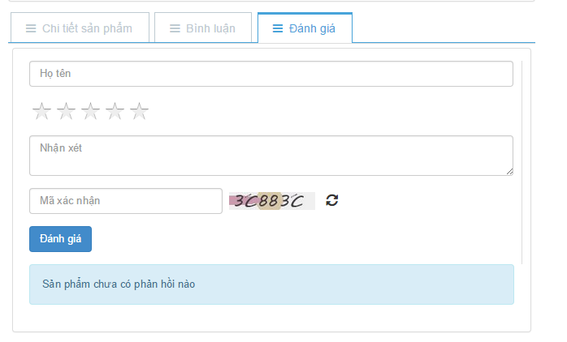
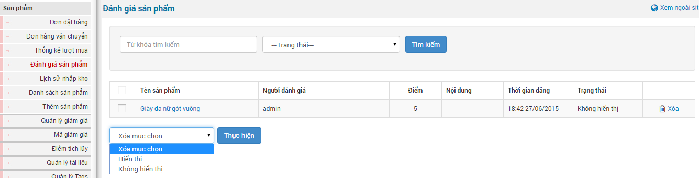

Đánh giá sản phẩm là tính năng nhận xét sản phẩm theo bằng phương án cho điểm 1 tới 5. Giúp người mua đánh giá sản phẩm sau khi mua hàng.

**Lưu ý:** Chức năng này đã được kích hoạt khi bạn cài module shops. Nếu bạn không muốn sử dụng tính năng này thì bạn truy cập vào "**Cấu hình module**" tìm đến ô "**Sử dụng chức năng đánh giá sản phẩm**" và bỏ chọn. Tiếp theo là nhấp chuột "**Lưu thay đổi**" để lưu lại cấu hình.

Mức đánh giá:

- Mức thấp nhất là 1 sao.
- Mức cao nhất là 5 sao.

**Bước 1:** Để đánh giá sản phẩm người truy cập cần phải chọn mức đánh giá và điền nội dung nhận xét (hoặc không cần điền).

**Bước 2:** Nhập mã xác nhận (mã capcha).

**Bước 3:** Nhấp chuột "**Đánh giá**".

Người quản trị sẽ tiến hành xét duyệt đánh giá như cho phép hiển thị, không hiển thị hoặc xóa đánh giá đó và tìm kiếm thông tin đánh giá.

**Để hiển thị đánh giá, người quản trị làm như sau:**

Bước 1: Nhấp chuột "**Đánh giá sản phẩm**" (tính năng phải được kích hoạt như ở phần lưu ý).

Bước 2: Tích chọn từng đánh giá hoặc tất cả đánh giá và tiến hành chọn Hiển thị.

Bước 3: Nhấp chuột "**Thực hiện**" và ra ngoài site đến sản phẩm có đánh giá đó kiểm tra kết quả.
