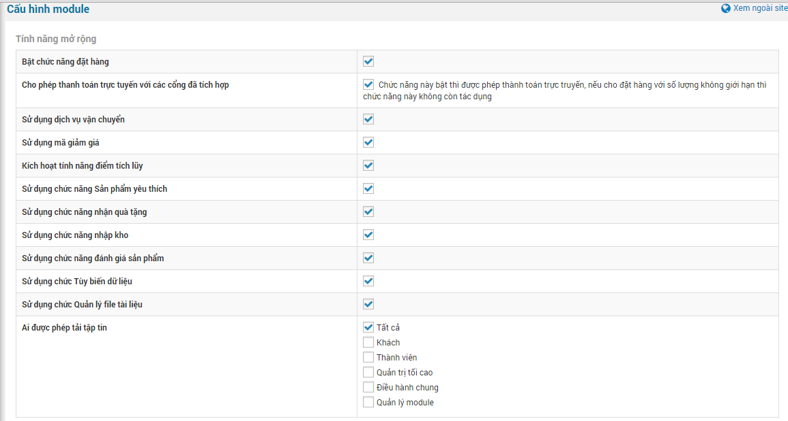
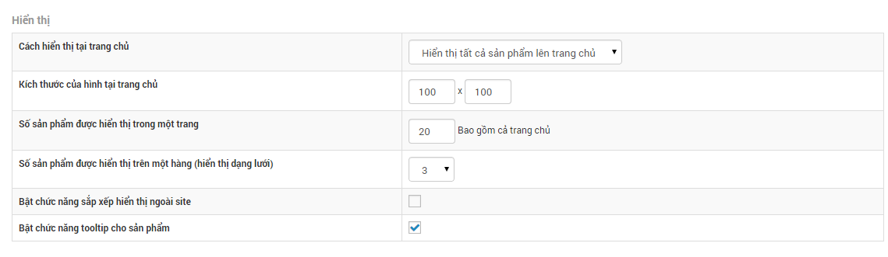
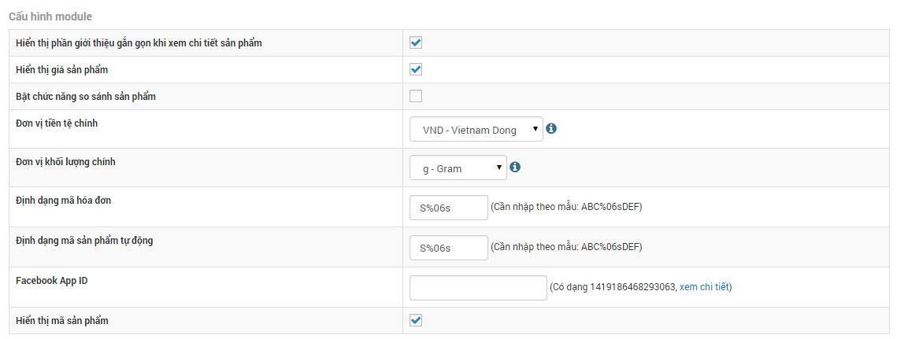
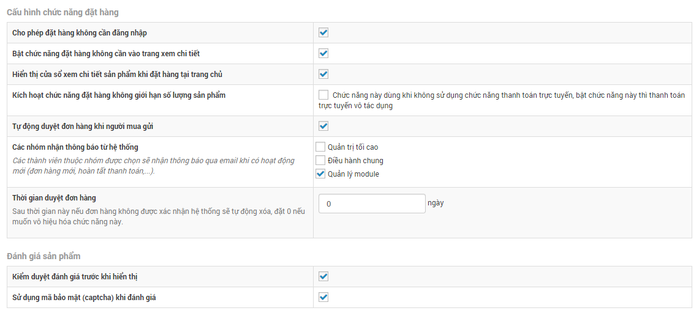
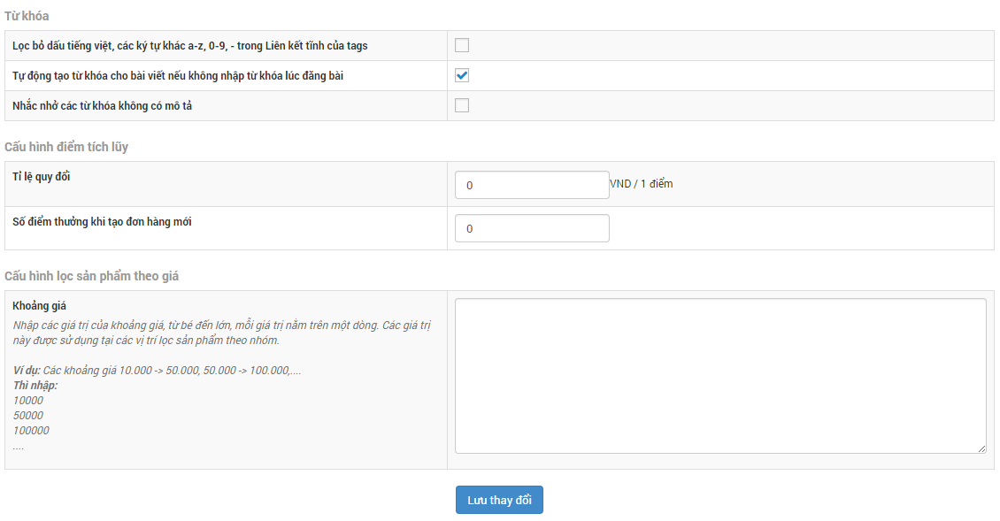
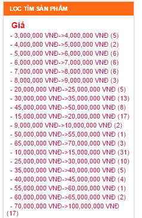

Cấu hình module shops cho phép website sử dụng những tính năng phù hợp cho nhu cầu kinh doanh phù hợp thay vì phải kích hoạt hết hoặc thiếu các tính năng cần thiết cho web

## 1 Tính năng mở rộng

Tính năng mở rộng cho phép bạn kích hoạt hoặc không kích hoạt một số tính năng tùy theo nhu cầu của website.

## 2 Hiển thị

Ở phần cấu hình hiển thị bạn cho phép cách trình bày ngoài site gồm có:

- Cách hiển thị tại trang chủ.
- Kích thước của hình tại trang chủ.
- Số sản phẩm được hiển thị trong một trang.
- Số sản phẩm được hiển thị trên một hàng (hiển thị dạng lưới).
- Bật chức năng sắp xếp hiển thị ngoài site.
- Bật chức năng tooltip cho sản phẩm.

## 3 Cấu hình module

Cấu hình module cho phép hiển thị thêm một số thông tin của sản phẩm ngoài site và bổ sung tính năng so sánh sản phẩm, các đơn vị mà cách tính toán.

- Hiển thị phần giới thiệu gắn gọn khi xem chi tiết sản phẩm.
- Hiển thị giá sản phẩm.
- Bật chức năng so sánh sản phẩm.
- Đơn vị tiền tệ chính.
- Đơn vị khối lượng chính.
- Định dạng mã hóa đơn.
- Định dạng mã sản phẩm tự động.
- Facebook App ID : phần này bạn xem ở mục "[quản trị comment facebook để lấy App ID](/nukeviet/admin/news/facebookapi)".
- Hiển thị mã sản phẩm.

## 4 Cấu hình chức năng đặt hàng và đánh giá sản phẩm

### 4.1 Cấu hình chức năng đặt hàng

- Cho phép đặt hàng không cần đăng nhập.
- Bật chức năng đặt hàng không cần vào trang xem chi tiết.
- Hiển thị cửa sổ xem chi tiết sản phẩm khi đặt hàng tại trang chủ.
- Kích hoạt chức năng đặt hàng không giới hạn số lượng sản phẩm.
- Tự động duyệt đơn hàng khi người mua gửi.
- Các nhóm nhận thông báo từ hệ thống.
- Thời gian duyệt đơn hàng.

### 4.2 Đánh giá sản phẩm

- Kiểm duyệt đánh giá trước khi hiển thị.
- Sử dụng mã bảo mật (captcha) khi đánh giá.

## 5 Từ khóa, cấu hình tích lũy điểm và cấu hình lọc sản phẩm theo giá

### 5.1 Từ khóa

- Lọc bỏ dấu tiếng việt, các ký tự khác a-z, 0-9, - trong Liên kết tĩnh của tags.
- Tự động tạo từ khóa cho bài viết nếu không nhập từ khóa lúc đăng bài.
- Nhắc nhở các từ khóa không có mô tả.

### 5.2 Cấu hình tích lũy điểm

- Tỉ lệ quy đổi: là số điểm trên 1 đơn vị tiền tệ
- Số điểm thưởng khi tạo đơn hàng mới: khi người truy cập tạo 1 đơn hàng sẽ được mặc định số điểm thường và số điểm thưởng sẽ tính theo tỉ lệ quy đổi ra đơn vị tiền tệ

### 5.3 Cấu hình lọc sản phẩm theo giá

Lọc sản phẩm theo giá: là lọc sản phẩm phẩn trong một khoảng giá cả nhất định. Và khi nhấp chuột chọn một khoảng giá thì tất cả các sản phẩm trong khoảng giá đó sẽ hiện lên trên website.

Lọc sản phẩm theo giá hoạt động thông qua block lọc sản phẩm.

> Ví dụ:  
> Tôi tìm sản phẩm có giá từ 1 triệu tới 2 triệu triệu tôn sẽ nhấp chuột chuột vào khoảng giá có sẵn trên website.

Demo hình ảnh:

