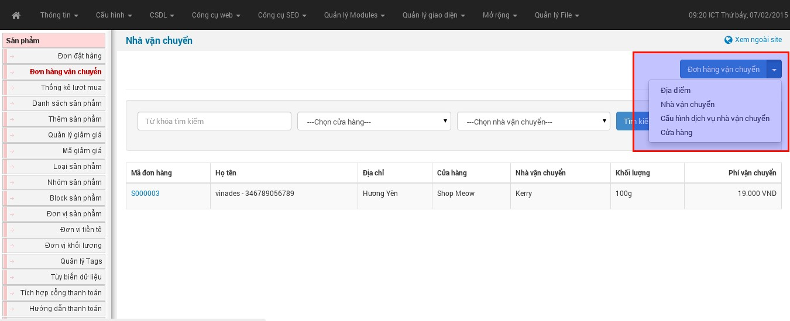
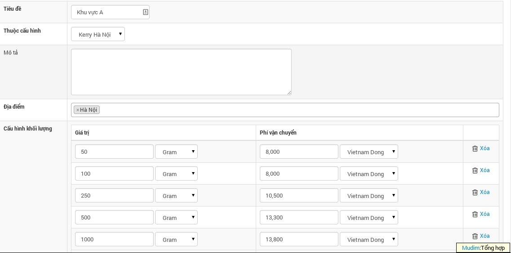

Đơn hàng vận chuyển: Là chức năng cho phép cửa hàng liên kết với một hoặc nhiều nhà cung cấp dịch vụ vận chuyển hàng hóa (khi cừa hàng có nhu cầu vận chuyển hàng đến tận tay người mua sau khi thanh toán hoàn tất).

Để sử dụng tính năng này bạn cần phải "**[cấu hình dịch vụ vận chuyển](/nukeviet4/admin/shops/shipping_config)**"

Các bước cấu hình dịch vụ:

**Bước 1** - Cập nhật địa điểm: Chọn menu “Địa điểm” từ menu “**Đơn hàng vận chuyển**”. Tại đây, nhập danh sách các địa điểm dự kiến có trong bảng giá của nhà cung cấp. Danh sách được tổ chức dạng đa cấp, do đó, bạn nhấp chuột vào tên địa điểm để vào bên trong, tạo điểm điểm trực thuộc.

**Bước 2** - Cập nhật nhà vận chuyển (đơn vị cung cấp dịch vụ vận chuyển): Chọn menu “Nhà vận chuyển”. Tại đây, bạn cập nhật danh sách các nhà vận chuyển mà cửa hàng có hợp tác.

**Bước 3** - Cấu hình dịch vụ nhà vận chuyển: Chọn menu “**Cấu hình dịch vụ nhà vận chuyển**”, tại đây, bạn cập nhật danh sách các cấu hình của nhà vận chuyển. Ví dụ: VNPT có 2 chi nhánh là VNPT Hà Nội và VNPT Đà Nẵng, thì bạn tạo 2 gói cấu hình cho 2 địa điểm này của VNPT, tương tự cho các nhà vận chuyển khác.

**Bước 4** - Nhập cấu hình chi tiết cho các gói cấu hình: Tại danh sách “**Cấu hình dịch vụ nhà vận chuyển**” (Được tạo ra trong bước 3 bên trên), nhấp chuột vào liên kết “**Chi tiết**” đằng sau mỗi gói cấu hình. Ở đây, các bạn tạo cấu hình chi tiết cho gói cấu hình được chọn. Có thể nhập nhiều cấu hình chi tiết, cho nhiều địa điểm.

- Tiêu đề: Tên cấu hình chi tiết
- Thuộc cấu hình: Chọn cấu hình cho chi tiết cấu hình đang nhập.
- Địa điểm: Chọn địa điểm áp dụng chi tiết cấu hình này.
- Cấu hình khối lượng: Nhập các mức khối lượng, tương ứng với chi phí vận chuyển.
- “**Lưu thay đổi**” để hoàn tất, tương tự cho các gói cấu hình khác.

**Bước 5** - Cập nhật danh sách cửa hàng và chọn nhà vận chuyển cho cửa hàng: Chọn menu “**Cừa hàng**” từ menu “**Đơn hàng vận chuyển**”, tại đây, bạn nhập thông tin các cửa hàng (nếu có nhiều cửa hàng) và chọn nhà vận chuyển, tương ứng với các gói cấu hình cho nhà vận chuyển đó.

Sau khi cấu hình đầy đủ các bước trên, tại trang đặt hàng, hệ thống sẽ hiển thị nút chọn để khách hàng có nhu cầu vận chuyển nhập thông tin nhận hàng, căn cứ vào vị trí, hệ thống sẽ đưa ra chi phí vận chuyển để khách hàng tham khảo.
