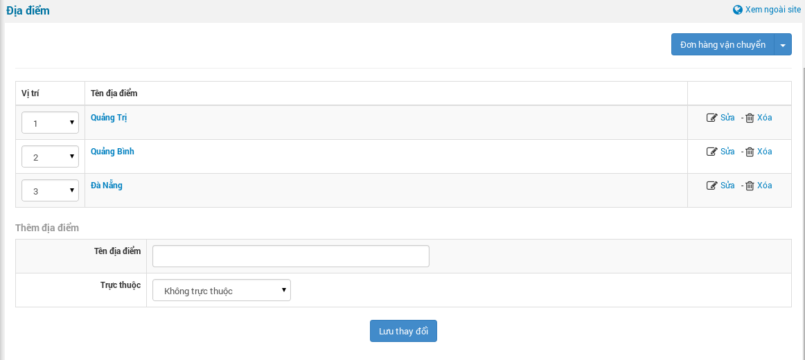
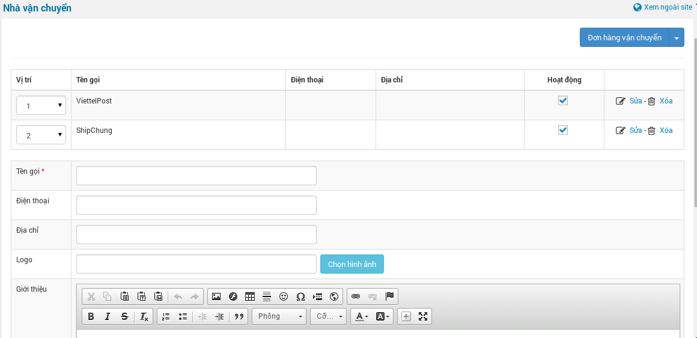

## Thiết lập ban đầu

- Mặc định, chức năng vận chuyển không được kích hoạt, bạn cần bật nó lên để có thể sử dụng.
- Đăng nhập vào khu vực "**Quản lý shops**" / "**Cấu hình module**". Tại đây, check chọn “**Sử dụng dịch vụ vận chuyển**”. Lúc này, ở menu shops sẽ xuất hiện một mục là “**Đơn hàng vận chuyển**”.
- Chức năng vận chuyển có liên quan đến khối lượng sản phẩm, nên, trước khi cập nhật sản phẩm, bạn kiểm tra lại danh sách các Đơn vị sản phẩm, sau đó nhập sản phẩm bình thường.

## Các bước cấu hình

### 1. Cập nhật danh sách địa điểm

- Truy cập khu vực “**Đơn hàng vận chuyển**”, tại menu “**Đơn hàng vận chuyển**” (Góc trên, phải), chọn “**Địa điểm**”
- Thông thường, các nhà cung cấp dịch vụ vận chuyển chỉ xác định đến cấp Tỉnh / Thành phố (hoặc quận/huyện đối với các Tỉnh / Thành phố lớn), nên bạn chỉ cần nhập cấp Tỉnh / Thành phố và các Quận / Huyện cần thiết.

### 2. Cập nhật danh sách Nhà vận chuyển (Nhà cung cấp dịch vụ vận chuyển)

- Truy cập khu vực “**Đơn hàng vận chuyển**”, tại menu “**Đơn hàng vận chuyển**” (Góc trên, phải), chọn “**Nhà vận chuyển**”
- Nhập thông tin các nhà cung cấp dịch vụ mà cừa hàng hợp tác với các thông tin tên gọi, điện thoại, địa chỉ,..... (1 cừa hàng có thể hợp tác với nhiều nhà cung cấp, khách hàng cũng có thể chọn dịch vụ của nhà cung cấp họ muốn - cửa hàng có hợp tác với dịch vụ đó).

### 3. Cấu hình dịch vụ nhà vận chuyển

- Phần này rất quan trọng, nó liên quan đến việc tính giá thành vận chuyển thực tế.
- Các nhà cung cấp dịch vụ vận chuyển thường có nhiều chi nhánh ở các vùng khác nhau - thuận tiện trong việc vận chuyển và tiết kiệm chi phí, nên bảng gía ở các bưu cục là khác nhau. Đối với trường hợp này, cần tạo ra các gói cấu hình, cho mỗi nhà cung cấp - ở mỗi chi nhánh khác nhau. (Trong trường hợp nhà cung cấp chỉ có 1 bưu cục chính thì bạn chỉ cần tạo 1 gói cấu hình cho nhà cung cấp đó.
- Truy cập khu vực “**Đơn hàng vận chuyển**”, tại menu “**Đơn hàng vận chuyển**” (Góc trên, phải), chọn “**Cấu hình dịch vụ nhà vận chuyển**” để tạo gói cấu hình. Sau khi tạo xong, nhấn vào link Chi tiết ở phía sau để tiếp tục tạo các gói cấu hình con cho gói cấu hình này. Ví dụ: ở đây mình tạo gói Cấu hình Shipchung chi nhánh TP.Đà Nẵng. Tại trang cấu hình con của gói cấu hình Cấu hình Shipchung chi nhánh TP.Đà Nẵng, ở đây bạn sẽ phải cấu hình gía - tương ứng theo khối lượng vận chuyển, của nhà vận chuyển ShipChung, có chi nhánh ở Đà Nẵng, đi đến các vùng trong cả nước. (Thường thì các tỉnh thành được gộp lại thành các vùng trả hàng có gía vận chuyển - theo các mức khối lượng giong nhau. (Tương tự cho ShipChung chi nhanh ở các tỉnh thành khác nếu có).
- Ở đây bạn tạo thêm các Vùng trả hàng, như mình nói bên trên, các tỉnh (địa điểm trả hàng sẽ đượm thành từng vùng). Ví dụ: Mình tạo vùng "**Các tỉnh Miền Trung gần Đà Nẵng**", ở ô Địa điểm, bạn chọn (có thể chọn nhiều) các tỉnh miền Trung nằm trong nhóm này (Quảng Nam, Huế, Quảng Trị, Bình Định,....). Tại bảng Cấu hình khối lượng, nhập các mức khối lượng và gía vận chuyển tương ứng. Các mức khối lượng nhập từ bé đến lớn. Tương tự, bạn tao ra các gói cấu hình - và cấu hình con cho các nhà cung cấp khác (nếu có), xong rồi để yên đó. Chuyển sang bước 4.

### 4. Quản lý cửa hàng, lựa chọn nhà vận chuyển

- Trường hợp: Bạn có một shops đặt tại Quảng Trị, và một shops tại Đà Nẵng. Bạn hợp tác với ViettelPost nhưng ViettelPost chỉ có chi nhánh ở Đà Nẵng, chứ Quảng Trị thì chưa có, khi đó, bạn muốn shops ở Quảng Tri hợp tác với ShipChung (ShipChung có chi nhánh ở Quảng Trị) thì lúc này bạn phải chọn shops - tương ứng với cấu hình của nhà chung cấp nào.
- Truy cập khu vực “**Đơn hàng vận chuyển**”, tại menu “**Đơn hàng vận chuyển**” (Góc trên, phải), chọn “**Cửa hàng**”. Tại đây, bạn thêm cừa hàng, chọn địa điểm cừa hàng của bạn. Ở ô Cấu hình nhà vận chuyển, bạn chọn nhà cung cấp theo cấu hình tương ứng.
