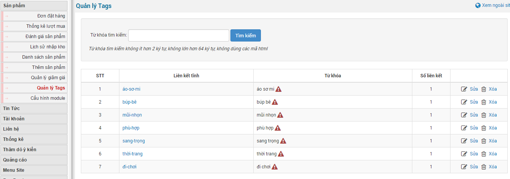
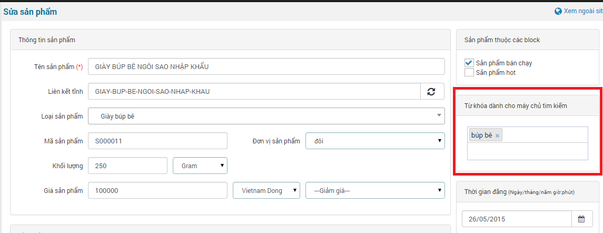
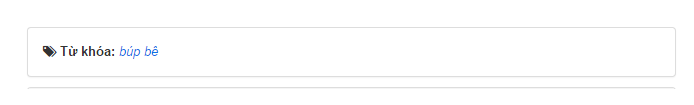

Quảng lý tags là quẩn lý các từ khóa cho sản phẩm dùng trong việc SEO kết quả lên công cụ tìm kiếm.

- Quản lý sửa xóa từ khóa (tabs).
- Thêm mới từ khóa.
- Tìm kiếm từ khóa trong quản lý tags.

Các từ khóa còn được phát sinh trong quá trình đăng sản phẩm do người quản trị điền vào hoặc hệ thống tự chọn từ khóa sinh ra.

Các từ khóa sẽ hiển thị ngoài site khi bạn xem chi tiết một sản phẩm. Nó sẽ được đặt dưới phần chi form hiển thị "**Chi tiết sản phẩm**".

