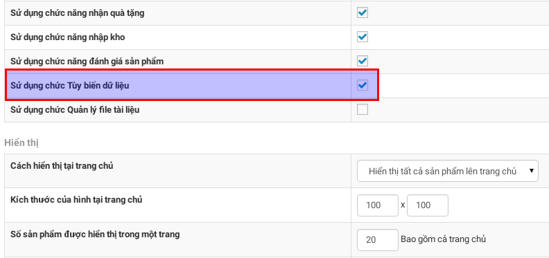
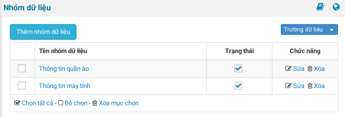
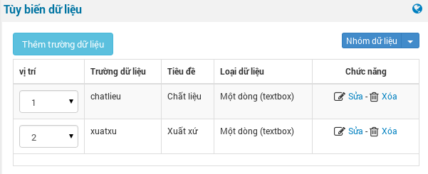
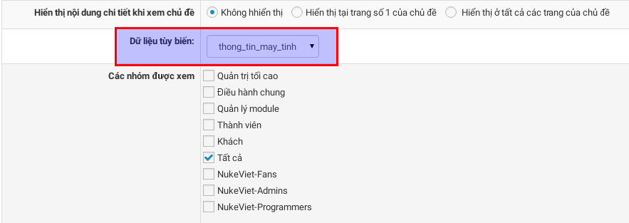
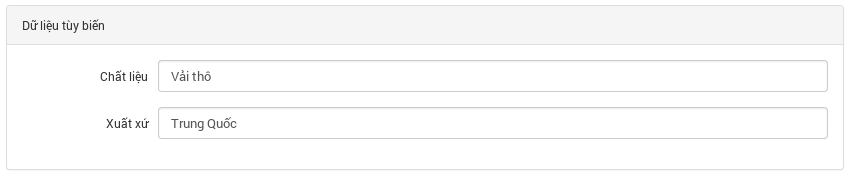
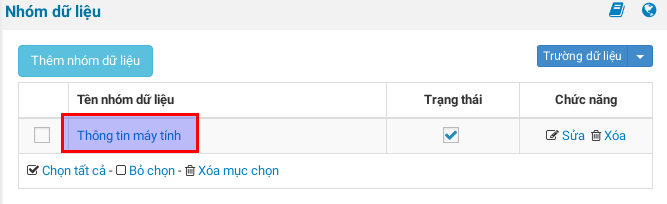
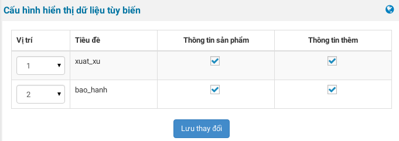

Tùy biến dữ liệu là chức năng giúp người quản lý có thể thêm các trường thông tin của một sản phẩm, theo đặc điểm riêng của từng loại.

Mặc định, tính năng "**Tùy biến dữ liệu**" không được kích hoạt khi cài đặt mới Module Shops, vì vậy bạn cần kích hoạt nó.

**Bước 1:** Truy cập vào khu vực "**Cấu hình module (Shops)**".

**Bước 2:** Tìm đến "**Sử dụng chức Tùy biến dữ liệu**" và tích chọn. Nhấn "**Lưu thay đổi**" ở cuối trang để lưu lại thông số cấu hình.

**Bước 3:** Tại menu khu vực 1, bạn rê con trỏ chuột vào "**Cấu hình module**", bảng menu con hiện ra, nhấp chuột chọn menu “**Tùy biến trường dữ liệu**” để vào khu vực quản lý các biểu mẫu dữ liệu.

Tại đây, bạn cập nhật các form dữ liệu (Nhóm dữ liệu). Ví dụ: Form thông tin máy tính, form thông tin quần áo,.... Tiếp tục chọn menu “**Trường dữ liệu**” để tạo các trường thông tin cho form vừa tạo.

**Bước 4:** Sau khi hoàn tất các bước tạo form thông tin, quay lại trang “**Loại sản phẩm**”, chọn sửa bất kỳ một loại sản phẩm muốn áp dụng thông tin form vừa tạo, ở mục “**Dữ liệu tùy biến**” sẽ hiển thị danh sách tất cả các form bạn vừa tạo ra ở bước 3, chọn tên form tương ứng với loại sản phẩm. Nhấn vào **Lưu thay đổi** ở cuối trang để lưu lại thiết lập.

**Bước 5:** Thực hiện việc cập nhật sản phẩm, các thông tin sẽ được hiển thị với **Loại sản phẩm** tương ứng.

**Bước 6:** Cấu hình hiển thị dữ liệu tùy biến. Trên trang xem chi tiết sản phẩm, dữ liệu tùy biến có thể hiển thị ở hai vị trí: Tại khu vực thông tin sản phẩm (giá, mã sản phẩm, ảnh minh họa,...) và trong tab dữ liệu (Chi tiết sản phẩm, bình luận, đánh giá,...). Thực hiện thêm các bước bên dưới để hoàn tất quá trình này.

1\. Tại danh sách các nhóm dữ liệu(domain/admin/index.phpnv=shops&op=template), bạn click vào tên nhóm chứa trường dữ liệu cần hiển thị.

2\. Chọn vị trí mà trường dữ liệu sẽ hiển thị. Trường hợp hiển thị trong tab, bạn cần [thêm các tab](/nukeviet4/admin/shops/tabs) có nội dung là "Dữ liệu tùy biến".

3\. Lưu lại cấu hình và xem kết quả tại trang chi tiết sản phẩm.
