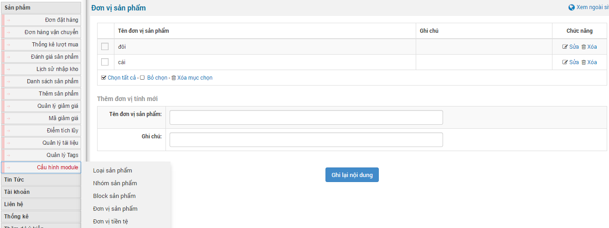
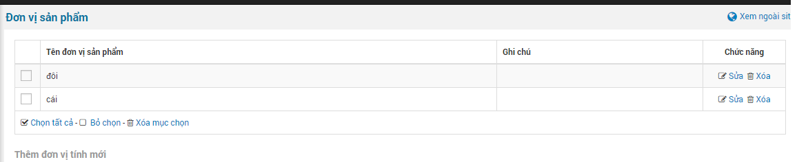
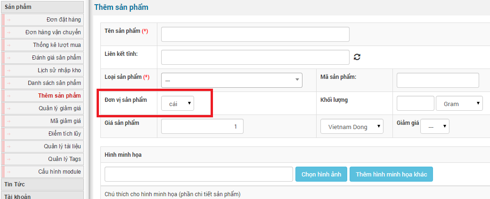

Đơn vị sản phẩm là đơn vị tính số lượng sản phẩm hiện có để người truy cập và khách hàng biết được sản phẩm còn bao nhiêu để mua sản phẩm theo số lượng ước tính.

- Để thêm mới đơn vị sản phẩm bạn di chuyển con trỏ chuột vào “**Cấu hình module**” chọn “**Đơn vị tiền tệ**”. Tiếp đến điền thông tin: Tên đơn vị sản phẩm, ghi chú. Cuối cùng là nhấp chuộtvào “**Ghi lại nội dung**”.
- Sửa xóa đơn vị sản phẩm bạn làm tương tự như thêm mới nhưng bạn sẽ chọn "**sửa**" hoặc "**xóa**" thay vì điền nội dung và ghi lại nội dung.

Khi đăng sản phẩm bạn cần phải chọn số lượng sản phẩm. Điều này là bắt buộc bởi nếu ko điền sản phẩm sẽ không được đang và khách hàng sẽ không biết sản phẩm có bán hay không bán.

