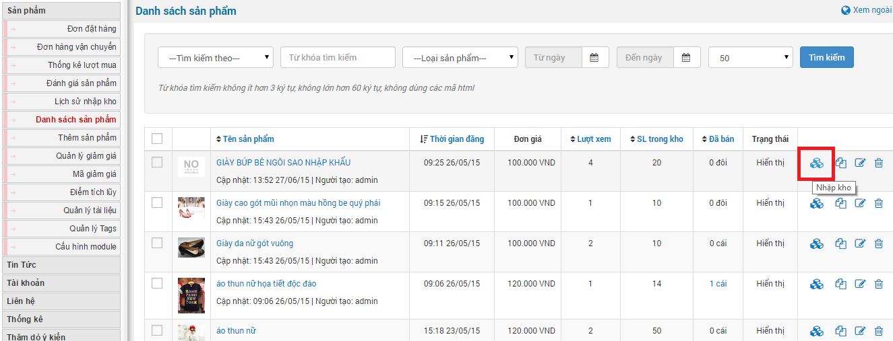
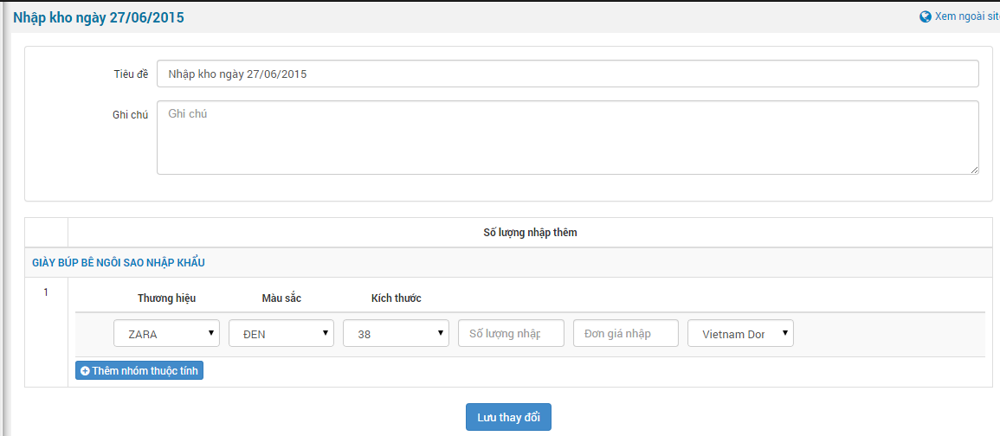
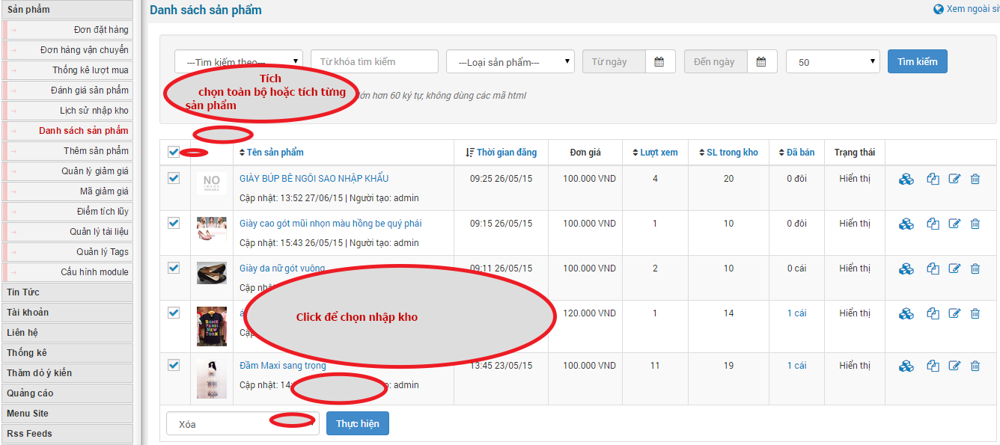
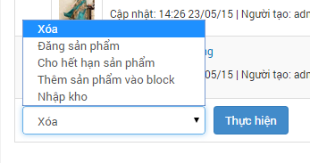
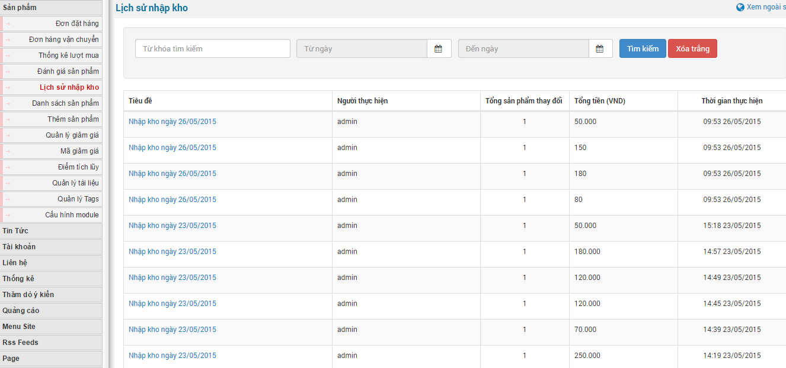
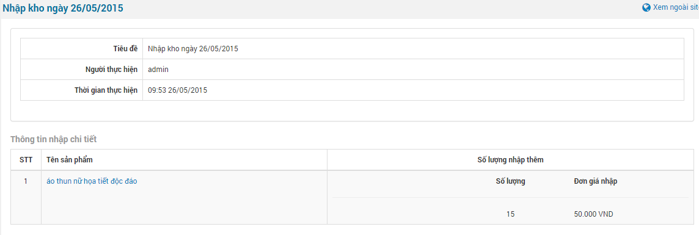

**Để nhập sản phẩn vào kho bạn có 2 cách**

## Cách 1: nhập toàn bộ sản phẩm vào kho

**Bước 1**: Bạn chỉ việc vào phần "**Danh sách sản phẩm**" sẽ hiển thị ra danh sách các sản phẩm có trên website. Tiếp đến bạn nhấp chuột vào biểu tượng nhập kho nhu hình sau.

**Bước 2**: Sau khi nhấp chuột sẽ hiển thị form điền thông tin nhập kho.

**Bước 3**: Điền đầy đủ thông tin rồi tiến hành nhấp chuột "**Lưu thay đổi**".

## Cách 2: nhập từng sản phẩm vào kho

**Bước 1:** Bạn nhấp chuột vào phần "**Danh sách sản phẩm**" tích chọn toàn bộ hoặc có thể tích chọn từng sản phẩm.

**Bước 2:** Sau đó chọn chức năng "**Nhập kho**".

**Bước 3:** Tiếp theo nhấp chuột thực hiện để chuyển qua form điền thông tin nhập kho.

# Lịch sử nhập kho

**Lưu ý:** Tính năng nhập kho đã được kích hoạt sẵn khi bạn cài module shops. Nếu bạn không sử dụng tính năng này bạn truy cập vào "**Cấu hình Module**" tiếp đến bỏ tích ô "**Sử dụng chức năng nhập kho**" và lưu lại là tính năng này sẽ không còn hoạt động.

Lịch sử nhập kho hiển thị danh sách các sản phẩm đã được nhập vào kho:

- Tên của ngày nhập kho.
- Ngày nhập kho.
- Người thực hiện nhập kho.
- Tổng số lượng sản phẩm nhập vào kho.
- Tổng tiền đã nhập.

Nhấp chuột vào tên ngày nhập kho hiển thị thông tin chi tiết nhập kho:

- Tên sản phẩm.
- Số lượng nhập.
- Đơn giá nhập.

